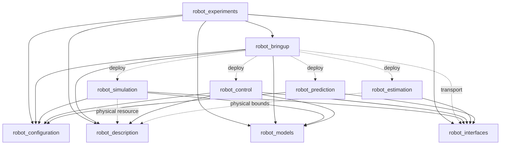
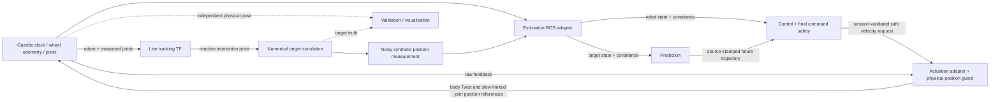

# Current architecture

Authoritative navigation guide, updated 2026-10-25. The earlier M06 audit,
target tree and compatibility-migration report describe historical states. Current
source has ten ROS packages, ROS adapters and an experiment CLI, and no M06 Python
compatibility aliases. See [hardening verification](m06_1_architecture_hardening.md).
M07 selection and runtime validation are documented in
[the unified configuration guide](m07_unified_system_configuration.md).
Experiment ownership and stable data contracts are documented in
[the M08 guide](m08_experiments_and_benchmarking.md).
Read-only live Gazebo/RViz display and its frame/time contracts are documented in
[the M09 guide](m09_robot_realism_and_visualization.md).

## Responsibilities and dependency direction

| Package | Owns | Does not own |
|---|---|---|
| robot_configuration | Pure YAML mapping loading, relative-parent inheritance and validation | ROS policy, physical parameters, experiment orchestration |
| robot_description | Authoritative geometry, axes, masses, collisions, joint limits, mount; visual-only camera icon, Xacro and parameter normalization | Control/estimator algorithms or scenario selection |
| robot_interfaces | ROS state, trajectory, safe command and telemetry messages | Numerical implementation or component selection |
| robot_models | Pure kinematics, dynamics, transforms, geometry, constraints, references and robot composition | ROS/Gazebo adapters, file-based robot deployment |
| robot_estimation | KF/EKF, measurements/process models, robot/target state handling, causal reordering and conditioning | Predictor/controller decisions or simulator truth feedback |
| robot_prediction | Predictors, residual adaptation, fusion, confidence and history | Actuation, robot geometry, scenario generation |
| robot_control | DLS/WLS algorithms, velocity tasks, references, optimization and command safety | Gazebo physics/PID or physical-speed certification |
| robot_simulation | Numerical target simulation, fields, RK4, synthetic observations, Gazebo, physical actuation transport/guard | Tracking controller algorithms or authoritative duplicate geometry |
| robot_bringup | Cross-package deployment composition, launch, tracking TF, pure visualization scene/configuration and read-only ROS display adapter | Control/estimation/prediction algorithms, M08 metrics or physics |
| robot_experiments | Experiment schema, isolated execution, recording, pure metrics, benchmarks and result artifacts | Physics, estimation/prediction/control algorithms, authoritative limits or launch assembly |

Arrows below mean consumer → dependency. Dashed lines are deployment/resource
dependencies; the others are direct project Python dependencies. The automated
tests check both declared project dependencies and runtime/launch imports.



No robotics algorithm package imports bringup or experiments. Experiments consumes
bringup's existing pure composition/model factories and launch entry point; bringup
does not depend on experiments. Models and configuration have no ROS or
Gazebo dependency. ROS messages are not a home for pure Python data contracts.

## End-to-end operation



The simulation target is integrated numerically and committed after the Gazebo
pose service accepts it. Synthetic target measurements are separate from truth.
The estimator does not receive the independent physical pose used by validation.
The nominal reactive target tracking TF uses wheel odometry plus measured arm
joints, so under skid drift it differs from the physical point. The isolated
[reactive manipulation challenge](reactive_3d_manipulation_challenge.md) selects
physical-base odometry for simulation interaction TF and typed base-relative
guidance context. Neither selection routes truth into estimation or control.
Contextual fields use retained causal source samples at each integration substep;
missing/stale/future data never create a static fallback.

Before starting process actions, optional `system_config` composition resolves
resources and invokes actual owner factories to validate the selected deployment.
Its pure implementation is `robot_bringup/factory/system_configuration.py`.
It supplies merged, typed owner parameters to ROS; it does not store duplicate
physics or implement algorithms. Legacy launch behavior remains available when
no manifest is supplied. No second launch stack or experiment runner was added.

Safe command publication requires explicit enablement. `publish_commands=false`
retains compute-only behavior; Gazebo holding PIDs can remain active. Command
session/sequence, freshness, reset recovery, raw-feedback gating, position guard
and independent wall watchdog remain in their existing owners.

## Finding code

Python implementation root is `src/<package>/<package>/`:

| Concern | Canonical location |
|---|---|
| ROS adapters | `nodes/`; executable names below are stable |
| Construction | `factory/`, including pure `robot_estimation/factory/estimator_factory.py` |
| YAML mapping loader | `robot_configuration/yaml_loader.py` |
| Generic resource/type validation | `robot_configuration/{resources,parameter_validation}.py`, with injected package-share lookup |
| System composition/preflight | `robot_bringup/factory/system_configuration.py`; examples in bringup `config/system_*.yaml` |
| Prediction section validation | `robot_prediction/configuration/prediction_config.py` |
| Physical parsing and normalization | `robot_description/model_parameters.py`; representation adaptation in `adapters/configuration.py` |
| Model construction / runtime composition | `robot_models/factory/whole_body_factory.py` / `whole_body/composer.py` |
| Spatial transforms and records | `robot_models/spatial/{rotations,transforms,spatial_data}.py` |
| Estimator math | `robot_estimation/{filters,robot,target}/`; `state.py`, `measurement.py`, `timestamp_buffer.py` are explicit domain data/timing |
| ROS parameter contracts | Owner `parameter_schema.py` modules in estimation/control, shared by declaration and preflight |
| Prediction math | `robot_prediction/{baseline,history,evaluation,online_adaptation,fusion}/`; `temporal_alignment.py` is reusable interpolation |
| Control math | `robot_control/{tracking,controllers,safety,pipeline}/` |
| Transport/state conversion | Domain-local `adapters/`; control's fixed-frame numerical conversion is `adapters/prediction_frame_transform.py` |
| Simulation components | `robot_simulation/{dynamics,disturbances,integration,engine,state,measurements}/` |
| Gazebo and actuation | `robot_simulation/gazebo/`, pure guard/reference in `actuation/`, ROS transport in `nodes/velocity_actuation.py` |
| Actuator startup construction | `robot_simulation/factory/actuation_factory.py`, reused by node and system preflight; guard/PID equations unchanged |
| External resources | Package-root `config/`, `launch/`, `urdf/`, `models/`, `worlds/` as appropriate |
| Tests | Package-root `test/`; cross-package architecture checks in bringup's `test_architecture.py` |

| ROS executable | Canonical module |
|---|---|
| estimation_node | robot_estimation.nodes.estimation_node |
| prediction_node | robot_prediction.nodes.prediction_node |
| control_node | robot_control.nodes.control_node |
| simulation_node | robot_simulation.nodes.simulation_node |
| velocity_actuation | robot_simulation.nodes.velocity_actuation |
| tracking_feedback_tf | robot_bringup.nodes.tracking_feedback_tf |
| tracking_visualization | robot_bringup.nodes.tracking_visualization |

The four control-pipeline layers intentionally separate state-to-kinematics,
reference generation, model/algorithm evaluation and independent final safety.
Factory construction is now separate from estimator ROS resource lookup. IMM
prediction/adaptation remains a cohesive model; simulation clock/pose commit and
actuation session/feedback/watchdog handling remain coherent runtime adapters.
They were not split merely because they are long.

`interfaces/` contains real domain contracts, not empty promises. Existing empty
`__init__.py` files and ament resource markers are required packaging infrastructure.
Empty aerial/omnidirectional namespaces and empty integrator/noise/truth-adapter
stubs have been removed. No aerial implementation is advertised.

## Folder ordering and semantic organization

All architecture views use the actual filesystem through
[`tools/show_architecture.py`](../tools/show_architecture.py). Generate the full
current canonical tree, or inspect one package (stored tree exports are historical):

```bash
python3 tools/show_architecture.py
python3 tools/show_architecture.py --package robot_prediction --depth 1
```

The centralized policy displays existing `nodes/`, `interfaces/`, `factory/`,
`adapters/` first, then domain directories in conceptual order, then root files,
with `__init__.py` last. Absent optional folders are never synthesized. New unknown
domains stay visible after known domains, with an alphabetical fallback; this is
a documented fallback, not the source of the semantic ordering. ROS package roots
display their Python implementation followed by config/launch/test/resource and
actual assets. Generated/cache directories are ignored. No numeric prefixes or
filesystem-browser sorting changes are used.

| Package domain order after shared directories | Rationale |
|---|---|
| models: spatial → base → manipulator → whole_body → target → camera → reference → task_space → constraints | Foundations, assembled robot, observed target, desired geometry, tasks and bounds |
| estimation: filters → robot → target | Filter kernels, robot fusion, target fusion |
| prediction: baseline → history → evaluation → online_adaptation → fusion → configuration | Predict, retain history, evaluate, adapt, combine; section validation last |
| control: tracking → controllers → safety → pipeline | Define tasks, compute, project safely, orchestrate |
| simulation: state → dynamics → disturbances → integration → measurements → engine → gazebo → actuation → diagnostics | Domain state evolution, observation, runtime integration and transport |

Configuration, description and bringup are small enough to need no artificial
domain folders. `robot_interfaces/msg/` contains its actual ROS contracts.

There are **no generic `common/` directories**. Spatial transformations belong to
`robot_models/spatial/`; estimator contracts belong to `interfaces/`, while its
three small data/timing modules remain flat. Abstract filter/sensor/measurement
contracts also live under estimation's interfaces. Control's task linearization
and geometry-policy contracts and models' reference-geometry contract live under
their package's interfaces; concrete implementations remain in their domains.

`types.py` is optional for compact aliases, never a home for unrelated domain
records. The old models `types.py` contained five substantial records, so it was
removed: Pose/Twist are in `spatial/spatial_data.py`, RobotState in
`whole_body/robot_state.py`, TargetState in `target/target_state.py`, ConstraintSet
in `constraints/constraint_set.py`. Their validation and math are unchanged. Local
NumPy aliases stay near their consumers; no `Any` replacement or common type layer
was introduced. Simulation's target state/vector conversion is an adapter and
does not define a competing TargetState.

Both DLS and WLS implement Controller, so they share flat `controllers/`; WLS is
not a separately exposed optimizer primitive. Confidence, performance monitoring
and residual statistics form flat prediction `evaluation/`. Temporal interpolation
is used by IMM and trajectory processing and stays outside evaluation. SDF model
generation/export is Gazebo-specific and now joins the builders in `gazebo/`;
there is no misleading simulator geometry namespace. Description-to-component
normalization is in `adapters/`; injected model construction is in `factory/`.

Rejected grouping: history buffers are reusable beyond evaluation; fusion combines
predictions rather than scores them; baseline prediction is distinct from online
adaptation; base/manipulator/whole-body math describe different mechanisms; robot
and target estimation use different state/process contracts; integration is a
numerical method while engine owns stepping; command safety is distinct from
pipeline orchestration. The learned sequence base class retains actual history
validation/prediction behavior under online_adaptation, rather than becoming an
empty interface facade. No new generic parent folder is needed for these domains.

## Mathematical and configuration contracts

Robot estimates use `[x,y,yaw,v,omega,q[n],dq[n]]` and row-major covariance;
current n=4 gives 13 states. Control configuration is `[x,y,yaw,q]`; generalized
velocity is body `[v,omega,dq]`, so their dimensions intentionally differ.
Whole-body geometric twists/Jacobians use world-expressed `[linear,angular]` rows.
Target public states are `[p,v]`; current Distance + Pointing deployment is 3D.

State headers represent measurement/filter source time, not current publication
time. Prediction headers retain the source state epoch and sample timestamps are
absolute. Control converts predicted positions/velocities using TF at that reference
time. Its rigid conversion assumes fixed inertial frames; moving-frame transport
terms are unsupported. Optical forward is tracking-frame +X; generic image-camera
projection uses optical +Z and needs an explicit camera transform when integrated.

Physical geometry/limits come from `robot_description/config/robot/robot.yaml`.
Gazebo, model construction, control safety, estimator conditioning and actuator
startup read/derive that source. Simulation owns PID/holding/recovery policy;
control owns task radius/weights and the current base command envelope. No new
configuration schema or source of physical truth was introduced by M06.1.

`robot_configuration.yaml_loader.load_yaml` resolves `extends` relative to each child and
merges mappings; lists/scalars/null replace. Resource values still resolve by the
owning package or explicit simulation resource base. ROS parameter YAML, prediction
sections and controller strategies keep their existing schemas and override order.
M07 composition references these owner files through relative paths or explicit
`{package, path}` resources. Generic per-document transforms preserve declaring-file
relative references through inheritance. Unknown selections and incompatible
state/frame/joint/timing contracts fail before process creation. Explicit launch
overrides win over manifest runtime settings; actuation remains an explicit opt-in.

## Adding a predictor: practical path

1. Read `robot_prediction/interfaces/predictor.py` and `prediction_data.py`.
   Implement `Predictor.predict(PredictionInput) -> TrajectoryPrediction` in a named
   module under `baseline/` (or the appropriate actual algorithm domain).
2. Preserve common `[p,v]` output dimensions, absolute sample times and finite
   values. Richer acceleration/jerk state may stay internal. Add independent
   numerical, horizon, dimension, timestamp and observed-update tests in `test/`.
3. Inspect `factory/system_factory.py`: deployed choices are IMM and CV, with
   residual/weighted-correction or none/none. Register a real new builder and
   supported identifier there, then add contract and manifest-selection tests.
   Dropping a file into baseline does not make it selectable. CA/CT require richer
   input state and are rejected as standalone deployed choices; extending IMM's
   existing internal CV/CA/CT ensemble is separate work.
4. Change no controller, robot description or actuator for a predictor that
   preserves the public contract. M07 covers the current six-state deployment;
   arbitrary adapters, learned models and state dimensions remain future work.

## Selecting or adding control

`robot_control/config/control.yaml` defaults to `controller_type: jacobian` (DLS).
Bringup's `strategy_config:=config/whole_body.yaml` selects the existing WLS
Distance + Pointing strategy. `factory/project_components.py` registers types;
`factory/control_factory.py` builds the task/model/safety composition. Strategy
configuration may configure controller/tracking choices, not overwrite physical
robot bounds. WLS consumes shared feasible bounds and final safety still projects
the output independently.

A new algorithm implements `interfaces/controller.py`, returns a model-sized
`ControlOutput`, and gets a named factory registration plus tests/strategy YAML.
Do not put a solver into the ROS node or bypass final safety. Algorithms needing
new horizon/state contracts must introduce and test those explicitly.

## Adding a simulation dynamic model

Start at `robot_simulation/interfaces/dynamics.py`. A continuous-time model
implements `derivative(state, control, time, context)` and belongs to `dynamics/`
(current target models are under `dynamics/target/`). Keep equations independent
of ROS/Gazebo. Inspect `factory/simulation_factory.py` and `registry.py`
for the existing named construction path; register the new model and its supported
parameters without embedding scenario constants in the node. Select it in target
YAML, preserving the state/context contract consumed by integration and engine.
Use independent derivative and RK4/engine tests and validate resource inheritance.
If a model requires a different state dimension, first update and test the relevant
state/measurement adapters explicitly; merely selecting a name cannot make the
current six-state target deployment support arbitrary dimensions. Acceleration
fields/disturbances have a separate interface and must not masquerade as the
target dynamics model.

## Enforcement, evidence and limitations

Architecture tests enforce declared/imported dependency ownership and acyclicity,
ROS-independent numerical layers, packaged meaningful source, canonical nodes,
removed legacy paths and active launch-resource resolution. Installed checks use
a non-symlink prefix from `/tmp`, require module/share origins there, generate
Xacro and reject removed imports. Static checks cannot validate arbitrary dynamic
imports; explicit registration remains preferred.

The tree renderer has lightweight ordering/real-filesystem tests. Architecture
checks also reject `common/` and removed semantic namespaces and resolve the new
canonical records/contracts. Active historical-estimator loaders translate only
old import statements in memory; archived file bytes stay unchanged and no old
runtime package aliases are installed.

Reusable validation utilities and fixtures live in [`tools/validation/`](../tools/validation/README.md).
Permanent reports live in `docs/validation/`; captured data and source snapshots
live in ignored `results/validation/`, with experiments in `results/<study>/`.
Large historical studies and copied workspaces use verified `results/archives/`
archives. See the [cleanup report](repository_cleanup.md) and root README for
restore commands and the explicit removal of unused buffer subclasses. Historical
architecture reports describe their original states. Local evidence is preserved
but does not ship with a source clone.

The robot family remains a planar mobile manipulator. Learned adapters and
alternate fusion libraries are not all deployed factory choices. Physical safety
and localization results have progressed since M06; use the
[actuation resolution](validation/m02_actuation_safety_resolution.md) and
[localization closure](validation/m03_robustness_closure.md) for measured status.
[R1C benchmarking remains CONDITIONAL](validation/runtime_reliability_r1c_closure.md)
because incomplete observation coverage prevents unconditional comparative
acceptance. No real-hardware safety certification or SLAM is claimed.

Metadata provenance is preserved: estimation declares MIT without a bundled license
text; prediction's existing LICENSE is empty; description, interfaces and estimation
also have placeholder maintainer emails. These require owner-supplied provenance, not an invented license
grant or identity. They are documented exceptions, not supported-capability stubs.

The ten former M06 Python paths were intentionally removed; use canonical node,
factory/configuration modules above and `robot_configuration.yaml_loader`.
The detailed removal inventory is in the hardening report. Supported ROS executable
names and message/topic contracts did not change.
