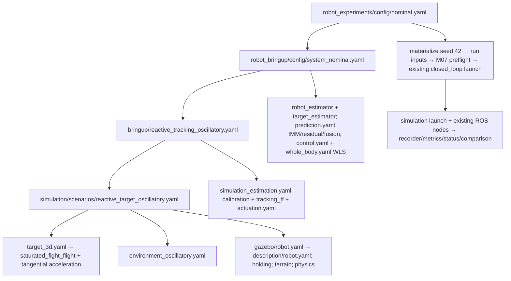
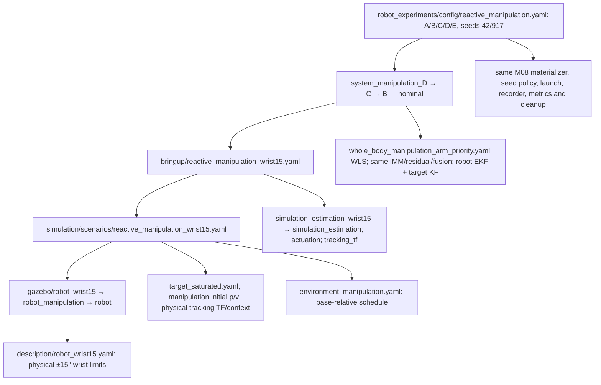
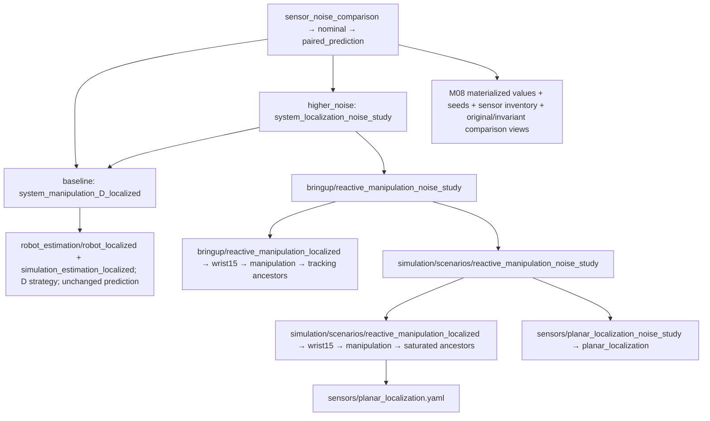

# Configuration architecture audit and simplification proposal

Status: **READ-ONLY AUDIT + DESIGN; migration not implemented or authorized.** Inspected current working tree on 2026-10-23. This report is the only repository write. Existing dirty work, YAML, launch code, algorithms, scientific comparison policy and historical results are preserved.

## 1. Executive summary

The architecture already has the right ownership: M08 executes experiments, M07 composes/preflights systems, domain packages own numerical parameters, and `robot_configuration` supplies shared loading/resource helpers. The main problem is repeated composition indirection and weak pre-run explainability, rather than an excessive number of independent mathematical components.

Verified findings:

- **90 package-owned YAML configurations**, plus **66 validation definitions/snapshots**, were inventoried: 156 `.yaml`/`.yml` files. Three additional YAML-formatted `.rviz` files are identified separately. No owner YAML exists under `robot_models`, `robot_configuration` or `robot_interfaces`.
- **Four M08 experiment entry points** cover nominal, paired prediction, manipulation A–E and sensor noise; the fifth experiment-package YAML is an analysis policy, not runnable experiment input. Eleven installed M07 manifests include ten successfully preflighted compositions and one deliberately invalid test example.
- Three launch surfaces remain relevant: manifest/legacy-profile closed loop, direct simulation, and visualization composition. The defaults differ materially: direct simulation uses static tracking and configured GUI; legacy closed loop defaults to Compute Only/DLS; the nominal M07 manifest selects WLS and an oscillatory reactive target; M08 explicitly enables actuation in these four experiments. A filename called `nominal` does not mean constant motion or disabled actuation.
- Inheritance depth, measured as **parent edges**, has median 1, mean 2.044 and maximum **9** (10 documents). The 57 inherited package files have median depth 3. System, profile and scenario chains are separate; their depths must not be added and called a single `extends` depth.
- The higher-noise variant adds **four forwarding/variation files**, increasing captured owner resources from 46 to 50, while its complete materialized comparison contract changes at exactly **one leaf**: `localization_sensor.localization_sensor.white_noise_std`. Additional protected conditions match.
- `system_manipulation_A.yaml` resolves exactly to `system_nominal.yaml`. No other complete resolved YAML documents in the package inventory are identical. Small deltas are common, but that alone does not make a file redundant.

Recommendation: preserve the existing engine and scientific contracts. First add a narrow M08 sensor-parameter assignment mechanism and a materialization-backed explain interface; stop creating system/profile/scenario wrappers for numerical sensor values. Then, separately, introduce an explicit M07 composition that references simulation deployment directly, moving existing actuation/tracking/calibration **selection** into that composition. Keep reusable component YAML and compatibility paths. Do not move files to an archive now.

Candidate estimate: **five evidenced consolidation opportunities** (four noise-variant files plus the exact A alias), **13 additional profile-wrapper opportunities conditional on a later M07 extension**, and **three speculative legacy quarantine candidates** with installation/documentation but no runtime filename references found. None is proven safe to delete. The inventory and migration matrix distinguish these groups.

## 2. Current architecture and source evidence

### 2.1 Actual production loading path

| Boundary | Current owner and source location | Responsibility / caveat |
|---|---|---|
| Installed entry | `robot_experiments/setup.py` console script `run = robot_experiments.cli:main`; `robot_experiments/cli.py:main` | `--config` first uses an existing caller-relative file, otherwise package share; `--output` changes only study parent. `--validate-only` prints selected identities, not a materialized scientific comparison. |
| Experiment parse | `src/robot_experiments/robot_experiments/configuration.py:load_experiment` (line 34) | Validates schema 1, metrics/seeds/runtime/deadlines, exactly `name` and `system_config` in each variant. Resource transform resolves variant system references at their declaring document before merge. Calls M07 with headless/truth/actuation overrides. **No experiment baseline-system field or per-variant parameter assignment exists.** |
| Shared inheritance | `src/robot_configuration/robot_configuration/yaml_loader.py:load_yaml`, `_load_yaml`, `_merge_mappings` | Exactly one nonempty string `extends`; child-relative parent; mappings recursively merge; lists, scalars and null replace; `extends` consumed; cycles, recursive aliases, nonmapping documents rejected. Optional caller transform runs on each document before inheritance merge. No list append, multi-parent inheritance or generic origin tracking. |
| Resource resolution | `src/robot_configuration/robot_configuration/resources.py:resolve_resource` | String relative to caller-supplied base or exact `{package, path}` mapping. Checks existence, package syntax and lexical package traversal; supports installed symlinks. This helper does not decide every domain's path base. |
| System assembly | `src/robot_bringup/robot_bringup/factory/system_configuration.py:load_system_configuration`, `_assemble` (lines 62/75) | Declaring-document transform for seven reference fields; schema validation, effective runtime precedence, owner loading, actual factory construction and cross-owner geometry/topic/frame/limit/time contracts. Returns identities, merged parameters, selected resources and computed sensor inventory. |
| Calibration precedence | Same `_assemble`, lines 185–205 | Robot and target ROS parameter files may not own overlapping keys. Profile `estimation_overrides` then wins; per-key final resource is recorded for sensor inventory. Launch runtime overrides win over manifest flags. |
| Control assembly | Same file lines 230–280; `robot_control/factory/project_configuration.py:configured_control` | Model/DOF/topic checks; owner ROS parameters feed adapter, optional strategy overrides controller/tracking, explicit lookahead/feedforward overrides apply afterward. An absent strategy preserves DLS. This compatibility behavior must survive migration. |
| Per-run preparation | `robot_experiments/configuration.py:materialize_run` (line 101) | Copies effective owner data into run inputs, preserves independent seed derivation, snapshots selected resources and inheritance parents, writes generated simulation/profile/system files, re-runs M07 on that actual materialized system. No source YAML is edited. |
| Comparison preparation | `robot_experiments/runner.py:run_one`; `comparison.py:comparison_views` | Keeps original contract/hash; records named effective variable values, invariant contract and additional protected setup/physics/algorithm/evaluation conditions. Metric-definition and source hashes are protected for explicit sensor studies. |
| Runtime | `runner.py:run_experiment`, `run_one`; `execution/` helpers; `robot_bringup/launch/closed_loop.launch.py:configure` | Existing seed/variant loops, unique directories, domain/partition ownership, source readiness/window recording, startup identity checks and bounded cleanup. Materialized `system_config:=...` reaches the existing launch; no second engine. |
| Simulation deployment | `src/robot_simulation/launch/simulation.launch.py:configure` (line 28) | `config` resolves relative to simulation share; nested strings use explicit `paths.base: package|config`. Loads/validates deployment, creates world/robot, starts existing simulation, bridge and optional localization source. Nested references are **not universally `{package,path}` capable** here. |
| Node configuration | `robot_simulation/nodes/{simulation_node,localization_sensor,velocity_actuation}.py`; estimation/prediction/control nodes | Owner dictionaries/files and ROS parameters reach adapters. Direct node defaults remain compatibility entry points outside M07. Prediction uses `PredictionConfig` plus shared loader. |

Package paths in this table are relative to `src/<package>/<package>/` where abbreviated. Precise callable names identify the inspected implementation, rather than a proposed abstraction.

### 2.2 Overlapping mechanisms and path assumptions

M07 already composes robot/model, robot+target estimation, predictor/adaptation/fusion and controller/strategy. However, `simulation.config` currently selects a **bringup profile**, not a simulation deployment. That profile also contains estimator/control resource selectors which M07 overwrites from the manifest, while the legacy profile-only launch still consumes them. This is a compatibility overlay, not two interchangeable authorities.

M07 profiles interpret simulation/actuation strings relative to `robot_simulation` share and calibration strings relative to `robot_bringup` share. Legacy launch interprets profile control/estimation strings relative to their owning package shares. Simulation uses its explicit resource base. `Path(base) / absolute` retains the absolute operand, which allows generated run inputs to flow through old string interfaces. Moving a declaring file alone does not automatically change all its nested references correctly.

Not every YAML reader supports `extends`: `robot_description/model_parameters.py:load_robot_model_parameters` uses `yaml.safe_load` (line 78); control and estimation node description readers also load raw YAML; Xacro uses `xacro.load_yaml` in `src/robot_description/urdf/robot.urdf.xacro:16`. Therefore converting full robot description variants into inherited fragments is **unsafe without a separately validated loader-boundary change**. Preserve those files in the first migration.

`PredictionConfig`, ROS parameter schemas, simulation deployment validation and owner factories are useful domain validators, not redundant generic YAML frameworks. Reuse them. Avoid replacing them with a universal config merger.

### 2.3 Existing explainability and saved evidence

M07's returned plan includes source/profile/description/prediction/strategy paths, selection, runtime, merged estimation/control parameters, actual implementation identities, prediction topics and `sensor_inventory`. Inventory describes configured producer/fusion/transport/timing/noise/covariance/provenance; it is not runtime health. It records selected resources and final estimator override owner, not a complete inherited per-key ancestry trace.

M08 already saves experiment input/resolved definition, per-run `inputs`, `resolved_configuration.json` with plan/context/owner snapshots/complete original contract/comparison views, `metadata.json` with effective seeds/Git/environment/identities/isolation/time contract, `comparison.json`, raw telemetry, metrics/coverage, time series, status/events/cleanup and study summary/CSV. These are the future UI's backend contracts. Do not introduce another editable catalog or results database.

The gap is **before execution**: current `--validate-only` does not seed-expand/materialize runs or show variable values, effective scenarios, full invariants or comparison decisions. It can validate a syntactically authorized leaf declaration without proving that leaf exists in each actual materialized contract; that check happens later, before launch, in `comparison_views`.

## 3. Inventory scope and measured complexity

The census uses current tracked plus nonignored untracked files, not just HEAD. Generated/ignored `build`, `install`, `log` and `results` trees are excluded from source counts; sampled current M08 run artifacts are inspected separately. Historical validation YAML under `docs/validation` is counted separately and never proposed for opportunistic cleanup. `.rviz` is outside the extension census but all three such resources are acknowledged below.

| Owning package | YAML count | Roles |
|---|---:|---|
| robot_bringup | 31 | 11 system manifests; 15 deployment profiles; 4 estimator-calibration overlays; 1 visualization policy |
| robot_simulation | 42 | 15 deployment/scenario selectors; 6 target dynamics; 6 environment fields; 4 physical robot deployments; 2 sensor producers; 3 legacy study definitions; 6 other physical/integration/measurement/geometry/terrain policies |
| robot_control | 5 | 1 ROS parameter owner; 4 strategy owners |
| robot_description | 3 | Full authoritative geometry/limit documents |
| robot_estimation | 3 | Robot baseline, localized robot extension, target parameter owner |
| robot_prediction | 1 | Prediction, adaptation and fusion parameters |
| robot_experiments | 5 | 4 runnable experiments; 1 offline analysis policy |
| **Package subtotal** | **90** | All 90 exist in the current installed package resources |
| Validation / no ROS package ownership | 66 | 48 resolved snapshots; 7 robot/reachability descriptions; 4 temporary deployment fixtures; 7 validation definitions |
| **Extension census total** | **156** | No `.yml` file in this census; all are `.yaml` |

The automated initial role classifier groups bringup calibration files with profiles; the table above splits the verified 19 into 15 profiles + 4 calibration overlays. It groups `target_geometry.yaml` separately. These role distinctions do not change counts.

Depth histogram for the 90 package files: `0:33, 1:19, 2:9, 3:6, 4:5, 5:7, 6:6, 7:3, 8:1, 9:1`. Forty-eight inherited documents change at most two recursively compared effective paths relative to their parent. Lists are atomic in that measurement, so an entire environment field list counts as one path; this number is **not** a count of dispensable files.

Other verified complexity:

- Nominal materialization captures 32 owner/parent resources; manipulation D captures 40; localized/noise baseline 46; higher noise 50. These are captured provenance resources, not node count or a claim about minimum file opens. Experiment inheritance is outside this owner snapshot count.
- The three description files differ only at wrist lower/upper limits, but distinct physical experiments and raw readers justify retaining full documents now. Do not collapse their limits into experimental sensor assignments.
- `whole_body_arm_preferred.yaml` versus `whole_body_oscillatory_arm_preferred.yaml` differs at `controller.parameters.motion_weights`; allocation is a real scientific variation, not cosmetic duplication.
- `target_geometry.yaml` deliberately replaces inherited `target.dynamics` with null before another policy supplies saturated dynamics. Dropping null during flattening would resurrect old parameters.
- Environment variants replace entire `acceleration_fields` lists. An element-wise or append merge would change the system.
- Repeated model identifiers across manifest/control parameters and duplicate description selectors currently provide equality checks. Remove redundant **selection** only while retaining the consistency checks and exact effective descriptions.
- The string `localized` denotes optional source plus fusion/calibration selection; it is not a robot topology. Names A–E encode a historical experiment's factors and remain important variant identifiers in old results. Names `3d`, `optimal` and `nominal` do not fully describe the selected policies.

## 4. Real dependency graphs

Arrows below are resource selection or runtime handoff; `extends` chains are explicitly listed separately. Component owners remain separate even if a future composition makes references more direct.

### A. Nominal M08 experiment



Experiment chain: `nominal.yaml → paired_prediction.yaml` (one parent). Profile chain: `reactive_tracking_oscillatory → reactive_tracking_3d → reactive_tracking_saturated → reactive_tracking → optimal_tracking → closed_loop` (five parents). Simulation chain: `reactive_target_oscillatory → reactive_target_3d → reactive_target_saturated → reactive_target → moving_target → ../launch` (five parents). Dynamics chain: `target_3d → target_saturated → target_geometry → ../target` (three parents).

Actual nominal target: saturated Fight/Flight `a_max=0.15`, transition 0.15, preferred distance 1, damping 0.5, epsilon 1e-6, plus tangential acceleration 0.06 about `[0.3,-0.8,0.5]`; environment has restoring and sinusoidal fields. Robot is physical nominal wrist; tracking TF uses configured base feedback, not the manipulation physical-context override. M08 runtime actuation is true despite manifest's safe default false.

### B. Reactive manipulation experiment, variant D



A is the original nominal alias; B changes to manipulation challenge; C changes wrist limits to ±15°; D changes allocation weights from C; E uses ±30° wrist. The aggregate A–E study is intentionally physically incomparable under strict pooling; do not relabel it a matched controlled ranking. C/D remain a matched physical-contract allocation comparison under the **existing historical strict** rule. A future explicit algorithm domain would require its own design; the new sensor domain must not be repurposed to authorize allocation changes.

Manipulation D's profile chain has seven parents; simulation chain five; system chain three. It selects saturated Fight/Flight without nominal tangential extension, physical tracking max age 0.3/future tolerance 0, physical-base context max age 0.3, and initial target `[0.5390366178,0.109268132,1.85]` with zero velocity. Environment schedule is low_overhead (10 s, radius/height/turn `[0.55,1.6,0]`), vertical_escape (10 s, transition 3 s, `[0.6,1.85,0]`), orbit (20 s, transition 3 s, `[1.3,1.35,0.3]`); radial/height gains are 1.5. These are real scenario parameters, not names to discard.

### C. Scientific localization-noise comparison



The baseline system adds robot localization config, localization-aware calibration, selected source and required physical truth to D. The higher-noise system chain is `system_localization_noise_study → system_manipulation_D_localized → D → C → B → nominal` (five parents). Its bringup profile has nine parents, its simulation scenario seven, its sensor component one. The longest actual chain is:

```text
src/robot_bringup/config/reactive_manipulation_noise_study.yaml
 → reactive_manipulation_localized.yaml
 → reactive_manipulation_wrist15.yaml
 → reactive_manipulation.yaml
 → reactive_tracking_oscillatory.yaml
 → reactive_tracking_3d.yaml
 → reactive_tracking_saturated.yaml
 → reactive_tracking.yaml
 → optimal_tracking.yaml
 → closed_loop.yaml
```

The inherited oscillatory profile in this chain contributes deployment/calibration defaults; the final manipulation simulation selector replaces it. It does **not** mean the final target retains the nominal oscillatory environment.

## 5. Design choices and target structure

This is a proposal, not an implementation plan authorized for execution. Three approaches were assessed:

1. **Flatten and rename only:** least code risk and useful as a transition, but still requires four files for every sensor-value variation and duplicates flattened systems. Insufficient alone.
2. **Bounded extension of existing M08/M07:** typed sensor assignments plus shared preparation/explain first; explicit M07 composition second. Reuses the existing materializer, comparison policy, validators and launches. **Recommended.**
3. **New universal configuration graph/catalog/plugin framework:** larger authority and schema surface, duplicates established factories/inventory, and does not solve scientific eligibility automatically. Not justified.

Proposed paths (none created):

```text
robot_experiments/config/
  sensor_noise_study.yaml              # primary human entry; one baseline, named values
  nominal.yaml                        # retained compatible entry
  paired_prediction.yaml              # retained existing domain behavior
  reactive_manipulation.yaml           # retained historical factor study
robot_bringup/config/
  systems/mobile_manipulator.yaml      # one explicit manipulation reference composition first
  calibration/manipulation_pose.yaml   # current effective calibration, descriptive owner selection
  tracking_visualization.yaml
robot_simulation/config/
  scenarios/base_relative_manipulation.yaml  # direct deployment, shallow defaults
  scenarios/oscillatory_tracking.yaml         # only if/when nominal migrates
  sensors/planar_localization.yaml
  gazebo/                             # physical deployment + native holding
  terrain/                            # retained
robot_estimation/config/               # robot/target parameter owners
robot_prediction/config/               # prediction/adaptation/fusion owner
robot_control/config/                  # ROS parameters + strategies
robot_description/config/robot/        # authoritative full physical descriptions
```

Start with one explicit reference composition equivalent to current localized manipulation D, not a new file for each noise/dropout/localization combination. Keep nominal and other old compositions until migrated. Decide whether another explicit system is justified by deployment/topology needs at that point; do not generate a Cartesian product of systems. A robot with genuinely different topology may require a separate composition. Names help navigation; the composition fields remain the authority for scenario, sensing and algorithms.

Use inheritance for component defaults and meaningful small reusable variants. Aim for zero system inheritance and at most 1–2 component/default parent edges in newly migrated workflows. This is a review target, not a loader rejection or excuse to duplicate numerical owners. No global depth limit should break old files. Keep lists/null merge semantics unchanged.

Moving experiments into nested subdirectories is optional and deferred: current `robot_experiments/setup.py` installs only `config/*.yaml`; M07 bringup also installs only top-level YAML. Proposed `systems/` and `calibration/` paths require explicit installation updates and copied-install tests before use. Simulation already recursively installs scenarios, Gazebo and sensors, but not arbitrary new directories.

## 6. Before/after examples and proposed schemas

### 6.1 Existing sensor experiment — production schema 1

The current experiment is `src/robot_experiments/config/sensor_noise_comparison.yaml`. This is an excerpt of **existing production YAML**, not a new capability:

```yaml
extends: nominal.yaml
experiment:
  name: sensor_noise_comparison
  duration: 8.0
  settling_time: 3.0
  seeds: [42]
  variants:
    - name: baseline
      system_config: {package: robot_bringup, path: config/system_manipulation_D_localized.yaml}
    - name: higher_noise
      system_config: {package: robot_bringup, path: config/system_localization_noise_study.yaml}
  comparison:
    schema_version: 1
    domain: sensor_parameters
    variables:
      - name: pose_white_noise_std
        path: localization_sensor.localization_sensor.white_noise_std
        values:
          - [0.04, 0.04, 0.03490658503988659]
          - [0.08, 0.08, 0.06981317007977318]
  execution: {max_skew: 0.15, record_actuator_trace: true}
```

Inherited fields include eight metric families, output directory, actuation true and deadlines. Higher-noise routing currently requires these four additional files:

```text
robot_bringup/config/system_localization_noise_study.yaml
 → robot_bringup/config/reactive_manipulation_noise_study.yaml
 → robot_simulation/config/scenarios/reactive_manipulation_noise_study.yaml
 → robot_simulation/config/sensors/planar_localization_noise_study.yaml
```

The sensor file changes only `[0.04,0.04,0.03490658503988659]` to `[0.08,0.08,0.06981317007977318]`. Baseline latency/jitter 0.04/0.01 s, rate 10 Hz, bias `[0.01,0.01,0.008726646259971648]`, dropout 0.05, frame/source/routing/maximum delivery age and all other parameters remain protected. Seed 42 materializes localization seed 3872720740 independently of the target's 42.

### 6.2 Proposed simplified experiment — NEW SCHEMA PROPOSAL, NOT RUNNABLE

First migrate only M08 assignments; the baseline can initially reference the **existing** M07 manifest. The proposed experiment schema version 2 is separate from existing comparison schema version 1:

```yaml
# NEW SCHEMA PROPOSAL ONLY — current load_experiment rejects these new keys.
schema_version: 2
experiment:
  name: sensor_noise_comparison   # preserve experiment identity during first equivalence slice
  description: Matched setup with explicitly varied localization white noise.
  system_config: {package: robot_bringup, path: config/system_manipulation_D_localized.yaml}
  duration: 8.0
  settling_time: 3.0
  seeds: [42]
  variants:
    - name: baseline
      parameters:
        pose_white_noise_std: [0.04, 0.04, 0.03490658503988659]
    - name: higher_noise
      parameters:
        pose_white_noise_std: [0.08, 0.08, 0.06981317007977318]
  comparison:
    schema_version: 1
    domain: sensor_parameters
    variables:
      - name: pose_white_noise_std
        path: localization_sensor.localization_sensor.white_noise_std
        values:
          - [0.04, 0.04, 0.03490658503988659]
          - [0.08, 0.08, 0.06981317007977318]
  metrics: [tracking_distance, pointing_error, prediction_rmse, estimation_error,
            joint_speed_violation, joint_position_violation, realtime_factor, control_compute]
  output: {directory: results/experiments}
  runtime: {enable_actuation: true}
  execution: {max_skew: 0.15, record_actuator_trace: true}
```

Existing unchanged execution defaults must resolve to readiness 45 s, stall 12 s, wall 150 s, shutdown 5 s, failure policy continue. Explicit sensor comparison still protects all settings except the single authorized leaf. A future filename can be `sensor_noise_study.yaml`; the first slice preserves the internal experiment name, seeds, durations, alignment budget and variant names so equality is inspectable.

A `parameters` key is an assignment, not permission. Its names must bind exactly to declared `comparison.variables`; the existing comparison policy remains the permission/eligibility authority. The baseline system remains package-owned. This removes the need for four parameter-only wrappers without moving numerical sensor authority into bringup or creating a second sensor catalog.

### 6.3 Proposed explicit M07 composition — NEW SCHEMA PROPOSAL, NOT RUNNABLE

This is a **later, separately approved** schema version 2. Existing robot/estimation/prediction/control structure is reused. New simulation fields are typed resource selectors; they are not arbitrary deep overrides. `simulation.config` would now mean the direct simulation deployment, not a bringup profile. Versioning is mandatory to avoid changing schema-1 interpretation.

```yaml
# NEW SCHEMA PROPOSAL ONLY — current M07 rejects schema 2 and these additional fields.
schema_version: 2
robot:
  type: mobile_manipulator
  description: {package: robot_description, path: config/robot/robot_wrist15.yaml}
  model: {base: differential_drive, manipulator: serial_arm}
estimation:
  robot:
    type: robot_ekf
    config: {package: robot_estimation, path: config/robot_localized.yaml}
  target:
    type: kalman
    config: {package: robot_estimation, path: config/target_estimator.yaml}
  calibration: {package: robot_bringup, path: config/calibration/manipulation_pose.yaml}
prediction:
  type: imm
  config: {package: robot_prediction, path: config/prediction.yaml}
  adaptation: residual
  fusion: weighted_correction
control:
  type: weighted_least_squares
  config: {package: robot_control, path: config/control.yaml}
  strategy: {package: robot_control, path: config/whole_body_manipulation_arm_priority.yaml}
simulation:
  config: {package: robot_simulation, path: config/scenarios/base_relative_manipulation.yaml}
  robot: {package: robot_simulation, path: config/gazebo/robot_wrist15.yaml}
  actuation: {package: robot_simulation, path: config/actuation.yaml}
  localization_sensor: {package: robot_simulation, path: config/sensors/planar_localization.yaml}
  tracking_tf: {rate_hz: 20.0, max_age: 0.2, max_skew: 0.05, future_tolerance: 0.01}
runtime:
  enable_actuation: false
  gui: false
  publish_ground_truth: true
```

All resource selectors must be normalized by the existing shared resolver at their declaring origin before merge. M07 would compile typed selections into the same run/deployment inputs, supplying one effective value for simulation robot and localization source. If the deployment also declares those selections and they disagree, reject the ambiguity; do not silently choose a second authoritative value. Tracking TF settings here are existing bringup adapter settings; they are distinct from target tracking/context freshness in the simulation scenario. Preserve both.

The proposed `base_relative_manipulation.yaml` is a direct, shallow deployment produced by resolving current `reactive_manipulation_wrist15.yaml`, separating the selected robot/sensor resource slots from the target/environment/physics settings. It must preserve current world source, terrain, native holding backend, initial conditions, max-step physics, target dynamics, live physical tracking context, integration/truth publication, measurements and Gazebo transport. Do not retype or tune those values from this illustrative snippet. Initially a flattened explicit existing deployment can serve as a transition, with no new M07 schema.

Calibration is the **exact effective** existing `simulation_estimation_localized.yaml` chain, including wrist description reference and wheel variances 0.02/0.04, rather than just `robot_localized.yaml` in isolation. Its package-owned numerical settings remain calibration, not an experimental override.

### 6.4 Reactive manipulation / Fight-Flight equivalence

Current user entry is `reactive_manipulation.yaml` (A–E); selected D follows section 4B. A descriptive future entry may be `reactive_manipulation_study.yaml` while retaining old A–E identifiers in historical results and compatibility aliases. The proposed explicit composition above is equivalent specifically to **localized D**, not all A–E at once. For nonlocalized D, retain `robot_estimator.yaml`, the wrist15 calibration chain and no localization source/fusion; do not silently upgrade its sensing. Until typed component-selection policies are separately designed, keep the existing schema-1 A–E systems for that factor study.

The revised file organization must still make saturated Fight/Flight and base-relative guidance separate component policies. The scenario is the physical initial conditions, schedule/context and selected dynamics, not the controller. Physical description wrist limits, allocation strategy and localization selection are separate factors. Preserve optical +X, gravity holding, feedback/command freshness, recovery and safe Compute Only behavior. No proposed snippet authorizes changing these settings.

## 7. Controlled assignment and explain design

### 7.1 Assignment protocol (proposed)

1. Keep schema-1 loading and per-variant `system_config` behavior unchanged. Schema 2 requires one experiment-level baseline and variant named `parameters`; reject mixed baseline/per-variant system mechanisms initially rather than guessing precedence.
2. Bind assignment names to one validated declaration. Reuse existing `comparison.validate_policy` exact sensor-leaf allowlist and `values` checks; no wildcard, list index, container replacement, arbitrary mapping path, physical/safety/protected timing/metric/source-seed mutation or algorithm assignment. Finite/type/dimension/range checks must also pass each owner validator.
3. In existing `materialize_run`, load/copy the selected owner dictionaries, apply authorized values to the **owning sensor dictionary** before writing run-local input, then apply unchanged target/localization seed derivation. The dotted comparison-contract path is not a filesystem path: map the two existing sensor producers to their existing materialization slots explicitly. Do not add a recursive write-anywhere utility.
4. Re-run M07 on the actual generated system. Then build original and invariant contracts from the actual materialized dictionaries, not requested values or inventory. Fail before acquiring a launch when a declared/assigned leaf is absent or invalid.
5. Preserve existing `comparison_views`, hash algorithms, required metric/coverage/window checks, result schema and outcome taxonomy. Add assignment provenance to resolved metadata; do not alter old result artifacts or weaken strict-default equality.
6. Precedence is owner inheritance → validated experiment assignment → existing run-specific seed injection → materialized owner/preflight. Runtime headless/actuation/truth overrides retain current precedence. No general experiment-wide algorithm override is introduced by this stage.

Initially require every declared variable to have an explicit value in every schema-2 variant. This makes omissions visible and removes silent inheritance surprises. Reject unknown assignment names, duplicate declaration names/paths, disallowed values, absent sources, nonfinite values, invalid covariance/ranges and protected-field declarations. Declaration of a permitted range alone does not modify the baseline.

CV versus IMM and DLS versus WLS already have actual schema-1 component substitution and historical strict comparison behavior. Preserve it. Do not route those choices through sensor policy; a future explicit algorithm comparison domain must define its own invariants. Existing declaration permissions are deliberately narrower than all technically possible YAML differences.

### 7.2 Explain interface (proposed, not currently installed)

Add `ros2 run robot_experiments run --config <experiment> --explain` emitting JSON to stdout, with an optional text presentation. It must reuse the **same preparation path** as execution: parse, select, validate, seed-expand, materialize into task-owned temporary inputs, recompute M07 inventory and comparison views, then exit without Recorder/ROS/Gazebo/domain/process creation. Temporary paths may be used internally; source owner files remain immutable. No second preview resolver.

Output should version the explain object and contain:

- Experiment/variant/seed identifiers and selected source resources/inheritance chains.
- Actual system/scenario/dynamics/environment/physical deployment and authoritative robot topology/limits.
- Effective producer/fusion inventory, estimator assumptions, prediction/adaptation/fusion, controller/strategy and actuation selection.
- Effective variable values with units where owner metadata defines them, exact paths, baseline values, assignment source, allowed values and final seed consumers.
- Runtime/window/readiness/alignment/safety contracts, owner validation results, actual component identities and original/invariant hashes.
- A **configuration-compatibility** decision and reasons. Runtime comparison eligibility remains pending until execution, status, required measurements, metric windows/coverage and cleanup are available. Never print a preflight as completed scientific acceptance.
- Explicit precedence/origin records for important selectors and experimental values; retain M07's current selected-resource/final-calibration provenance limitations. Do not promise complete per-key ancestry unless the shared loader gains a separately tested opt-in trace.

A future dashboard should discover top-level installed experiment YAML by parsing root schema/experiment identity and validating with M08; exclude `manipulation_analysis.yaml`. It can call the existing CLI/explain interface and read existing results. Discovery is not permission to auto-run an experiment. If later nested directories are adopted, update installation/discovery in one place. No hand-maintained duplicate catalog or UI logic belongs in this task.

## 8. Migration, compatibility and rollback

The file-by-file matrix in Appendix B specifies disposition, target, stage and dependencies. Stage labels describe future authorized work, not operations performed here.

| Stage | Small change / gate | Rollback and compatibility |
|---|---|---|
| S0 | This audit; capture actual resolved owners, comparisons, resource/install rules and fixtures | No runtime change. Preserve this working tree and historical evidence. |
| S1 | Shared preparation/explain output, using existing schema-1 inputs | Keep execution unchanged; tests require identical prepared inputs/contracts and no process/ROS startup. Revert the additive explain interface alone. |
| S2 | M08 schema-2 named sensor assignments; parallel noise-study entry using existing baseline system | Retain all four old wrapper paths. Under the **same new code**, materialize old and proposed entries with experiment identity/seeds/settings matched; compare effective owner dictionaries and complete contracts. Roll back by selecting the existing schema-1 example. |
| S3 | One explicit shallow manipulation composition; direct deployment and effective calibration; M07 schema-2 adapter only if required | Keep schema-1 manifest/profile adapter and direct simulation launch. First establish semantic equivalence with generated legacy execution inputs. No simultaneous physical-description format migration. |
| S4 | Migrate supported docs/experiments/launch examples to descriptive paths one workflow at a time | Keep old resource aliases and packaging; preserve old IDs in results. Update tests and copied-install resources together. No automatic global rewrite. |
| S5 | Quarantine proven superseded files only after usage/equivalence/replay review | Explicit separate authorization. Preserve package aliases or replay snapshots and relative-parent closure. Archive must not disappear from installed compatibility paths. |
| S6 | Optional deletion in a distinct cleanup task | Never part of this proposal's authorized scope. External usage evidence and retention policy required first. |

For every moved/renamed resource: update exact YAML incoming edges, default paths in launch/node/probe code, tests, docs and package installation. The inventory's lexical references are evidence to review, not a safe automated replacement list. Dynamic formatted paths, external CLI consumers and historical recorded paths must be considered.

`config_archive/deprecated/` would be a later **repository-root quarantine** only for demonstrably superseded editable source, not historical run inputs. Placing a file there breaks normal package-share lookup and child-relative `extends` unless installation/aliases and its parent closure are preserved. Moving it is not deprecation compatibility by itself. Do not archive the 66 validation fixtures, native holding/actuation, physical descriptions or intentionally invalid tests merely for age or apparent lack of references.

## 9. Validation and equivalence gates for implementation

| Gate | Objective acceptance |
|---|---|
| Owner value equivalence | Compare every behavior-relevant resolved owner: full robot/topology/limits/inertia/mount, deployed pose/drive, holding/actuator backend/feedback/recovery/watchdogs/command policy, physics timestep/engine/world/terrain, scenario/dynamics/environment/initial conditions/context, all sensor noise/bias/dropout/outage/latency/rates/covariance/routing/enables, estimation assumptions/selection/calibration, full prediction/adaptation/fusion, control strategy/gains/allocation/constraints, frames/time/publication/runtime. Compare ordered arrays exactly. |
| Justified normalization | Normalize only explicit resource *selector* locations after verifying their contents and selected role. Preserve array/joint order and complete values. Generated run-input/trace output paths are provenance destinations and may be remapped only with their owner/runtime semantics checked. No substring stripping, basename matching, broad ignore list or numeric tolerance for changed physical parameters. |
| Comparison semantics | Existing original-contract algorithm remains unchanged; schema-1 strict decisions and schema-1 sensor policy tests stay intact. For sensor assignments only declared leaves may differ. Recompute eligibility from original evidence and preserve rejected/incomplete artifacts. |
| Path/hash treatment | Inspect actual contract dictionaries; do not assume path independence. Current original contract removes deployed robot `description` selector and records actual description, includes world content SHA, owner contents and seed values. Extra sensor conditions remove four estimator/controller resource selectors but retain full algorithm contents and source-tree hash. A source/config rename changes that source hash even if behavior is equivalent. Never rewrite historical hashes or ignore it during normal scientific comparison. |
| Historical versus migration comparison | Equivalence tests should resolve old and new YAML under the **same implementation/source revision** with matching experiment name/settings; that separates path-format changes from code-version changes. Preserve old recorded hashes/views as historical evidence. An old/new-code equivalence audit can explicitly document code/version differences without promoting those runs to a scientifically eligible pair. |
| Schema/merge/precedence | Test old supported entries, unknown/ambiguous keys, list replacement, null, child-relative parents, declaring-reference transforms, cycles, invalid owner values, seed expansion and explicit false runtime overrides. New schema must not reinterpret schema 1. |
| Resource/install | Test source, symlink install and copied isolated install from `/tmp`, including each new nested path and unknown package/traversal rejection. Check generated files delivered to ROS nodes, not only preflight return values. |
| M07 inventory | Producer versus fusion selection, truth/context distinction, effective noise/R/timing/seed/resource values and calibration precedence remain accurate; inventory must not become authority. |
| M08 compatibility | Old result readability, variants/seeds, complete original/invariant views/hashes, metric definitions/units/windows/coverage, control validity, failure/interruption and status/cleanup remain unchanged. Pre-run configuration compatibility must not imply measured acceptance. |
| Runtime smoke | Bounded matched nominal and manipulation/noise runs through existing runner; verify measurement/control/actuation activity, existing physical limits and full trace where selected, watchdog/freshness/recovery behavior and no owned survivors. Use unique output directories; retain earlier results. Poor tracking remains a valid result. |
| Reproducibility | Reproduce selected configuration/seed contracts, not assumed identical contact dynamics, random-draw consumption, startup epoch or reactive target trajectory. Equal config hashes do not establish deterministic physics. |
| Regression | Shared loader/resource, M07 preflight/inventory/launch compatibility, M08 configuration/materialization/comparison/reporting, architecture/dependency, owner tests and affected-package build/copy checks. Separate old lint debt from new functional changes. |

Current scientific contract paths are concrete, not a generic document path language. During migration, a protected difference is a failing gate to investigate, not a reason to extend the mask. Keep default 0.08 skew versus noise-study 0.15, 3 s settling versus manipulation 0 s, current target-relative windows and physical tolerances exactly per workflow. Do not silently align settings across different studies to make their hashes match.

## 10. Risks, uncertainties and recommendations

- **External consumers:** static absence does not prove non-use. The three old simulation study files are explicitly installed and mentioned in architecture docs; external usage is unknown. Retain until a compatibility policy exists.
- **Raw description loaders:** current full-file duplication is safer than unrecognized inheritance fragments. Defer description consolidation rather than coupling it to experiment overrides.
- **Versioned meanings:** changing `simulation.config` from profile to deployment without a new manifest version would break old inputs. Keep a schema-1 adapter and reject ambiguous mixed fields.
- **Calibration ownership:** do not accidentally remove simulation-estimator overrides when replacing profiles. The localized chain changes wheel R and physical description, not just publisher enablement.
- **Separate source/fusion choices:** explicit component selections must support producer and consumer independently, while preserving source/route/frame preflight. A new `sensors` catalog duplicating existing owner fields is unnecessary.
- **File-count temptation:** the estimate is not a deletion quota. Meaningful controller allocation, physical wrist limits and scenario/environment variants deserve names and reusable owner files.
- **Provenance:** current per-key ancestry is limited; initial explain should state that. Prioritize variable/selector origins rather than inventing a full general-purpose trace framework.
- **Policy scope:** scientific sensor assignments can only touch existing authorized leaves. Broader sensor enablement, rates, routing, estimator tuning and algorithm swaps need separately designed comparison domains, not additional unreviewed override paths.
- **Historical replay:** source snapshots do not automatically bundle every executable/native dependency or reproduce old physics. Preserve package paths/aliases and recorded content; do not promise exact replay from YAML alone.
- **Naming decisions:** prefer descriptive scenario/strategy fields; retain historical A–E variant IDs in artifacts. Do not automatically create suggested dropout/model studies before their actual designs and contracts exist.

## 11. Audit validation and final recommendation

Performed read-only owner resolution and seed materialization into `/tmp/configuration_audit_0qmh6l3s`, without starting ROS/Gazebo. All four M08 experiments preflighted. All 11 system manifests were exercised: ten passed, `system_invalid.yaml` failed intentionally. Four representative materializations produced the actual resource counts/contract differences above. All 90 package YAML resources were present in the current install. Existing targeted loader/resource/M07/M08/architecture suites: **184 passed in 11.97 s**, no functional failures. No build, Gazebo run or full functional rerun was needed for a report-only task; runtime results from prior milestones are historical evidence, not freshly claimed checks here.

Reproduce read-only resolution/tests from this workspace:

```bash
source install/setup.bash
export PYTHONDONTWRITEBYTECODE=1 OPENBLAS_NUM_THREADS=1 OMP_NUM_THREADS=1
python3 /tmp/configuration_audit_0qmh6l3s/inventory.py
# resolve.py creates fresh temporary inputs; choose a new output root before repeating it.
python3 -m pytest src/robot_configuration/test \
  src/robot_experiments/test/test_configuration.py \
  src/robot_experiments/test/test_scientific_comparison.py \
  src/robot_experiments/test/test_reporting_benchmark.py \
  src/robot_bringup/test/test_system_configuration.py \
  src/robot_bringup/test/test_sensor_inventory.py \
  src/robot_bringup/test/test_architecture.py \
  src/robot_bringup/test/test_architecture_tree.py \
  -q --import-mode=importlib -p no:launch_testing -p no:launch_ros \
  -k 'not copyright and not flake8 and not pep257'
```

Temporary machine-readable collection/evidence: `inventory.json` (all paths/roles/parents/depths/outgoing resources and static reference sites), `resolved.json`, `resolve.log`, `systems.json`, `tests.log`, `baseline.json`. This report retains the complete file census/migration decisions below; temporary tooling is audit evidence, not a new repository subsystem.

**Recommended next implementation prompt:** implement S1 and the bounded S2 noise-study migration only: one baseline system, validated assignments by existing comparison-variable name, same materializer/preflight/contracts, and a pre-run JSON explain view. Add one replacement experiment alongside existing files; prove old/new effective values, seed consumers, original/invariant contracts and installed resources match under the same code. Run targeted/full functional tests plus one bounded real baseline/noise comparison and owned cleanup. Keep every old YAML path. Do not combine this with M07 schema-2 profile removal, algorithm domains, robot-description inheritance, archival or dashboard work. The next independently verifiable milestone is eliminating the need for the four noise-only wrappers in the new entry, while the old entry remains runnable for rollback.

A fresh read-only builder review checked the S1/S2 design against the materializer, runner, comparison/benchmark owners and localization validator, and found no important unanswered planning questions. That review made no edits and did not authorize implementation.

No production configuration or runtime behavior was changed. No files were moved/renamed/deleted, no archive created, and nothing staged, committed or pushed. A final content audit checks all pre-existing tracked/nonignored files against the start snapshot; only this new report is permitted to differ.


## Appendix A. Complete file inventory and usage evidence

Each path is relative to the stated package `config/` directory, or to the workspace for validation files. IDs are stable within this report. Depth is parent-edge count; `— / 0` means no parent. Outgoing references are **declared**, not necessarily effective after overriding: representative graphs and materialized flow tags identify actual selected paths. `Resolved N/D/L/H` means captured in nominal, manipulation D, localized baseline or higher-noise materialization (including required inheritance ancestry).

Usage columns show one inspected lexical site per source class (Python/launch, tests, YAML/experiments, documentation); all collected sites remain in the temporary inventory JSON. `*` explicitly marks ambiguous basename matches, **not proven consumers**. Shared owner loading paths in section 2 establish runtime consumption. Generic filenames such as `robot.yaml` have many collisions; static counts are deliberately not used as evidence of reachability or non-use. Dynamically selected paths and external callers can exist without any literal hit. The migration matrix uses this evidence conservatively.


### robot_bringup

| ID / relative file | Role / exposure | Direct parent / depth | Other declared YAML/package resources | Usage evidence | ROS installation |
|---|---|---|---|---|---|---|
| B01 `closed_loop.yaml` | bringup deployment profile; profile entry / compatibility + M07 dependency | — / 0 | `simulation_config=config/scenarios/moving_target.yaml`; `actuation_config=config/actuation.yaml`; `control_config=config/control.yaml`; `robot_estimator_config=config/robot_estimator.yaml`; `target_estimator_config=config/target_estimator.yaml` | Resolved N,D,L,H; Py/L: `src/robot_bringup/launch/closed_loop.launch.py:57`; Test: `src/robot_bringup/test/test_system_configuration.py:227`; YAML: `src/robot_bringup/config/optimal_tracking.yaml:1`; Doc: `docs/closed_loop_tracking_v1.md:77` | config/*.yaml; present |
| B02 `optimal_tracking.yaml` | bringup deployment profile; profile entry / compatibility + M07 dependency | B01 / 1 | `estimation_overrides=config/simulation_estimation.yaml` | Resolved N,D,L,H; Py/L: `tools/validation/v2_orientation_probe.py:74`; YAML: `src/robot_bringup/config/reactive_tracking.yaml:1`; Doc: `docs/m06_target_architecture.md:480` | config/*.yaml; present |
| B03 `reactive_manipulation.yaml` | bringup deployment profile; profile entry / compatibility + M07 dependency | B12 / 6 | `simulation_config=config/scenarios/reactive_manipulation.yaml` | Resolved D,L,H; Py/L: `tools/validation/joint_limit_recovery_authority_probe.py:328` *; Test: `src/robot_bringup/test/test_reactive_manipulation_configuration.py:116` *; YAML: `src/robot_bringup/config/reactive_manipulation_wrist15.yaml:1` *; Doc: `docs/reactive_3d_manipulation_challenge.md:224` * | config/*.yaml; present |
| B04 `reactive_manipulation_localized.yaml` | bringup deployment profile; profile entry / compatibility + M07 dependency | B06 / 8 | `simulation_config=config/scenarios/reactive_manipulation_localized.yaml`; `estimation_overrides=config/calibration/manipulation_pose.yaml` | Resolved L,H; YAML: `src/robot_bringup/config/reactive_manipulation_noise_study.yaml:1` *; Doc: `docs/architecture/sensor_architecture_proposed_design.md:136` * | config/*.yaml; present |
| B05 `reactive_manipulation_noise_study.yaml` | bringup deployment profile; profile entry / compatibility + M07 dependency | B04 / 9 | `simulation_config=config/scenarios/reactive_manipulation_noise_study.yaml` | Resolved H; YAML: `src/robot_bringup/config/system_localization_noise_study.yaml:3` *; Doc: `docs/validation/m08_scientific_sensor_comparison_closure.md:210` * | config/*.yaml; present |
| B06 `reactive_manipulation_wrist15.yaml` | bringup deployment profile; profile entry / compatibility + M07 dependency | B03 / 7 | `simulation_config=config/scenarios/reactive_manipulation_wrist15.yaml`; `estimation_overrides=config/simulation_estimation_wrist15.yaml` | Resolved D,L,H; YAML: `src/robot_bringup/config/reactive_manipulation_localized.yaml:1` * | config/*.yaml; present |
| B07 `reactive_manipulation_wrist30.yaml` | bringup deployment profile; profile entry / compatibility + M07 dependency | B03 / 7 | `simulation_config=config/scenarios/reactive_manipulation_wrist30.yaml`; `estimation_overrides=config/simulation_estimation_wrist30.yaml` | YAML: `src/robot_bringup/config/system_manipulation_E.yaml:6` * | config/*.yaml; present |
| B08 `reactive_tracking.yaml` | bringup deployment profile; profile entry / compatibility + M07 dependency | B02 / 2 | `simulation_config=config/scenarios/reactive_target.yaml` | Resolved N,D,L,H; Test: `src/robot_bringup/test/test_shoulder_safety.py:93`; YAML: `src/robot_bringup/config/reactive_tracking_low_damping.yaml:2`; Doc: `docs/m06_target_architecture.md:481` | config/*.yaml; present |
| B09 `reactive_tracking_3d.yaml` | bringup deployment profile; profile entry / compatibility + M07 dependency | B15 / 4 | `simulation_config=config/scenarios/reactive_target_3d.yaml` | Resolved N,D,L,H; Test: `src/robot_bringup/test/test_reactive_v3_configuration.py:33`; YAML: `src/robot_bringup/config/reactive_tracking_3d_aggressive.yaml:1`; Doc: `docs/m06_target_architecture.md:482` | config/*.yaml; present |
| B10 `reactive_tracking_3d_aggressive.yaml` | bringup deployment profile; profile entry / compatibility + M07 dependency | B09 / 5 | `simulation_config=config/scenarios/reactive_target_3d_aggressive.yaml` | Doc: `docs/m06_target_architecture.md:483` | config/*.yaml; present |
| B11 `reactive_tracking_low_damping.yaml` | bringup deployment profile; profile entry / compatibility + M07 dependency | B08 / 3 | `simulation_config=config/scenarios/reactive_target_low_damping.yaml` | Test: `src/robot_bringup/test/test_shoulder_safety.py:94`; YAML: `results/validation/saturated_linear_low_damping/configuration_snapshot.yaml:271`; Doc: `docs/m06_target_architecture.md:484` | config/*.yaml; present |
| B12 `reactive_tracking_oscillatory.yaml` | bringup deployment profile; profile entry / compatibility + M07 dependency | B09 / 5 | `simulation_config=config/scenarios/oscillatory_reactive_tracking.yaml` | Resolved N,D,L,H; Py/L: `tools/validation/run_m02_comparison.py:12`; Test: `src/robot_bringup/test/test_aggressive_oscillatory.py:67`; YAML: `src/robot_bringup/config/reactive_manipulation.yaml:1`; Doc: `docs/aggressive_oscillatory_tracking.md:113` | config/*.yaml; present |
| B13 `reactive_tracking_oscillatory_aggressive.yaml` | bringup deployment profile; profile entry / compatibility + M07 dependency | B12 / 6 | `simulation_config=config/scenarios/reactive_target_oscillatory_aggressive.yaml` | Py/L: `tools/validation/run_m02_comparison.py:14`; Test: `src/robot_bringup/test/test_aggressive_oscillatory.py:41`; YAML: `results/validation/aggressive_B/configuration_snapshot.yaml:310`; Doc: `docs/aggressive_oscillatory_tracking.md:104` | config/*.yaml; present |
| B14 `reactive_tracking_oscillatory_aggressive_reference.yaml` | bringup deployment profile; profile entry / compatibility + M07 dependency | B12 / 6 | `simulation_config=config/scenarios/reactive_target_oscillatory_aggressive_reference.yaml` | Doc: `docs/m02_physical_actuation_safety.md:286` | config/*.yaml; present |
| B15 `reactive_tracking_saturated.yaml` | bringup deployment profile; profile entry / compatibility + M07 dependency | B08 / 3 | `simulation_config=config/scenarios/reactive_target_saturated.yaml` | Resolved N,D,L,H; YAML: `src/robot_bringup/config/reactive_tracking_3d.yaml:1`; Doc: `docs/m06_target_architecture.md:488` | config/*.yaml; present |
| B16 `simulation_estimation.yaml` | bringup deployment profile; calibration/internal | — / 0 | — | Resolved N,D,L,H; YAML: `src/robot_bringup/config/optimal_tracking.yaml:2`; Doc: `docs/m04_m05_performance_control_acceptance.md:218` | config/*.yaml; present |
| B17 `simulation_estimation_localized.yaml` | bringup deployment profile; calibration/internal | B18 / 2 | — | Resolved L,H; YAML: `src/robot_bringup/config/reactive_manipulation_localized.yaml:3`; Doc: `docs/architecture/sensor_architecture_review.md:157` | config/*.yaml; present |
| B18 `simulation_estimation_wrist15.yaml` | bringup deployment profile; calibration/internal | B16 / 1 | `robot_description_config=config/robot/robot_wrist15.yaml` | Resolved D,L,H; YAML: `src/robot_bringup/config/reactive_manipulation_wrist15.yaml:3`; Doc: `docs/architecture/sensor_architecture_review.md:157` | config/*.yaml; present |
| B19 `simulation_estimation_wrist30.yaml` | bringup deployment profile; calibration/internal | B16 / 1 | `robot_description_config=config/robot/robot_wrist30.yaml` | YAML: `src/robot_bringup/config/reactive_manipulation_wrist30.yaml:3` | config/*.yaml; present |
| B20 `system_cv.yaml` | system manifest; system entry / current | B30 / 1 | — | Test: `src/robot_bringup/test/test_system_configuration.py:45`; YAML: `src/robot_experiments/config/paired_prediction.yaml:12`; Doc: `README.md:85` | config/*.yaml; present |
| B21 `system_dls.yaml` | system manifest; system entry / current | B30 / 1 | — | Test: `src/robot_bringup/test/test_system_configuration.py:46`; Doc: `README.md:86` | config/*.yaml; present |
| B22 `system_invalid.yaml` | system manifest; test-only invalid | B30 / 1 | — | Py/L: `tools/validation/m07_verify_installation.py:33`; Test: `src/robot_bringup/test/test_system_configuration.py:75`; Doc: `docs/m07_unified_system_configuration.md:31` | config/*.yaml; present |
| B23 `system_localization_noise_study.yaml` | system manifest; system entry / current | B28 / 5 | `simulation.config=robot_bringup:config/reactive_manipulation_noise_study.yaml` | Resolved H; YAML: `src/robot_experiments/config/sensor_noise_comparison.yaml:12`; Doc: `docs/validation/m08_scientific_sensor_comparison_closure.md:212` | config/*.yaml; present |
| B24 `system_manipulation_A.yaml` | system manifest; system entry / current | B30 / 1 | — | Test: `src/robot_bringup/test/test_reactive_manipulation_configuration.py:70`; YAML: `src/robot_experiments/config/reactive_manipulation.yaml:13`; Doc: `docs/reactive_3d_manipulation_challenge.md:129` | config/*.yaml; present |
| B25 `system_manipulation_B.yaml` | system manifest; system entry / current | B30 / 1 | `simulation.config=robot_bringup:config/reactive_manipulation.yaml` | Resolved D,L,H; YAML: `src/robot_bringup/config/system_manipulation_C.yaml:2`; Doc: `docs/reactive_3d_manipulation_challenge.md:130` | config/*.yaml; present |
| B26 `system_manipulation_C.yaml` | system manifest; system entry / current | B25 / 2 | `robot.description=robot_description:config/robot/robot_wrist15.yaml`; `simulation.config=robot_bringup:config/reactive_manipulation_wrist15.yaml` | Resolved D,L,H; YAML: `src/robot_bringup/config/system_manipulation_D.yaml:2`; Doc: `docs/reactive_3d_manipulation_challenge.md:131` | config/*.yaml; present |
| B27 `system_manipulation_D.yaml` | system manifest; system entry / current | B26 / 3 | `control.strategy=robot_control:config/whole_body_manipulation_arm_priority.yaml` | Resolved D,L,H; Py/L: `tools/validation/m03_localization_verify_installation.py:28`; Test: `src/robot_bringup/test/test_system_configuration.py:263`; YAML: `src/robot_bringup/config/system_manipulation_D_localized.yaml:2`; Doc: `docs/reactive_3d_manipulation_challenge.md:132` | config/*.yaml; present |
| B28 `system_manipulation_D_localized.yaml` | system manifest; system entry / current | B27 / 4 | `estimation.robot.config=robot_estimation:config/robot_localized.yaml`; `simulation.config=robot_bringup:config/reactive_manipulation_localized.yaml` | Resolved L,H; Py/L: `tools/validation/m03_localization_run.py:28`; Test: `src/robot_bringup/test/test_sensor_inventory.py:43`; YAML: `src/robot_bringup/config/system_localization_noise_study.yaml:1`; Doc: `docs/architecture/sensor_architecture_proposed_design.md:129` | config/*.yaml; present |
| B29 `system_manipulation_E.yaml` | system manifest; system entry / current | B25 / 2 | `robot.description=robot_description:config/robot/robot_wrist30.yaml`; `simulation.config=robot_bringup:config/reactive_manipulation_wrist30.yaml` | YAML: `src/robot_experiments/config/reactive_manipulation.yaml:21`; Doc: `docs/reactive_3d_manipulation_challenge.md:133` | config/*.yaml; present |
| B30 `system_nominal.yaml` | system manifest; system entry / current | — / 0 | `robot.description=robot_description:config/robot/robot.yaml`; `estimation.robot.config=robot_estimation:config/robot_estimator.yaml`; `estimation.target.config=robot_estimation:config/target_estimator.yaml`; `prediction.config=robot_prediction:config/prediction.yaml`; `control.config=robot_control:config/control.yaml`; `control.strategy=robot_control:config/whole_body.yaml`; `simulation.config=robot_bringup:config/reactive_tracking_oscillatory.yaml` | Resolved N,D,L,H; Py/L: `src/robot_bringup/launch/visualization.launch.py:93`; Test: `src/robot_bringup/test/test_reactive_manipulation_configuration.py:70`; YAML: `src/robot_bringup/config/system_cv.yaml:1`; Doc: `README.md:50` | config/*.yaml; present |
| B31 `tracking_visualization.yaml` | visualization policy; internal component; explicit CLI selection may exist | — / 0 | — | Py/L: `src/robot_bringup/launch/closed_loop.launch.py:96`; Test: `src/robot_bringup/test/test_rviz_configuration.py:26`; Doc: `docs/m06_target_architecture.md:491` | config/*.yaml; present |

### robot_control

| ID / relative file | Role / exposure | Direct parent / depth | Other declared YAML/package resources | Usage evidence | ROS installation |
|---|---|---|---|---|---|---|
| C01 `control.yaml` | ROS control parameters; internal component; explicit CLI selection may exist | — / 0 | — | Resolved N,D,L,H; Py/L: `src/robot_experiments/robot_experiments/configuration.py:181`; Test: `src/robot_bringup/test/test_system_configuration.py:120`; YAML: `src/robot_bringup/config/closed_loop.yaml:4`; Doc: `docs/ARCHITECTURE.md:272` | config/*.yaml; present |
| C02 `whole_body.yaml` | controller strategy; internal component; explicit CLI selection may exist | — / 0 | — | Resolved N,D,L,H; Py/L: `tools/validation/reactive_challenge_allocation_verified.py:46`; Test: `src/robot_bringup/test/test_aggressive_oscillatory.py:49`; YAML: `src/robot_bringup/config/system_nominal.yaml:22`; Doc: `docs/ARCHITECTURE.md:273` | config/*.yaml; present |
| C03 `whole_body_arm_preferred.yaml` | controller strategy; internal component; explicit CLI selection may exist | — / 0 | — | Py/L: `tools/validation/reactive_challenge_allocation_verified.py:48`; Test: `src/robot_bringup/test/test_reactive_v3_configuration.py:41`; YAML: `results/validation/v3_3d_arm/configuration_snapshot.yaml:273`; Doc: `docs/m06_target_architecture.md:540` | config/*.yaml; present |
| C04 `whole_body_manipulation_arm_priority.yaml` | controller strategy; internal component; explicit CLI selection may exist | C02 / 1 | — | Resolved D,L,H; Py/L: `tools/validation/reactive_challenge_allocation_verified.py:47`; Test: `src/robot_bringup/test/test_reactive_manipulation_configuration.py:64`; YAML: `src/robot_bringup/config/system_manipulation_D.yaml:4`; Doc: `docs/reactive_3d_manipulation_challenge.md:153` | config/*.yaml; present |
| C05 `whole_body_oscillatory_arm_preferred.yaml` | controller strategy; internal component; explicit CLI selection may exist | — / 0 | — | Test: `src/robot_bringup/test/test_aggressive_oscillatory.py:50`; YAML: `results/validation/aggressive_C/configuration_snapshot.yaml:312`; Doc: `docs/aggressive_oscillatory_tracking.md:113` | config/*.yaml; present |

### robot_description

| ID / relative file | Role / exposure | Direct parent / depth | Other declared YAML/package resources | Usage evidence | ROS installation |
|---|---|---|---|---|---|---|
| R01 `robot/robot.yaml` | authoritative robot geometry/limits; internal component; explicit CLI selection may exist | — / 0 | — | Resolved N; Py/L: `src/robot_control/robot_control/factory/project_components.py:76` *; Test: `src/robot_bringup/test/test_reactive_manipulation_configuration.py:30` *; YAML: `src/robot_bringup/config/system_nominal.yaml:5` *; Doc: `docs/ARCHITECTURE.md:236` * | config/robot/*.yaml; present |
| R02 `robot/robot_wrist15.yaml` | authoritative robot geometry/limits; internal component; explicit CLI selection may exist | — / 0 | — | Resolved D,L,H; YAML: `src/robot_bringup/config/simulation_estimation_wrist15.yaml:2` * | config/robot/*.yaml; present |
| R03 `robot/robot_wrist30.yaml` | authoritative robot geometry/limits; internal component; explicit CLI selection may exist | — / 0 | — | YAML: `src/robot_bringup/config/simulation_estimation_wrist30.yaml:2` * | config/robot/*.yaml; present |

### robot_estimation

| ID / relative file | Role / exposure | Direct parent / depth | Other declared YAML/package resources | Usage evidence | ROS installation |
|---|---|---|---|---|---|---|
| F01 `robot_estimator.yaml` | ROS estimation parameters; internal component; explicit CLI selection may exist | — / 0 | `estimation_node.ros__parameters.robot_description_config=config/robot/robot.yaml` | Resolved N,D,L,H; Py/L: `src/robot_estimation/robot_estimation/nodes/estimation_node.py:143`; Test: `src/robot_bringup/test/test_sensor_inventory.py:259`; YAML: `src/robot_bringup/config/closed_loop.yaml:5`; Doc: `docs/architecture/sensor_architecture_review.md:75` | explicit 3-file list; present |
| F02 `robot_localized.yaml` | ROS estimation parameters; internal component; explicit CLI selection may exist | F01 / 1 | — | Resolved L,H; Py/L: `src/robot_estimation/setup.py:24`; Test: `src/robot_bringup/test/test_sensor_inventory.py:57`; YAML: `src/robot_bringup/config/system_manipulation_D_localized.yaml:5`; Doc: `docs/architecture/sensor_architecture_proposed_design.md:132` | explicit 3-file list; present |
| F03 `target_estimator.yaml` | ROS estimation parameters; internal component; explicit CLI selection may exist | — / 0 | — | Resolved N,D,L,H; Py/L: `src/robot_estimation/robot_estimation/nodes/estimation_node.py:143`; YAML: `src/robot_bringup/config/closed_loop.yaml:6`; Doc: `docs/architecture/sensor_architecture_review.md:79` | explicit 3-file list; present |

### robot_experiments

| ID / relative file | Role / exposure | Direct parent / depth | Other declared YAML/package resources | Usage evidence | ROS installation |
|---|---|---|---|---|---|---|
| E01 `manipulation_analysis.yaml` | offline analysis policy; internal component; explicit CLI selection may exist | — / 0 | `phase_reference=robot_simulation:config/scenarios/environment_manipulation.yaml` | Py/L: `tools/validation/joint_limit_recovery_compare.py:19` | config/*.yaml; present |
| E02 `nominal.yaml` | experiment entry; PRIMARY / current | E03 / 1 | `experiment.variants[0].system_config=robot_bringup:config/system_nominal.yaml` | Py/L: `src/robot_bringup/launch/visualization.launch.py:93`; Test: `src/robot_bringup/test/test_reactive_manipulation_configuration.py:70`; YAML: `src/robot_bringup/config/system_cv.yaml:1`; Doc: `README.md:50` | config/*.yaml; present |
| E03 `paired_prediction.yaml` | experiment entry; PRIMARY / current | — / 0 | `experiment.variants[0].system_config=robot_bringup:config/system_nominal.yaml`; `experiment.variants[1].system_config=robot_bringup:config/system_cv.yaml` | Py/L: `tools/validation/m02_resolution_run.py:93`; Test: `src/robot_experiments/test/test_cli.py:8`; YAML: `src/robot_experiments/config/nominal.yaml:1`; Doc: `README.md:66` | config/*.yaml; present |
| E04 `reactive_manipulation.yaml` | experiment entry; PRIMARY / current | E03 / 1 | `experiment.variants[0].system_config=robot_bringup:config/system_nominal.yaml`; `experiment.variants[1].system_config=robot_bringup:config/system_manipulation_B.yaml`; `experiment.variants[2].system_config=robot_bringup:config/system_manipulation_C.yaml`; `experiment.variants[3].system_config=robot_bringup:config/system_manipulation_D.yaml`; `experiment.variants[4].system_config=robot_bringup:config/system_manipulation_E.yaml` | Py/L: `tools/validation/joint_limit_recovery_authority_probe.py:328` *; Test: `src/robot_bringup/test/test_reactive_manipulation_configuration.py:116` *; YAML: `src/robot_bringup/config/reactive_manipulation.yaml:2` *; Doc: `docs/reactive_3d_manipulation_challenge.md:224` * | config/*.yaml; present |
| E05 `sensor_noise_comparison.yaml` | experiment entry; PRIMARY / current | E02 / 2 | `experiment.variants[0].system_config=robot_bringup:config/system_manipulation_D_localized.yaml`; `experiment.variants[1].system_config=robot_bringup:config/system_localization_noise_study.yaml` | Doc: `docs/m08_experiments_and_benchmarking.md:309` | config/*.yaml; present |

### robot_prediction

| ID / relative file | Role / exposure | Direct parent / depth | Other declared YAML/package resources | Usage evidence | ROS installation |
|---|---|---|---|---|---|---|
| P01 `prediction.yaml` | prediction/adaptation/fusion policy; internal component; explicit CLI selection may exist | — / 0 | — | Resolved N,D,L,H; Py/L: `src/robot_prediction/robot_prediction/nodes/prediction_node.py:41`; Test: `src/robot_bringup/test/test_system_configuration.py:128`; YAML: `src/robot_bringup/config/system_nominal.yaml:16`; Doc: `README.md:66` | config/*.yaml; present |

### robot_simulation

| ID / relative file | Role / exposure | Direct parent / depth | Other declared YAML/package resources | Usage evidence | ROS installation |
|---|---|---|---|---|---|---|
| S01 `actuation.yaml` | actuator feedback/safety policy; internal component; explicit CLI selection may exist | — / 0 | — | Resolved N,D,L,H; Py/L: `tools/validation/v2_tracking_gazebo.py:96`; Test: `src/robot_simulation/test/test_actuation_factory.py:14`; YAML: `src/robot_bringup/config/closed_loop.yaml:3`; Doc: `docs/architecture/sensor_architecture_review.md:76` | explicit directory glob; present |
| S02 `comparison/baseline.yaml` | legacy offline study definition; legacy compatibility; current external use unknown | — / 0 | — | Doc: `docs/m06_target_architecture.md:901` | explicit directory glob; present |
| S03 `environment.yaml` | environment field; internal component; explicit CLI selection may exist | — / 0 | — | Py/L: `src/robot_simulation/robot_simulation/diagnostics/trajectory_probe.py:28` *; Test: `src/robot_simulation/test/test_configuration.py:67` *; YAML: `src/robot_simulation/config/launch.yaml:40` *; Doc: `docs/closed_loop_tracking_v1.md:79` * | explicit directory glob; present |
| S04 `experiments/flat_baseline.yaml` | legacy offline study definition; legacy compatibility; current external use unknown | — / 0 | — | Doc: `docs/m06_target_architecture.md:905` | explicit directory glob; present |
| S05 `experiments/turn_baseline.yaml` | legacy offline study definition; legacy compatibility; current external use unknown | — / 0 | — | Doc: `docs/m06_target_architecture.md:906` | explicit directory glob; present |
| S06 `gazebo/joint_position_hold.yaml` | native holding policy; internal component; explicit CLI selection may exist | — / 0 | — | Resolved N,D,L,H; Py/L: `tools/validation/compute_only_gazebo.py:83`; Test: `src/robot_bringup/test/test_reactive_manipulation_configuration.py:95`; YAML: `src/robot_simulation/config/launch.yaml:28`; Doc: `docs/control_compute_only.md:175` | recursive tree; present |
| S07 `gazebo/robot.yaml` | physical deployment; internal component; explicit CLI selection may exist | — / 0 | `robot.description.config=config/robot/robot.yaml`; `robot.description.xacro=urdf/robot.urdf.xacro` | Resolved N,D,L,H; Py/L: `src/robot_control/robot_control/factory/project_components.py:76` *; Test: `src/robot_bringup/test/test_reactive_manipulation_configuration.py:30` *; YAML: `src/robot_bringup/config/system_nominal.yaml:5` *; Doc: `docs/ARCHITECTURE.md:236` * | recursive tree; present |
| S08 `gazebo/robot_manipulation.yaml` | physical deployment; internal component; explicit CLI selection may exist | S07 / 1 | — | Resolved D,L,H; Test: `src/robot_bringup/test/test_reactive_manipulation_configuration.py:71`; YAML: `src/robot_simulation/config/gazebo/robot_wrist15.yaml:1` | recursive tree; present |
| S09 `gazebo/robot_wrist15.yaml` | physical deployment; internal component; explicit CLI selection may exist | S08 / 2 | `robot.description.config=config/robot/robot_wrist15.yaml` | Resolved D,L,H; YAML: `src/robot_bringup/config/simulation_estimation_wrist15.yaml:2` * | recursive tree; present |
| S10 `gazebo/robot_wrist30.yaml` | physical deployment; internal component; explicit CLI selection may exist | S08 / 2 | `robot.description.config=config/robot/robot_wrist30.yaml` | YAML: `src/robot_bringup/config/simulation_estimation_wrist30.yaml:2` * | recursive tree; present |
| S11 `launch.yaml` | simulation deployment; direct-simulation entry + internal | — / 0 | `world.terrain_config=config/terrain/flat.yaml`; `target.config=config/target.yaml`; `robot.config=config/gazebo/robot.yaml`; `robot.joint_position_hold=config/gazebo/joint_position_hold.yaml`; `simulation.config=config/simulation.yaml`; `simulation.environment_config=config/environment.yaml`; `simulation.measurement_config=config/measurements.yaml`; `world.source=worlds/tracking_testbed.sdf.xacro`; `world.output_name=world.sdf` | Resolved N,D,L,H; Py/L: `src/robot_simulation/launch/simulation.launch.py:290`; Test: `src/robot_simulation/test/test_configuration.py:245`; YAML: `src/robot_simulation/config/scenarios/moving_target.yaml:3`; Doc: `docs/architecture/sensor_architecture_review.md:27` | explicit directory glob; present |
| S12 `measurements.yaml` | target measurement policy; internal component; explicit CLI selection may exist | — / 0 | — | Resolved N,D,L,H; Py/L: `src/robot_experiments/robot_experiments/configuration.py:165`; Test: `src/robot_experiments/test/test_configuration.py:58`; YAML: `src/robot_simulation/config/launch.yaml:41`; Doc: `docs/architecture/sensor_architecture_proposed_design.md:54` | explicit directory glob; present |
| S13 `scenarios/environment.yaml` | environment field; internal component; explicit CLI selection may exist | — / 0 | — | Py/L: `src/robot_simulation/robot_simulation/diagnostics/trajectory_probe.py:28` *; Test: `src/robot_simulation/test/test_configuration.py:67` *; YAML: `src/robot_simulation/config/launch.yaml:40` *; Doc: `docs/closed_loop_tracking_v1.md:79` * | recursive tree; present |
| S14 `scenarios/environment_manipulation.yaml` | environment field; internal component; explicit CLI selection may exist | — / 0 | — | Resolved D,L,H; YAML: `src/robot_experiments/config/manipulation_analysis.yaml:9` | recursive tree; present |
| S15 `scenarios/environment_oscillatory.yaml` | environment field; internal component; explicit CLI selection may exist | — / 0 | — | Resolved N; Test: `src/robot_bringup/test/test_aggressive_oscillatory.py:27`; YAML: `src/robot_simulation/config/scenarios/environment_oscillatory_aggressive.yaml:1`; Doc: `docs/m06_target_architecture.md:914` | recursive tree; present |
| S16 `scenarios/environment_oscillatory_aggressive.yaml` | environment field; internal component; explicit CLI selection may exist | S15 / 1 | — | Test: `src/robot_bringup/test/test_aggressive_oscillatory.py:37`; YAML: `src/robot_simulation/config/scenarios/reactive_target_oscillatory_aggressive.yaml:3`; Doc: `docs/aggressive_oscillatory_tracking.md:135` | recursive tree; present |
| S17 `scenarios/environment_oscillatory_aggressive_reference.yaml` | environment field; internal component; explicit CLI selection may exist | S15 / 1 | — | Test: `src/robot_bringup/test/test_aggressive_oscillatory.py:28`; YAML: `src/robot_simulation/config/scenarios/reactive_target_oscillatory_aggressive_reference.yaml:3`; Doc: `docs/m06_target_architecture.md:916` | recursive tree; present |
| S18 `scenarios/moving_target.yaml` | simulation deployment; direct-simulation entry + internal | S11 / 1 | `target.config=config/scenarios/target.yaml`; `simulation.environment_config=config/scenarios/environment.yaml` | Resolved N,D,L,H; Py/L: `tools/validation/v2_performance.py:67`; Test: `src/robot_simulation/test/test_configuration.py:168`; YAML: `src/robot_bringup/config/closed_loop.yaml:2`; Doc: `docs/closed_loop_tracking_v1.md:79` | recursive tree; present |
| S19 `scenarios/reactive_manipulation.yaml` | simulation deployment; direct-simulation entry + internal | S31 / 4 | `target.config=config/scenarios/target_saturated.yaml`; `robot.config=config/gazebo/robot_manipulation.yaml`; `simulation.environment_config=config/scenarios/environment_manipulation.yaml` | Resolved D,L,H; Py/L: `tools/validation/joint_limit_recovery_authority_probe.py:328` *; Test: `src/robot_bringup/test/test_reactive_manipulation_configuration.py:116` *; YAML: `src/robot_bringup/config/reactive_manipulation.yaml:2` *; Doc: `docs/reactive_3d_manipulation_challenge.md:224` * | recursive tree; present |
| S20 `scenarios/reactive_manipulation_localized.yaml` | simulation deployment; direct-simulation entry + internal | S22 / 6 | `localization_sensor_config=config/sensors/planar_localization.yaml` | Resolved L,H; YAML: `src/robot_bringup/config/reactive_manipulation_localized.yaml:2` *; Doc: `docs/architecture/sensor_architecture_proposed_design.md:136` * | recursive tree; present |
| S21 `scenarios/reactive_manipulation_noise_study.yaml` | simulation deployment; direct-simulation entry + internal | S20 / 7 | `localization_sensor_config=config/sensors/planar_localization_noise_study.yaml` | Resolved H; YAML: `src/robot_bringup/config/reactive_manipulation_noise_study.yaml:2` *; Doc: `docs/validation/m08_scientific_sensor_comparison_closure.md:210` * | recursive tree; present |
| S22 `scenarios/reactive_manipulation_wrist15.yaml` | simulation deployment; direct-simulation entry + internal | S19 / 5 | `robot.config=config/gazebo/robot_wrist15.yaml` | Resolved D,L,H; YAML: `src/robot_bringup/config/reactive_manipulation_localized.yaml:1` * | recursive tree; present |
| S23 `scenarios/reactive_manipulation_wrist30.yaml` | simulation deployment; direct-simulation entry + internal | S19 / 5 | `robot.config=config/gazebo/robot_wrist30.yaml` | YAML: `src/robot_bringup/config/reactive_manipulation_wrist30.yaml:2` * | recursive tree; present |
| S24 `scenarios/reactive_target.yaml` | simulation deployment; direct-simulation entry + internal | S18 / 2 | `target.config=config/target.yaml` | Resolved N,D,L,H; Test: `src/robot_simulation/test/test_configuration.py:186`; YAML: `src/robot_bringup/config/reactive_tracking.yaml:2`; Doc: `docs/m06_target_architecture.md:918` | recursive tree; present |
| S25 `scenarios/reactive_target_3d.yaml` | simulation deployment; direct-simulation entry + internal | S31 / 4 | `target.config=config/scenarios/target_3d.yaml` | Resolved N; Test: `src/robot_bringup/test/test_reactive_v3_configuration.py:17`; YAML: `src/robot_bringup/config/reactive_tracking_3d.yaml:2`; Doc: `docs/m06_target_architecture.md:919` | recursive tree; present |
| S26 `scenarios/reactive_target_3d_aggressive.yaml` | simulation deployment; direct-simulation entry + internal | S25 / 5 | `target.config=config/scenarios/target_3d_aggressive.yaml` | YAML: `src/robot_bringup/config/reactive_tracking_3d_aggressive.yaml:2`; Doc: `docs/m06_target_architecture.md:920` | recursive tree; present |
| S27 `scenarios/reactive_target_low_damping.yaml` | simulation deployment; direct-simulation entry + internal | S24 / 3 | `target.config=config/scenarios/target_fight_flight_low_damping.yaml` | Test: `src/robot_bringup/test/test_shoulder_safety.py:96`; YAML: `src/robot_bringup/config/reactive_tracking_low_damping.yaml:3`; Doc: `docs/m06_target_architecture.md:921` | recursive tree; present |
| S28 `scenarios/reactive_target_oscillatory.yaml` | simulation deployment; direct-simulation entry + internal | S25 / 5 | `simulation.environment_config=config/scenarios/environment_oscillatory.yaml` | Resolved N; Test: `src/robot_bringup/test/test_aggressive_oscillatory.py:35`; YAML: `src/robot_bringup/config/reactive_tracking_oscillatory.yaml:3`; Doc: `docs/m06_target_architecture.md:922` | recursive tree; present |
| S29 `scenarios/reactive_target_oscillatory_aggressive.yaml` | simulation deployment; direct-simulation entry + internal | S28 / 6 | `simulation.environment_config=config/scenarios/environment_oscillatory_aggressive.yaml` | Test: `src/robot_bringup/test/test_aggressive_oscillatory.py:34`; YAML: `src/robot_bringup/config/reactive_tracking_oscillatory_aggressive.yaml:2`; Doc: `docs/aggressive_oscillatory_tracking.md:136` | recursive tree; present |
| S30 `scenarios/reactive_target_oscillatory_aggressive_reference.yaml` | simulation deployment; direct-simulation entry + internal | S28 / 6 | `simulation.environment_config=config/scenarios/environment_oscillatory_aggressive_reference.yaml` | Test: `src/robot_simulation/test/test_oscillatory_experiment.py:36`; YAML: `src/robot_bringup/config/reactive_tracking_oscillatory_aggressive_reference.yaml:2`; Doc: `docs/m06_target_architecture.md:924` | recursive tree; present |
| S31 `scenarios/reactive_target_saturated.yaml` | simulation deployment; direct-simulation entry + internal | S24 / 3 | `target.config=config/scenarios/target_saturated.yaml` | Resolved N,D,L,H; Py/L: `tools/validation/saturated_dynamics_probe.py:51`; Test: `src/robot_bringup/test/test_reactive_v3_configuration.py:16`; YAML: `src/robot_bringup/config/reactive_tracking_saturated.yaml:2`; Doc: `docs/m06_target_architecture.md:925` | recursive tree; present |
| S32 `scenarios/target.yaml` | target dynamics; internal component; explicit CLI selection may exist | — / 0 | — | Py/L: `src/robot_simulation/robot_simulation/diagnostics/trajectory_probe.py:27` *; Test: `src/robot_simulation/test/test_configuration.py:66` *; YAML: `src/robot_bringup/config/closed_loop.yaml:2` *; Doc: `docs/closed_loop_tracking_v1.md:79` * | recursive tree; present |
| S33 `scenarios/target_3d.yaml` | target dynamics; internal component; explicit CLI selection may exist | S37 / 3 | — | Resolved N; Test: `src/robot_bringup/test/test_reactive_v3_configuration.py:17`; YAML: `src/robot_bringup/config/reactive_tracking_3d.yaml:2`; Doc: `docs/m06_target_architecture.md:919` | recursive tree; present |
| S34 `scenarios/target_3d_aggressive.yaml` | target dynamics; internal component; explicit CLI selection may exist | S33 / 4 | — | YAML: `src/robot_bringup/config/reactive_tracking_3d_aggressive.yaml:2`; Doc: `docs/m06_target_architecture.md:920` | recursive tree; present |
| S35 `scenarios/target_fight_flight_low_damping.yaml` | target dynamics; internal component; explicit CLI selection may exist | S41 / 1 | — | YAML: `src/robot_simulation/config/scenarios/reactive_target_low_damping.yaml:5`; Doc: `docs/m06_target_architecture.md:929` | recursive tree; present |
| S36 `scenarios/target_geometry.yaml` | target visual geometry; internal component; explicit CLI selection may exist | S41 / 1 | — | Resolved N,D,L,H; YAML: `src/robot_simulation/config/scenarios/target_saturated.yaml:1`; Doc: `docs/m06_target_architecture.md:930` | recursive tree; present |
| S37 `scenarios/target_saturated.yaml` | target dynamics; internal component; explicit CLI selection may exist | S36 / 2 | — | Resolved N,D,L,H; Py/L: `tools/validation/saturated_dynamics_probe.py:51`; Test: `src/robot_bringup/test/test_reactive_v3_configuration.py:16`; YAML: `src/robot_bringup/config/reactive_tracking_saturated.yaml:2`; Doc: `docs/m06_target_architecture.md:925` | recursive tree; present |
| S38 `sensors/planar_localization.yaml` | sensor producer policy; internal component; explicit CLI selection may exist | — / 0 | — | Resolved L,H; Py/L: `tools/validation/m03_localization_verify_installation.py:35`; Test: `src/robot_simulation/test/test_planar_localization_sensor.py:10`; YAML: `src/robot_simulation/config/scenarios/base_relative_manipulation.yaml:2`; Doc: `docs/architecture/sensor_architecture_proposed_design.md:54` | recursive tree; present |
| S39 `sensors/planar_localization_noise_study.yaml` | sensor producer policy; internal component; explicit CLI selection may exist | S38 / 1 | — | Resolved H; YAML: `src/robot_simulation/config/scenarios/reactive_manipulation_noise_study.yaml:2`; Doc: `docs/validation/m08_scientific_sensor_comparison_closure.md:209` | recursive tree; present |
| S40 `simulation.yaml` | target integration/truth policy; internal component; explicit CLI selection may exist | — / 0 | — | Resolved N,D,L,H; Py/L: `src/robot_experiments/robot_experiments/configuration.py:167` *; Test: `src/robot_bringup/test/test_sensor_inventory.py:52` *; YAML: `src/robot_simulation/config/launch.yaml:39` *; Doc: `docs/architecture/sensor_architecture_review.md:82` * | explicit directory glob; present |
| S41 `target.yaml` | target dynamics; internal component; explicit CLI selection may exist | — / 0 | — | Resolved N,D,L,H; Py/L: `src/robot_simulation/robot_simulation/diagnostics/trajectory_probe.py:27` *; Test: `src/robot_simulation/test/test_configuration.py:66` *; YAML: `src/robot_bringup/config/closed_loop.yaml:2` *; Doc: `docs/closed_loop_tracking_v1.md:79` * | explicit directory glob; present |
| S42 `terrain/flat.yaml` | terrain parameters; internal component; explicit CLI selection may exist | — / 0 | — | Resolved N,D,L,H; Test: `src/robot_simulation/test/test_physics_engine.py:27`; YAML: `src/robot_simulation/config/launch.yaml:9`; Doc: `docs/m06_target_architecture.md:935` | explicit directory glob; present |

### validation/non-ROS

| ID / relative file | Role / exposure | Direct parent / depth | Other declared YAML/package resources | Usage evidence | ROS installation |
|---|---|---|---|---|---|---|
| V01 `results/validation/aggressive_A/configuration_snapshot.yaml` | historical resolved snapshot; retained validation/historical; not M08 entry | — / 0 | Inert recorded configuration/provenance (15 embedded YAML references); not active resource edges | Py/L: `tools/validation/analyze_aggressive_oscillatory.py:86` *; Doc: `docs/m04_m05_performance_control_acceptance.md:22` * | Not package-installed |
| V02 `results/validation/aggressive_A/reachability_description.yaml` | historical robot description fixture; retained validation/historical; not M08 entry | — / 0 | — | Py/L: `tools/validation/analyze_aggressive_oscillatory.py:31` * | Not package-installed |
| V03 `results/validation/aggressive_A_before/configuration_snapshot.yaml` | historical resolved snapshot; retained validation/historical; not M08 entry | — / 0 | Inert recorded configuration/provenance (15 embedded YAML references); not active resource edges | Py/L: `tools/validation/analyze_aggressive_oscillatory.py:86` *; Doc: `docs/m04_m05_performance_control_acceptance.md:22` * | Not package-installed |
| V04 `results/validation/aggressive_A_before/reachability_description.yaml` | historical robot description fixture; retained validation/historical; not M08 entry | — / 0 | — | Py/L: `tools/validation/analyze_aggressive_oscillatory.py:31` * | Not package-installed |
| V05 `results/validation/aggressive_A_gui/configuration_snapshot.yaml` | historical resolved snapshot; retained validation/historical; not M08 entry | — / 0 | Inert recorded configuration/provenance (15 embedded YAML references); not active resource edges | Py/L: `tools/validation/analyze_aggressive_oscillatory.py:86` *; Doc: `docs/m04_m05_performance_control_acceptance.md:22` * | Not package-installed |
| V06 `results/validation/aggressive_A_gui/reachability_description.yaml` | historical robot description fixture; retained validation/historical; not M08 entry | — / 0 | — | Py/L: `tools/validation/analyze_aggressive_oscillatory.py:31` * | Not package-installed |
| V07 `results/validation/aggressive_A_gui_before/configuration_snapshot.yaml` | historical resolved snapshot; retained validation/historical; not M08 entry | — / 0 | Inert recorded configuration/provenance (15 embedded YAML references); not active resource edges | Py/L: `tools/validation/analyze_aggressive_oscillatory.py:86` *; Doc: `docs/m04_m05_performance_control_acceptance.md:22` * | Not package-installed |
| V08 `results/validation/aggressive_A_gui_reference/configuration_snapshot.yaml` | historical resolved snapshot; retained validation/historical; not M08 entry | — / 0 | Inert recorded configuration/provenance (15 embedded YAML references); not active resource edges | Py/L: `tools/validation/analyze_aggressive_oscillatory.py:86` *; Doc: `docs/m04_m05_performance_control_acceptance.md:22` * | Not package-installed |
| V09 `results/validation/aggressive_A_gui_reference/reachability_description.yaml` | historical robot description fixture; retained validation/historical; not M08 entry | — / 0 | — | Py/L: `tools/validation/analyze_aggressive_oscillatory.py:31` * | Not package-installed |
| V10 `results/validation/aggressive_B/configuration_snapshot.yaml` | historical resolved snapshot; retained validation/historical; not M08 entry | — / 0 | Inert recorded configuration/provenance (16 embedded YAML references); not active resource edges | Py/L: `tools/validation/analyze_aggressive_oscillatory.py:86` *; Doc: `docs/m04_m05_performance_control_acceptance.md:22` * | Not package-installed |
| V11 `results/validation/aggressive_B/reachability_description.yaml` | historical robot description fixture; retained validation/historical; not M08 entry | — / 0 | — | Py/L: `tools/validation/analyze_aggressive_oscillatory.py:31` * | Not package-installed |
| V12 `results/validation/aggressive_B_gui/configuration_snapshot.yaml` | historical resolved snapshot; retained validation/historical; not M08 entry | — / 0 | Inert recorded configuration/provenance (16 embedded YAML references); not active resource edges | Py/L: `tools/validation/analyze_aggressive_oscillatory.py:86` *; Doc: `docs/m04_m05_performance_control_acceptance.md:22` * | Not package-installed |
| V13 `results/validation/aggressive_B_gui/reachability_description.yaml` | historical robot description fixture; retained validation/historical; not M08 entry | — / 0 | — | Py/L: `tools/validation/analyze_aggressive_oscillatory.py:31` * | Not package-installed |
| V14 `results/validation/aggressive_C/configuration_snapshot.yaml` | historical resolved snapshot; retained validation/historical; not M08 entry | — / 0 | Inert recorded configuration/provenance (16 embedded YAML references); not active resource edges | Py/L: `tools/validation/analyze_aggressive_oscillatory.py:86` *; Doc: `docs/m04_m05_performance_control_acceptance.md:22` * | Not package-installed |
| V15 `results/validation/aggressive_C/reachability_description.yaml` | historical robot description fixture; retained validation/historical; not M08 entry | — / 0 | — | Py/L: `tools/validation/analyze_aggressive_oscillatory.py:31` * | Not package-installed |
| V16 `tools/validation/closed_loop_thresholds.yaml` | validation harness definition; retained validation/historical; not M08 entry | — / 0 | — | Py/L: `tools/validation/closed_loop_gazebo.py:42`; Doc: `docs/closed_loop_tracking_v1.md:80` | Not package-installed |
| V17 `tools/validation/joint_limit_recovery_authority_probe.yaml` | validation harness definition; retained validation/historical; not M08 entry | — / 0 | — | Selected dynamically by owner/CLI; no literal hit found | Not package-installed |
| V18 `tools/validation/joint_limit_recovery_probe.yaml` | validation harness definition; retained validation/historical; not M08 entry | — / 0 | — | Selected dynamically by owner/CLI; no literal hit found | Not package-installed |
| V19 `results/validation/m02_A_after/configuration_snapshot.yaml` | historical resolved snapshot; retained validation/historical; not M08 entry | — / 0 | Inert recorded configuration/provenance (16 embedded YAML references); not active resource edges | Py/L: `tools/validation/analyze_aggressive_oscillatory.py:86` *; Doc: `docs/m04_m05_performance_control_acceptance.md:22` * | Not package-installed |
| V20 `results/validation/m02_A_before/configuration_snapshot.yaml` | historical resolved snapshot; retained validation/historical; not M08 entry | — / 0 | Inert recorded configuration/provenance (16 embedded YAML references); not active resource edges | Py/L: `tools/validation/analyze_aggressive_oscillatory.py:86` *; Doc: `docs/m04_m05_performance_control_acceptance.md:22` * | Not package-installed |
| V21 `results/validation/m02_B_after/configuration_snapshot.yaml` | historical resolved snapshot; retained validation/historical; not M08 entry | — / 0 | Inert recorded configuration/provenance (16 embedded YAML references); not active resource edges | Py/L: `tools/validation/analyze_aggressive_oscillatory.py:86` *; Doc: `docs/m04_m05_performance_control_acceptance.md:22` * | Not package-installed |
| V22 `results/validation/m02_B_before/configuration_snapshot.yaml` | historical resolved snapshot; retained validation/historical; not M08 entry | — / 0 | Inert recorded configuration/provenance (16 embedded YAML references); not active resource edges | Py/L: `tools/validation/analyze_aggressive_oscillatory.py:86` *; Doc: `docs/m04_m05_performance_control_acceptance.md:22` * | Not package-installed |
| V23 `results/validation/m02_B_final/configuration_snapshot.yaml` | historical resolved snapshot; retained validation/historical; not M08 entry | — / 0 | Inert recorded configuration/provenance (16 embedded YAML references); not active resource edges | Py/L: `tools/validation/analyze_aggressive_oscillatory.py:86` *; Doc: `docs/m04_m05_performance_control_acceptance.md:22` * | Not package-installed |
| V24 `results/validation/m02_quiet_A_after/configuration_snapshot.yaml` | historical resolved snapshot; retained validation/historical; not M08 entry | — / 0 | Inert recorded configuration/provenance (16 embedded YAML references); not active resource edges | Py/L: `tools/validation/analyze_aggressive_oscillatory.py:86` *; Doc: `docs/m04_m05_performance_control_acceptance.md:22` * | Not package-installed |
| V25 `results/validation/m02_quiet_A_before/configuration_snapshot.yaml` | historical resolved snapshot; retained validation/historical; not M08 entry | — / 0 | Inert recorded configuration/provenance (16 embedded YAML references); not active resource edges | Py/L: `tools/validation/analyze_aggressive_oscillatory.py:86` *; Doc: `docs/m04_m05_performance_control_acceptance.md:22` * | Not package-installed |
| V26 `results/validation/m02_quiet_B_after/configuration_snapshot.yaml` | historical resolved snapshot; retained validation/historical; not M08 entry | — / 0 | Inert recorded configuration/provenance (16 embedded YAML references); not active resource edges | Py/L: `tools/validation/analyze_aggressive_oscillatory.py:86` *; Doc: `docs/m04_m05_performance_control_acceptance.md:22` * | Not package-installed |
| V27 `results/validation/m02_quiet_B_before/configuration_snapshot.yaml` | historical resolved snapshot; retained validation/historical; not M08 entry | — / 0 | Inert recorded configuration/provenance (16 embedded YAML references); not active resource edges | Py/L: `tools/validation/analyze_aggressive_oscillatory.py:86` *; Doc: `docs/m04_m05_performance_control_acceptance.md:22` * | Not package-installed |
| V28 `tools/validation/m03_drive.yaml` | validation harness definition; retained validation/historical; not M08 entry | — / 0 | — | Py/L: `tools/validation/run_m03_remaining.py:33`; Doc: `docs/m03_estimation_localization.md:346` | Not package-installed |
| V29 `results/validation/m03_drive_after/configuration_snapshot.yaml` | historical resolved snapshot; retained validation/historical; not M08 entry | — / 0 | Inert recorded configuration/provenance (17 embedded YAML references); not active resource edges | Py/L: `tools/validation/analyze_aggressive_oscillatory.py:86` *; Doc: `docs/m04_m05_performance_control_acceptance.md:22` * | Not package-installed |
| V30 `results/validation/m03_drive_before/configuration_snapshot.yaml` | historical resolved snapshot; retained validation/historical; not M08 entry | — / 0 | Inert recorded configuration/provenance (17 embedded YAML references); not active resource edges | Py/L: `tools/validation/analyze_aggressive_oscillatory.py:86` *; Doc: `docs/m04_m05_performance_control_acceptance.md:22` * | Not package-installed |
| V31 `results/validation/m03_nominal_after/configuration_snapshot.yaml` | historical resolved snapshot; retained validation/historical; not M08 entry | — / 0 | Inert recorded configuration/provenance (17 embedded YAML references); not active resource edges | Py/L: `tools/validation/analyze_aggressive_oscillatory.py:86` *; Doc: `docs/m04_m05_performance_control_acceptance.md:22` * | Not package-installed |
| V32 `results/validation/m03_nominal_before/configuration_snapshot.yaml` | historical resolved snapshot; retained validation/historical; not M08 entry | — / 0 | Inert recorded configuration/provenance (17 embedded YAML references); not active resource edges | Py/L: `tools/validation/analyze_aggressive_oscillatory.py:86` *; Doc: `docs/m04_m05_performance_control_acceptance.md:22` * | Not package-installed |
| V33 `results/validation/m03_wide_after/configuration_snapshot.yaml` | historical resolved snapshot; retained validation/historical; not M08 entry | — / 0 | Inert recorded configuration/provenance (17 embedded YAML references); not active resource edges | Py/L: `tools/validation/analyze_aggressive_oscillatory.py:86` *; Doc: `docs/m04_m05_performance_control_acceptance.md:22` * | Not package-installed |
| V34 `results/validation/m03_wide_before/configuration_snapshot.yaml` | historical resolved snapshot; retained validation/historical; not M08 entry | — / 0 | Inert recorded configuration/provenance (17 embedded YAML references); not active resource edges | Py/L: `tools/validation/analyze_aggressive_oscillatory.py:86` *; Doc: `docs/m04_m05_performance_control_acceptance.md:22` * | Not package-installed |
| V35 `results/validation/m03_wide_final/configuration_snapshot.yaml` | historical resolved snapshot; retained validation/historical; not M08 entry | — / 0 | Inert recorded configuration/provenance (17 embedded YAML references); not active resource edges | Py/L: `tools/validation/analyze_aggressive_oscillatory.py:86` *; Doc: `docs/m04_m05_performance_control_acceptance.md:22` * | Not package-installed |
| V36 `results/validation/m06_smoke/configuration_snapshot.yaml` | historical resolved snapshot; retained validation/historical; not M08 entry | — / 0 | Inert recorded configuration/provenance (17 embedded YAML references); not active resource edges | Py/L: `tools/validation/analyze_aggressive_oscillatory.py:86` *; Doc: `docs/m04_m05_performance_control_acceptance.md:22` * | Not package-installed |
| V37 `results/validation/orientation_final_physical/configuration_snapshot.yaml` | historical resolved snapshot; retained validation/historical; not M08 entry | — / 0 | Inert recorded configuration/provenance (15 embedded YAML references); not active resource edges | Py/L: `tools/validation/analyze_aggressive_oscillatory.py:86` *; Doc: `docs/m04_m05_performance_control_acceptance.md:22` * | Not package-installed |
| V38 `results/validation/saturated_candidate_gentle/configuration_snapshot.yaml` | historical resolved snapshot; retained validation/historical; not M08 entry | — / 0 | Inert recorded configuration/provenance (15 embedded YAML references); not active resource edges | Py/L: `tools/validation/analyze_aggressive_oscillatory.py:86` *; Doc: `docs/m04_m05_performance_control_acceptance.md:22` * | Not package-installed |
| V39 `results/validation/saturated_candidate_suggested/configuration_snapshot.yaml` | historical resolved snapshot; retained validation/historical; not M08 entry | — / 0 | Inert recorded configuration/provenance (15 embedded YAML references); not active resource edges | Py/L: `tools/validation/analyze_aggressive_oscillatory.py:86` *; Doc: `docs/m04_m05_performance_control_acceptance.md:22` * | Not package-installed |
| V40 `tools/validation/saturated_dynamics_cases.yaml` | validation harness definition; retained validation/historical; not M08 entry | — / 0 | — | Py/L: `tools/validation/analyze_aggressive_oscillatory.py:129`; Doc: `docs/saturated_fight_flight_milestone.md:329` | Not package-installed |
| V41 `results/validation/saturated_final_120/configuration_snapshot.yaml` | historical resolved snapshot; retained validation/historical; not M08 entry | — / 0 | Inert recorded configuration/provenance (15 embedded YAML references); not active resource edges | Py/L: `tools/validation/analyze_aggressive_oscillatory.py:86` *; Doc: `docs/m04_m05_performance_control_acceptance.md:22` * | Not package-installed |
| V42 `results/validation/saturated_linear_baseline/configuration_snapshot.yaml` | historical resolved snapshot; retained validation/historical; not M08 entry | — / 0 | Inert recorded configuration/provenance (15 embedded YAML references); not active resource edges | Py/L: `tools/validation/analyze_aggressive_oscillatory.py:86` *; Doc: `docs/m04_m05_performance_control_acceptance.md:22` * | Not package-installed |
| V43 `results/validation/saturated_linear_low_damping/configuration_snapshot.yaml` | historical resolved snapshot; retained validation/historical; not M08 entry | — / 0 | Inert recorded configuration/provenance (15 embedded YAML references); not active resource edges | Py/L: `tools/validation/analyze_aggressive_oscillatory.py:86` *; Doc: `docs/m04_m05_performance_control_acceptance.md:22` * | Not package-installed |
| V44 `results/validation/saturated_production_60/configuration_snapshot.yaml` | historical resolved snapshot; retained validation/historical; not M08 entry | — / 0 | Inert recorded configuration/provenance (15 embedded YAML references); not active resource edges | Py/L: `tools/validation/analyze_aggressive_oscillatory.py:86` *; Doc: `docs/m04_m05_performance_control_acceptance.md:22` * | Not package-installed |
| V45 `results/validation/shoulder_normal_v2/configuration_snapshot.yaml` | historical resolved snapshot; retained validation/historical; not M08 entry | — / 0 | Inert recorded configuration/provenance (15 embedded YAML references); not active resource edges | Py/L: `tools/validation/analyze_aggressive_oscillatory.py:86` *; Doc: `docs/m04_m05_performance_control_acceptance.md:22` * | Not package-installed |
| V46 `results/validation/shoulder_normal_v2_final/configuration_snapshot.yaml` | historical resolved snapshot; retained validation/historical; not M08 entry | — / 0 | Inert recorded configuration/provenance (15 embedded YAML references); not active resource edges | Py/L: `tools/validation/analyze_aggressive_oscillatory.py:86` *; Doc: `docs/m04_m05_performance_control_acceptance.md:22` * | Not package-installed |
| V47 `results/validation/shoulder_reactive_baseline/configuration_snapshot.yaml` | historical resolved snapshot; retained validation/historical; not M08 entry | — / 0 | Inert recorded configuration/provenance (15 embedded YAML references); not active resource edges | Py/L: `tools/validation/analyze_aggressive_oscillatory.py:86` *; Doc: `docs/m04_m05_performance_control_acceptance.md:22` * | Not package-installed |
| V48 `results/validation/shoulder_reactive_baseline_final/configuration_snapshot.yaml` | historical resolved snapshot; retained validation/historical; not M08 entry | — / 0 | Inert recorded configuration/provenance (15 embedded YAML references); not active resource edges | Py/L: `tools/validation/analyze_aggressive_oscillatory.py:86` *; Doc: `docs/m04_m05_performance_control_acceptance.md:22` * | Not package-installed |
| V49 `results/validation/shoulder_reactive_low_damping/configuration_snapshot.yaml` | historical resolved snapshot; retained validation/historical; not M08 entry | — / 0 | Inert recorded configuration/provenance (15 embedded YAML references); not active resource edges | Py/L: `tools/validation/analyze_aggressive_oscillatory.py:86` *; Doc: `docs/m04_m05_performance_control_acceptance.md:22` * | Not package-installed |
| V50 `results/validation/shoulder_reactive_verified/configuration_snapshot.yaml` | historical resolved snapshot; retained validation/historical; not M08 entry | — / 0 | Inert recorded configuration/provenance (15 embedded YAML references); not active resource edges | Py/L: `tools/validation/analyze_aggressive_oscillatory.py:86` *; Doc: `docs/m04_m05_performance_control_acceptance.md:22` * | Not package-installed |
| V51 `tools/validation/tracking_loss_experiments.yaml` | validation harness definition; retained validation/historical; not M08 entry | — / 0 | — | Py/L: `tools/validation/m03_localization_metrics.py:29`; Doc: `docs/validation/tracking_loss_root_cause.md:119` | Not package-installed |
| V52 `results/validation/v2_final_recheck/configuration_snapshot.yaml` | historical resolved snapshot; retained validation/historical; not M08 entry | — / 0 | Inert recorded configuration/provenance (15 embedded YAML references); not active resource edges | Py/L: `tools/validation/analyze_aggressive_oscillatory.py:86` *; Doc: `docs/m04_m05_performance_control_acceptance.md:22` * | Not package-installed |
| V53 `results/validation/v2_performance_before_active_2ms/bringup.yaml` | historical temporary deployment fixture; retained validation/historical; not M08 entry | — / 0 | `actuation_config=config/actuation.yaml`; `control_config=config/control.yaml`; `robot_estimator_config=config/robot_estimator.yaml`; `simulation_config=/home/user/ros2_ws/results/validation/v2_performance_before_active_2ms/simulation.yaml`; `target_estimator_config=config/target_estimator.yaml` | Py/L: `tools/validation/v2_performance.py:75` * | Not package-installed |
| V54 `results/validation/v2_performance_before_active_2ms/simulation.yaml` | historical temporary deployment fixture; retained validation/historical; not M08 entry | — / 0 | `robot.config=config/gazebo/robot.yaml`; `robot.joint_position_hold=config/gazebo/joint_position_hold.yaml`; `simulation.config=config/simulation.yaml`; `simulation.environment_config=config/scenarios/environment.yaml`; `simulation.measurement_config=config/measurements.yaml`; `target.config=config/scenarios/target.yaml`; `world.terrain_config=config/terrain/flat.yaml`; `world.output_name=world.sdf`; `world.source=/home/user/ros2_ws/results/validation/v2_performance_before_active_2ms/world.sdf.xacro` | Py/L: `src/robot_experiments/robot_experiments/configuration.py:167` *; Test: `src/robot_bringup/test/test_sensor_inventory.py:52` *; YAML: `src/robot_simulation/config/launch.yaml:39` *; Doc: `docs/architecture/sensor_architecture_review.md:82` * | Not package-installed |
| V55 `results/validation/v2_performance_before_hold_2ms/bringup.yaml` | historical temporary deployment fixture; retained validation/historical; not M08 entry | — / 0 | `actuation_config=config/actuation.yaml`; `control_config=config/control.yaml`; `robot_estimator_config=config/robot_estimator.yaml`; `simulation_config=/home/user/ros2_ws/results/validation/v2_performance_before_hold_2ms/simulation.yaml`; `target_estimator_config=config/target_estimator.yaml` | Py/L: `tools/validation/v2_performance.py:75` * | Not package-installed |
| V56 `results/validation/v2_performance_before_hold_2ms/simulation.yaml` | historical temporary deployment fixture; retained validation/historical; not M08 entry | — / 0 | `robot.config=config/gazebo/robot.yaml`; `robot.joint_position_hold=config/gazebo/joint_position_hold.yaml`; `simulation.config=config/simulation.yaml`; `simulation.environment_config=config/scenarios/environment.yaml`; `simulation.measurement_config=config/measurements.yaml`; `target.config=config/scenarios/target.yaml`; `world.terrain_config=config/terrain/flat.yaml`; `world.output_name=world.sdf`; `world.source=/home/user/ros2_ws/results/validation/v2_performance_before_hold_2ms/world.sdf.xacro` | Py/L: `src/robot_experiments/robot_experiments/configuration.py:167` *; Test: `src/robot_bringup/test/test_sensor_inventory.py:52` *; YAML: `src/robot_simulation/config/launch.yaml:39` *; Doc: `docs/architecture/sensor_architecture_review.md:82` * | Not package-installed |
| V57 `results/validation/v2_reactive_tf/configuration_snapshot.yaml` | historical resolved snapshot; retained validation/historical; not M08 entry | — / 0 | Inert recorded configuration/provenance (14 embedded YAML references); not active resource edges | Py/L: `tools/validation/analyze_aggressive_oscillatory.py:86` *; Doc: `docs/m04_m05_performance_control_acceptance.md:22` * | Not package-installed |
| V58 `tools/validation/v2_thresholds.yaml` | validation harness definition; retained validation/historical; not M08 entry | — / 0 | — | Py/L: `tools/validation/compare_shoulder_experiments.py:30`; Doc: `docs/m06_architecture_audit.md:187` | Not package-installed |
| V59 `results/validation/v3_3d_arm/configuration_snapshot.yaml` | historical resolved snapshot; retained validation/historical; not M08 entry | — / 0 | Inert recorded configuration/provenance (15 embedded YAML references); not active resource edges | Py/L: `tools/validation/analyze_aggressive_oscillatory.py:86` *; Doc: `docs/m04_m05_performance_control_acceptance.md:22` * | Not package-installed |
| V60 `results/validation/v3_3d_arm_launch_failure/configuration_snapshot.yaml` | historical resolved snapshot; retained validation/historical; not M08 entry | — / 0 | Inert recorded configuration/provenance (15 embedded YAML references); not active resource edges | Py/L: `tools/validation/analyze_aggressive_oscillatory.py:86` *; Doc: `docs/m04_m05_performance_control_acceptance.md:22` * | Not package-installed |
| V61 `results/validation/v3_3d_original/configuration_snapshot.yaml` | historical resolved snapshot; retained validation/historical; not M08 entry | — / 0 | Inert recorded configuration/provenance (15 embedded YAML references); not active resource edges | Py/L: `tools/validation/analyze_aggressive_oscillatory.py:86` *; Doc: `docs/m04_m05_performance_control_acceptance.md:22` * | Not package-installed |
| V62 `results/validation/v3_arm_4x_rejected/configuration_snapshot.yaml` | historical resolved snapshot; retained validation/historical; not M08 entry | — / 0 | Inert recorded configuration/provenance (15 embedded YAML references); not active resource edges | Py/L: `tools/validation/analyze_aggressive_oscillatory.py:86` *; Doc: `docs/m04_m05_performance_control_acceptance.md:22` * | Not package-installed |
| V63 `results/validation/v3_baseline_after/configuration_snapshot.yaml` | historical resolved snapshot; retained validation/historical; not M08 entry | — / 0 | Inert recorded configuration/provenance (15 embedded YAML references); not active resource edges | Py/L: `tools/validation/analyze_aggressive_oscillatory.py:86` *; Doc: `docs/m04_m05_performance_control_acceptance.md:22` * | Not package-installed |
| V64 `results/validation/v3_baseline_before/configuration_snapshot.yaml` | historical resolved snapshot; retained validation/historical; not M08 entry | — / 0 | Inert recorded configuration/provenance (15 embedded YAML references); not active resource edges | Py/L: `tools/validation/analyze_aggressive_oscillatory.py:86` *; Doc: `docs/m04_m05_performance_control_acceptance.md:22` * | Not package-installed |
| V65 `results/validation/v3_baseline_gui/configuration_snapshot.yaml` | historical resolved snapshot; retained validation/historical; not M08 entry | — / 0 | Inert recorded configuration/provenance (15 embedded YAML references); not active resource edges | Py/L: `tools/validation/analyze_aggressive_oscillatory.py:86` *; Doc: `docs/m04_m05_performance_control_acceptance.md:22` * | Not package-installed |
| V66 `results/validation/v3_selected_long/configuration_snapshot.yaml` | historical resolved snapshot; retained validation/historical; not M08 entry | — / 0 | Inert recorded configuration/provenance (15 embedded YAML references); not active resource edges | Py/L: `tools/validation/analyze_aggressive_oscillatory.py:86` *; Doc: `docs/m04_m05_performance_control_acceptance.md:22` * | Not package-installed |

The three additional YAML-formatted RViz resources are `src/robot_bringup/config/tracking_scene.rviz` (installed by bringup top-level `config/*.rviz`; consumed by visualization launch/configured_rviz and RViz tests) and `src/robot_description/config/robot.rviz` (installed by description `config/*.rviz`; consumed by description display workflow). The third is `src/robot_bringup/config/tracking_axes.rviz` (installed by the same bringup glob; no current literal consumer found, so UNRESOLVED and retained pending external/manual RViz usage review). All have no `extends`; no migration in this slice. These are not counted among the 156 `.yaml`/`.yml` files.


## Appendix B. File-by-file migration matrix

Existing path and owning package are identified by the exact inventory ID above. Each row names a replacement path/selection or explicitly retains the original path; no operation is performed. A CONSOLIDATE decision is an opportunity with its stage/gates, not authorization to remove that file. The four noise-routing rows plus A alias are the five evidenced candidates. The other thirteen profile rows are conditional on a separately validated direct-composition design. Three DEPRECATION CANDIDATE rows are speculative quarantine candidates, never verified unused files.

Consumer/compatibility gate codes: **E** = update the exact experiment/variant/YAML references and configuration/comparison tests shown in inventory; retain variant IDs and frozen resolved contracts. **L** = update M07/launch/node/probe defaults and system/legacy launch tests, preserving explicit-false overrides, calibration and DLS/Compute Only. **I** = update the owner setup.py installation rule shown in inventory, child-relative parent closure and source/symlink/copied-install tests; keep installed compatibility paths. **H** = historical/validation artifact: keep original content/path, reader tests and evidence; not installed and no quarantine proposed. **K** = keep current component owner/consumers and corresponding owner tests; no replacement. **X** = obtain external-use/CLI evidence, identify a real compatible replacement or retain original readers/install, then separate quarantine approval. Every archive decision also requires S5 conditions in section 8.

| ID / existing relative file | Disposition | Replacement path or selected resource | Stage / evidence | Consumer/test/install/compatibility and archive requirements |
|---|---|---|---|---|
| V01 `results/validation/aggressive_A/configuration_snapshot.yaml` | LEGACY / RETAIN | `results/validation/aggressive_A/configuration_snapshot.yaml` | S0: retain fixture/snapshot | H; never age-based archival |
| V02 `results/validation/aggressive_A/reachability_description.yaml` | LEGACY / RETAIN | `results/validation/aggressive_A/reachability_description.yaml` | S0: retain fixture/snapshot | H; never age-based archival |
| V03 `results/validation/aggressive_A_before/configuration_snapshot.yaml` | LEGACY / RETAIN | `results/validation/aggressive_A_before/configuration_snapshot.yaml` | S0: retain fixture/snapshot | H; never age-based archival |
| V04 `results/validation/aggressive_A_before/reachability_description.yaml` | LEGACY / RETAIN | `results/validation/aggressive_A_before/reachability_description.yaml` | S0: retain fixture/snapshot | H; never age-based archival |
| V05 `results/validation/aggressive_A_gui/configuration_snapshot.yaml` | LEGACY / RETAIN | `results/validation/aggressive_A_gui/configuration_snapshot.yaml` | S0: retain fixture/snapshot | H; never age-based archival |
| V06 `results/validation/aggressive_A_gui/reachability_description.yaml` | LEGACY / RETAIN | `results/validation/aggressive_A_gui/reachability_description.yaml` | S0: retain fixture/snapshot | H; never age-based archival |
| V07 `results/validation/aggressive_A_gui_before/configuration_snapshot.yaml` | LEGACY / RETAIN | `results/validation/aggressive_A_gui_before/configuration_snapshot.yaml` | S0: retain fixture/snapshot | H; never age-based archival |
| V08 `results/validation/aggressive_A_gui_reference/configuration_snapshot.yaml` | LEGACY / RETAIN | `results/validation/aggressive_A_gui_reference/configuration_snapshot.yaml` | S0: retain fixture/snapshot | H; never age-based archival |
| V09 `results/validation/aggressive_A_gui_reference/reachability_description.yaml` | LEGACY / RETAIN | `results/validation/aggressive_A_gui_reference/reachability_description.yaml` | S0: retain fixture/snapshot | H; never age-based archival |
| V10 `results/validation/aggressive_B/configuration_snapshot.yaml` | LEGACY / RETAIN | `results/validation/aggressive_B/configuration_snapshot.yaml` | S0: retain fixture/snapshot | H; never age-based archival |
| V11 `results/validation/aggressive_B/reachability_description.yaml` | LEGACY / RETAIN | `results/validation/aggressive_B/reachability_description.yaml` | S0: retain fixture/snapshot | H; never age-based archival |
| V12 `results/validation/aggressive_B_gui/configuration_snapshot.yaml` | LEGACY / RETAIN | `results/validation/aggressive_B_gui/configuration_snapshot.yaml` | S0: retain fixture/snapshot | H; never age-based archival |
| V13 `results/validation/aggressive_B_gui/reachability_description.yaml` | LEGACY / RETAIN | `results/validation/aggressive_B_gui/reachability_description.yaml` | S0: retain fixture/snapshot | H; never age-based archival |
| V14 `results/validation/aggressive_C/configuration_snapshot.yaml` | LEGACY / RETAIN | `results/validation/aggressive_C/configuration_snapshot.yaml` | S0: retain fixture/snapshot | H; never age-based archival |
| V15 `results/validation/aggressive_C/reachability_description.yaml` | LEGACY / RETAIN | `results/validation/aggressive_C/reachability_description.yaml` | S0: retain fixture/snapshot | H; never age-based archival |
| V16 `tools/validation/closed_loop_thresholds.yaml` | LEGACY / RETAIN | `tools/validation/closed_loop_thresholds.yaml` | S0: retain fixture/snapshot | H; never age-based archival |
| V17 `tools/validation/joint_limit_recovery_authority_probe.yaml` | LEGACY / RETAIN | `tools/validation/joint_limit_recovery_authority_probe.yaml` | S0: retain fixture/snapshot | H; never age-based archival |
| V18 `tools/validation/joint_limit_recovery_probe.yaml` | LEGACY / RETAIN | `tools/validation/joint_limit_recovery_probe.yaml` | S0: retain fixture/snapshot | H; never age-based archival |
| V19 `results/validation/m02_A_after/configuration_snapshot.yaml` | LEGACY / RETAIN | `results/validation/m02_A_after/configuration_snapshot.yaml` | S0: retain fixture/snapshot | H; never age-based archival |
| V20 `results/validation/m02_A_before/configuration_snapshot.yaml` | LEGACY / RETAIN | `results/validation/m02_A_before/configuration_snapshot.yaml` | S0: retain fixture/snapshot | H; never age-based archival |
| V21 `results/validation/m02_B_after/configuration_snapshot.yaml` | LEGACY / RETAIN | `results/validation/m02_B_after/configuration_snapshot.yaml` | S0: retain fixture/snapshot | H; never age-based archival |
| V22 `results/validation/m02_B_before/configuration_snapshot.yaml` | LEGACY / RETAIN | `results/validation/m02_B_before/configuration_snapshot.yaml` | S0: retain fixture/snapshot | H; never age-based archival |
| V23 `results/validation/m02_B_final/configuration_snapshot.yaml` | LEGACY / RETAIN | `results/validation/m02_B_final/configuration_snapshot.yaml` | S0: retain fixture/snapshot | H; never age-based archival |
| V24 `results/validation/m02_quiet_A_after/configuration_snapshot.yaml` | LEGACY / RETAIN | `results/validation/m02_quiet_A_after/configuration_snapshot.yaml` | S0: retain fixture/snapshot | H; never age-based archival |
| V25 `results/validation/m02_quiet_A_before/configuration_snapshot.yaml` | LEGACY / RETAIN | `results/validation/m02_quiet_A_before/configuration_snapshot.yaml` | S0: retain fixture/snapshot | H; never age-based archival |
| V26 `results/validation/m02_quiet_B_after/configuration_snapshot.yaml` | LEGACY / RETAIN | `results/validation/m02_quiet_B_after/configuration_snapshot.yaml` | S0: retain fixture/snapshot | H; never age-based archival |
| V27 `results/validation/m02_quiet_B_before/configuration_snapshot.yaml` | LEGACY / RETAIN | `results/validation/m02_quiet_B_before/configuration_snapshot.yaml` | S0: retain fixture/snapshot | H; never age-based archival |
| V28 `tools/validation/m03_drive.yaml` | LEGACY / RETAIN | `tools/validation/m03_drive.yaml` | S0: retain fixture/snapshot | H; never age-based archival |
| V29 `results/validation/m03_drive_after/configuration_snapshot.yaml` | LEGACY / RETAIN | `results/validation/m03_drive_after/configuration_snapshot.yaml` | S0: retain fixture/snapshot | H; never age-based archival |
| V30 `results/validation/m03_drive_before/configuration_snapshot.yaml` | LEGACY / RETAIN | `results/validation/m03_drive_before/configuration_snapshot.yaml` | S0: retain fixture/snapshot | H; never age-based archival |
| V31 `results/validation/m03_nominal_after/configuration_snapshot.yaml` | LEGACY / RETAIN | `results/validation/m03_nominal_after/configuration_snapshot.yaml` | S0: retain fixture/snapshot | H; never age-based archival |
| V32 `results/validation/m03_nominal_before/configuration_snapshot.yaml` | LEGACY / RETAIN | `results/validation/m03_nominal_before/configuration_snapshot.yaml` | S0: retain fixture/snapshot | H; never age-based archival |
| V33 `results/validation/m03_wide_after/configuration_snapshot.yaml` | LEGACY / RETAIN | `results/validation/m03_wide_after/configuration_snapshot.yaml` | S0: retain fixture/snapshot | H; never age-based archival |
| V34 `results/validation/m03_wide_before/configuration_snapshot.yaml` | LEGACY / RETAIN | `results/validation/m03_wide_before/configuration_snapshot.yaml` | S0: retain fixture/snapshot | H; never age-based archival |
| V35 `results/validation/m03_wide_final/configuration_snapshot.yaml` | LEGACY / RETAIN | `results/validation/m03_wide_final/configuration_snapshot.yaml` | S0: retain fixture/snapshot | H; never age-based archival |
| V36 `results/validation/m06_smoke/configuration_snapshot.yaml` | LEGACY / RETAIN | `results/validation/m06_smoke/configuration_snapshot.yaml` | S0: retain fixture/snapshot | H; never age-based archival |
| V37 `results/validation/orientation_final_physical/configuration_snapshot.yaml` | LEGACY / RETAIN | `results/validation/orientation_final_physical/configuration_snapshot.yaml` | S0: retain fixture/snapshot | H; never age-based archival |
| V38 `results/validation/saturated_candidate_gentle/configuration_snapshot.yaml` | LEGACY / RETAIN | `results/validation/saturated_candidate_gentle/configuration_snapshot.yaml` | S0: retain fixture/snapshot | H; never age-based archival |
| V39 `results/validation/saturated_candidate_suggested/configuration_snapshot.yaml` | LEGACY / RETAIN | `results/validation/saturated_candidate_suggested/configuration_snapshot.yaml` | S0: retain fixture/snapshot | H; never age-based archival |
| V40 `tools/validation/saturated_dynamics_cases.yaml` | LEGACY / RETAIN | `tools/validation/saturated_dynamics_cases.yaml` | S0: retain fixture/snapshot | H; never age-based archival |
| V41 `results/validation/saturated_final_120/configuration_snapshot.yaml` | LEGACY / RETAIN | `results/validation/saturated_final_120/configuration_snapshot.yaml` | S0: retain fixture/snapshot | H; never age-based archival |
| V42 `results/validation/saturated_linear_baseline/configuration_snapshot.yaml` | LEGACY / RETAIN | `results/validation/saturated_linear_baseline/configuration_snapshot.yaml` | S0: retain fixture/snapshot | H; never age-based archival |
| V43 `results/validation/saturated_linear_low_damping/configuration_snapshot.yaml` | LEGACY / RETAIN | `results/validation/saturated_linear_low_damping/configuration_snapshot.yaml` | S0: retain fixture/snapshot | H; never age-based archival |
| V44 `results/validation/saturated_production_60/configuration_snapshot.yaml` | LEGACY / RETAIN | `results/validation/saturated_production_60/configuration_snapshot.yaml` | S0: retain fixture/snapshot | H; never age-based archival |
| V45 `results/validation/shoulder_normal_v2/configuration_snapshot.yaml` | LEGACY / RETAIN | `results/validation/shoulder_normal_v2/configuration_snapshot.yaml` | S0: retain fixture/snapshot | H; never age-based archival |
| V46 `results/validation/shoulder_normal_v2_final/configuration_snapshot.yaml` | LEGACY / RETAIN | `results/validation/shoulder_normal_v2_final/configuration_snapshot.yaml` | S0: retain fixture/snapshot | H; never age-based archival |
| V47 `results/validation/shoulder_reactive_baseline/configuration_snapshot.yaml` | LEGACY / RETAIN | `results/validation/shoulder_reactive_baseline/configuration_snapshot.yaml` | S0: retain fixture/snapshot | H; never age-based archival |
| V48 `results/validation/shoulder_reactive_baseline_final/configuration_snapshot.yaml` | LEGACY / RETAIN | `results/validation/shoulder_reactive_baseline_final/configuration_snapshot.yaml` | S0: retain fixture/snapshot | H; never age-based archival |
| V49 `results/validation/shoulder_reactive_low_damping/configuration_snapshot.yaml` | LEGACY / RETAIN | `results/validation/shoulder_reactive_low_damping/configuration_snapshot.yaml` | S0: retain fixture/snapshot | H; never age-based archival |
| V50 `results/validation/shoulder_reactive_verified/configuration_snapshot.yaml` | LEGACY / RETAIN | `results/validation/shoulder_reactive_verified/configuration_snapshot.yaml` | S0: retain fixture/snapshot | H; never age-based archival |
| V51 `tools/validation/tracking_loss_experiments.yaml` | LEGACY / RETAIN | `tools/validation/tracking_loss_experiments.yaml` | S0: retain fixture/snapshot | H; never age-based archival |
| V52 `results/validation/v2_final_recheck/configuration_snapshot.yaml` | LEGACY / RETAIN | `results/validation/v2_final_recheck/configuration_snapshot.yaml` | S0: retain fixture/snapshot | H; never age-based archival |
| V53 `results/validation/v2_performance_before_active_2ms/bringup.yaml` | LEGACY / RETAIN | `results/validation/v2_performance_before_active_2ms/bringup.yaml` | S0: retain fixture/snapshot | H; never age-based archival |
| V54 `results/validation/v2_performance_before_active_2ms/simulation.yaml` | LEGACY / RETAIN | `results/validation/v2_performance_before_active_2ms/simulation.yaml` | S0: retain fixture/snapshot | H; never age-based archival |
| V55 `results/validation/v2_performance_before_hold_2ms/bringup.yaml` | LEGACY / RETAIN | `results/validation/v2_performance_before_hold_2ms/bringup.yaml` | S0: retain fixture/snapshot | H; never age-based archival |
| V56 `results/validation/v2_performance_before_hold_2ms/simulation.yaml` | LEGACY / RETAIN | `results/validation/v2_performance_before_hold_2ms/simulation.yaml` | S0: retain fixture/snapshot | H; never age-based archival |
| V57 `results/validation/v2_reactive_tf/configuration_snapshot.yaml` | LEGACY / RETAIN | `results/validation/v2_reactive_tf/configuration_snapshot.yaml` | S0: retain fixture/snapshot | H; never age-based archival |
| V58 `tools/validation/v2_thresholds.yaml` | LEGACY / RETAIN | `tools/validation/v2_thresholds.yaml` | S0: retain fixture/snapshot | H; never age-based archival |
| V59 `results/validation/v3_3d_arm/configuration_snapshot.yaml` | LEGACY / RETAIN | `results/validation/v3_3d_arm/configuration_snapshot.yaml` | S0: retain fixture/snapshot | H; never age-based archival |
| V60 `results/validation/v3_3d_arm_launch_failure/configuration_snapshot.yaml` | LEGACY / RETAIN | `results/validation/v3_3d_arm_launch_failure/configuration_snapshot.yaml` | S0: retain fixture/snapshot | H; never age-based archival |
| V61 `results/validation/v3_3d_original/configuration_snapshot.yaml` | LEGACY / RETAIN | `results/validation/v3_3d_original/configuration_snapshot.yaml` | S0: retain fixture/snapshot | H; never age-based archival |
| V62 `results/validation/v3_arm_4x_rejected/configuration_snapshot.yaml` | LEGACY / RETAIN | `results/validation/v3_arm_4x_rejected/configuration_snapshot.yaml` | S0: retain fixture/snapshot | H; never age-based archival |
| V63 `results/validation/v3_baseline_after/configuration_snapshot.yaml` | LEGACY / RETAIN | `results/validation/v3_baseline_after/configuration_snapshot.yaml` | S0: retain fixture/snapshot | H; never age-based archival |
| V64 `results/validation/v3_baseline_before/configuration_snapshot.yaml` | LEGACY / RETAIN | `results/validation/v3_baseline_before/configuration_snapshot.yaml` | S0: retain fixture/snapshot | H; never age-based archival |
| V65 `results/validation/v3_baseline_gui/configuration_snapshot.yaml` | LEGACY / RETAIN | `results/validation/v3_baseline_gui/configuration_snapshot.yaml` | S0: retain fixture/snapshot | H; never age-based archival |
| V66 `results/validation/v3_selected_long/configuration_snapshot.yaml` | LEGACY / RETAIN | `results/validation/v3_selected_long/configuration_snapshot.yaml` | S0: retain fixture/snapshot | H; never age-based archival |
| B01 `closed_loop.yaml` | KEEP | `src/robot_bringup/config/closed_loop.yaml` | S0: retain existing owner/workflow | K/I; no archive proposed |
| B02 `optimal_tracking.yaml` | CONSOLIDATE | `M07 v2 simulation.config → robot_simulation:config/scenarios/moving_target.yaml; estimation.calibration → config/simulation_estimation.yaml` | S3/S4: conditional profile removal | L/I; first preserve legacy config:= path; no archive decision |
| B03 `reactive_manipulation.yaml` | CONSOLIDATE | `M07 v2 simulation.config → robot_simulation:config/scenarios/reactive_manipulation.yaml; estimation.calibration → config/simulation_estimation.yaml` | S3/S4: conditional profile removal | L/I; first preserve legacy config:= path; no archive decision |
| B04 `reactive_manipulation_localized.yaml` | CONSOLIDATE | `M07 v2 simulation.config → robot_simulation:config/scenarios/reactive_manipulation_localized.yaml; estimation.calibration → config/calibration/manipulation_pose.yaml` | S3/S4: conditional profile removal | L/I; first preserve legacy config:= path; no archive decision |
| B05 `reactive_manipulation_noise_study.yaml` | CONSOLIDATE | `robot_experiments/config/sensor_noise_study.yaml → parameters.pose_white_noise_std` | S2: evidenced one-leaf routing | E/I; old installed path retained; archive only after S5 proof |
| B06 `reactive_manipulation_wrist15.yaml` | CONSOLIDATE | `M07 v2 simulation.config → robot_simulation:config/scenarios/reactive_manipulation_wrist15.yaml; estimation.calibration → config/simulation_estimation_wrist15.yaml` | S3/S4: conditional profile removal | L/I; first preserve legacy config:= path; no archive decision |
| B07 `reactive_manipulation_wrist30.yaml` | CONSOLIDATE | `M07 v2 simulation.config → robot_simulation:config/scenarios/reactive_manipulation_wrist30.yaml; estimation.calibration → config/simulation_estimation_wrist30.yaml` | S3/S4: conditional profile removal | L/I; first preserve legacy config:= path; no archive decision |
| B08 `reactive_tracking.yaml` | CONSOLIDATE | `M07 v2 simulation.config → robot_simulation:config/scenarios/reactive_target.yaml; estimation.calibration → config/simulation_estimation.yaml` | S3/S4: conditional profile removal | L/I; first preserve legacy config:= path; no archive decision |
| B09 `reactive_tracking_3d.yaml` | CONSOLIDATE | `M07 v2 simulation.config → robot_simulation:config/scenarios/reactive_target_3d.yaml; estimation.calibration → config/simulation_estimation.yaml` | S3/S4: conditional profile removal | L/I; first preserve legacy config:= path; no archive decision |
| B10 `reactive_tracking_3d_aggressive.yaml` | CONSOLIDATE | `M07 v2 simulation.config → robot_simulation:config/scenarios/reactive_target_3d_aggressive.yaml; estimation.calibration → config/simulation_estimation.yaml` | S3/S4: conditional profile removal | L/I; first preserve legacy config:= path; no archive decision |
| B11 `reactive_tracking_low_damping.yaml` | CONSOLIDATE | `M07 v2 simulation.config → robot_simulation:config/scenarios/reactive_target_low_damping.yaml; estimation.calibration → config/simulation_estimation.yaml` | S3/S4: conditional profile removal | L/I; first preserve legacy config:= path; no archive decision |
| B12 `reactive_tracking_oscillatory.yaml` | CONSOLIDATE | `M07 v2 simulation.config → robot_simulation:config/scenarios/oscillatory_reactive_tracking.yaml; estimation.calibration → config/simulation_estimation.yaml` | S3/S4: conditional profile removal | L/I; first preserve legacy config:= path; no archive decision |
| B13 `reactive_tracking_oscillatory_aggressive.yaml` | CONSOLIDATE | `M07 v2 simulation.config → robot_simulation:config/scenarios/reactive_target_oscillatory_aggressive.yaml; estimation.calibration → config/simulation_estimation.yaml` | S3/S4: conditional profile removal | L/I; first preserve legacy config:= path; no archive decision |
| B14 `reactive_tracking_oscillatory_aggressive_reference.yaml` | CONSOLIDATE | `M07 v2 simulation.config → robot_simulation:config/scenarios/reactive_target_oscillatory_aggressive_reference.yaml; estimation.calibration → config/simulation_estimation.yaml` | S3/S4: conditional profile removal | L/I; first preserve legacy config:= path; no archive decision |
| B15 `reactive_tracking_saturated.yaml` | CONSOLIDATE | `M07 v2 simulation.config → robot_simulation:config/scenarios/reactive_target_saturated.yaml; estimation.calibration → config/simulation_estimation.yaml` | S3/S4: conditional profile removal | L/I; first preserve legacy config:= path; no archive decision |
| B16 `simulation_estimation.yaml` | RENAME | `robot_bringup/config/calibration/simulation_feedback.yaml` | S3: equivalent values, shallow parent | L/I; calibration precedence and parent closure; old paths retained |
| B17 `simulation_estimation_localized.yaml` | RENAME | `robot_bringup/config/calibration/manipulation_pose.yaml` | S3: equivalent values, shallow parent | L/I; calibration precedence and parent closure; old paths retained |
| B18 `simulation_estimation_wrist15.yaml` | RENAME | `robot_bringup/config/calibration/simulation_feedback_wrist15.yaml` | S3: equivalent values, shallow parent | L/I; calibration precedence and parent closure; old paths retained |
| B19 `simulation_estimation_wrist30.yaml` | RENAME | `robot_bringup/config/calibration/simulation_feedback_wrist30.yaml` | S3: equivalent values, shallow parent | L/I; calibration precedence and parent closure; old paths retained |
| B20 `system_cv.yaml` | KEEP | `src/robot_bringup/config/system_cv.yaml` | S0: retain existing owner/workflow | K/I; no archive proposed |
| B21 `system_dls.yaml` | KEEP | `src/robot_bringup/config/system_dls.yaml` | S0: retain existing owner/workflow | K/I; no archive proposed |
| B22 `system_invalid.yaml` | LEGACY / RETAIN | `src/robot_bringup/config/system_invalid.yaml` | S0: keep negative preflight fixture | L/I; optional test/fixtures move only after installed-negative test migration |
| B23 `system_localization_noise_study.yaml` | CONSOLIDATE | `robot_experiments/config/sensor_noise_study.yaml → parameters.pose_white_noise_std` | S2: evidenced one-leaf routing | E/I; old installed path retained; archive only after S5 proof |
| B24 `system_manipulation_A.yaml` | CONSOLIDATE | `robot_bringup/config/system_nominal.yaml; retain variant name A` | S4: evidenced exact alias | E/I; old alias for historical/external callers |
| B25 `system_manipulation_B.yaml` | LEGACY / RETAIN | `src/robot_bringup/config/system_manipulation_B.yaml` | S0–S4: retain physical factor study | E/L/I; A–E identities/limits/allocation preserved |
| B26 `system_manipulation_C.yaml` | LEGACY / RETAIN | `src/robot_bringup/config/system_manipulation_C.yaml` | S0–S4: retain physical factor study | E/L/I; A–E identities/limits/allocation preserved |
| B27 `system_manipulation_D.yaml` | LEGACY / RETAIN | `src/robot_bringup/config/system_manipulation_D.yaml` | S0–S4: retain physical factor study | E/L/I; A–E identities/limits/allocation preserved |
| B28 `system_manipulation_D_localized.yaml` | RENAME | `robot_bringup/config/systems/mobile_manipulator.yaml` | S3: one explicit reference composition | E/L/I; schema-1 alias until v2 equivalence/copy smoke |
| B29 `system_manipulation_E.yaml` | LEGACY / RETAIN | `src/robot_bringup/config/system_manipulation_E.yaml` | S0–S4: retain physical factor study | E/L/I; A–E identities/limits/allocation preserved |
| B30 `system_nominal.yaml` | LEGACY / RETAIN | `src/robot_bringup/config/system_nominal.yaml` | S0–S4: nominal baseline remains available | E/L/I; potential descriptive rename later, not prerequisite |
| B31 `tracking_visualization.yaml` | KEEP | `src/robot_bringup/config/tracking_visualization.yaml` | S0: retain existing owner/workflow | K/I; no archive proposed |
| C01 `control.yaml` | KEEP | `src/robot_control/config/control.yaml` | S0: retain existing owner/workflow | K/I; no archive proposed |
| C02 `whole_body.yaml` | KEEP | `src/robot_control/config/whole_body.yaml` | S0: retain existing owner/workflow | K/I; no archive proposed |
| C03 `whole_body_arm_preferred.yaml` | KEEP | `src/robot_control/config/whole_body_arm_preferred.yaml` | S0: retain existing owner/workflow | K/I; no archive proposed |
| C04 `whole_body_manipulation_arm_priority.yaml` | KEEP | `src/robot_control/config/whole_body_manipulation_arm_priority.yaml` | S0: retain existing owner/workflow | K/I; no archive proposed |
| C05 `whole_body_oscillatory_arm_preferred.yaml` | KEEP | `src/robot_control/config/whole_body_oscillatory_arm_preferred.yaml` | S0: retain existing owner/workflow | K/I; no archive proposed |
| R01 `robot/robot.yaml` | KEEP | `src/robot_description/config/robot/robot.yaml` | S0: retain existing owner/workflow | K/I; no archive proposed |
| R02 `robot/robot_wrist15.yaml` | KEEP | `src/robot_description/config/robot/robot_wrist15.yaml` | S0: retain existing owner/workflow | K/I; no archive proposed |
| R03 `robot/robot_wrist30.yaml` | KEEP | `src/robot_description/config/robot/robot_wrist30.yaml` | S0: retain existing owner/workflow | K/I; no archive proposed |
| F01 `robot_estimator.yaml` | KEEP | `src/robot_estimation/config/robot_estimator.yaml` | S0: retain existing owner/workflow | K/I; no archive proposed |
| F02 `robot_localized.yaml` | KEEP | `src/robot_estimation/config/robot_localized.yaml` | S0: retain existing owner/workflow | K/I; no archive proposed |
| F03 `target_estimator.yaml` | KEEP | `src/robot_estimation/config/target_estimator.yaml` | S0: retain existing owner/workflow | K/I; no archive proposed |
| E01 `manipulation_analysis.yaml` | KEEP | `src/robot_experiments/config/manipulation_analysis.yaml` | S0: retain existing owner/workflow | K/I; no archive proposed |
| E02 `nominal.yaml` | KEEP | `src/robot_experiments/config/nominal.yaml` | S0: retain existing owner/workflow | K/I; no archive proposed |
| E03 `paired_prediction.yaml` | KEEP | `src/robot_experiments/config/paired_prediction.yaml` | S0: retain existing owner/workflow | K/I; no archive proposed |
| E04 `reactive_manipulation.yaml` | KEEP | `src/robot_experiments/config/reactive_manipulation.yaml` | S0: retain existing owner/workflow | K/I; no archive proposed |
| E05 `sensor_noise_comparison.yaml` | KEEP | `src/robot_experiments/config/sensor_noise_comparison.yaml` | S0: retain existing owner/workflow | K/I; no archive proposed |
| P01 `prediction.yaml` | KEEP | `src/robot_prediction/config/prediction.yaml` | S0: retain existing owner/workflow | K/I; no archive proposed |
| S01 `actuation.yaml` | KEEP | `src/robot_simulation/config/actuation.yaml` | S0: retain existing owner/workflow | K/I; no archive proposed |
| S02 `comparison/baseline.yaml` | DEPRECATION CANDIDATE | `possible config_archive/deprecated/robot_simulation/config/comparison/baseline.yaml` | S5 only: speculative external-use review | I/X; no M08 substitute is behavior-equivalent yet; retain installation |
| S03 `environment.yaml` | KEEP | `src/robot_simulation/config/environment.yaml` | S0: retain existing owner/workflow | K/I; no archive proposed |
| S04 `experiments/flat_baseline.yaml` | DEPRECATION CANDIDATE | `possible config_archive/deprecated/robot_simulation/config/experiments/flat_baseline.yaml` | S5 only: speculative external-use review | I/X; no M08 substitute is behavior-equivalent yet; retain installation |
| S05 `experiments/turn_baseline.yaml` | DEPRECATION CANDIDATE | `possible config_archive/deprecated/robot_simulation/config/experiments/turn_baseline.yaml` | S5 only: speculative external-use review | I/X; no M08 substitute is behavior-equivalent yet; retain installation |
| S06 `gazebo/joint_position_hold.yaml` | KEEP | `src/robot_simulation/config/gazebo/joint_position_hold.yaml` | S0: retain existing owner/workflow | K/I; no archive proposed |
| S07 `gazebo/robot.yaml` | KEEP | `src/robot_simulation/config/gazebo/robot.yaml` | S0: retain existing owner/workflow | K/I; no archive proposed |
| S08 `gazebo/robot_manipulation.yaml` | KEEP | `src/robot_simulation/config/gazebo/robot_manipulation.yaml` | S0: retain existing owner/workflow | K/I; no archive proposed |
| S09 `gazebo/robot_wrist15.yaml` | KEEP | `src/robot_simulation/config/gazebo/robot_wrist15.yaml` | S0: retain existing owner/workflow | K/I; no archive proposed |
| S10 `gazebo/robot_wrist30.yaml` | KEEP | `src/robot_simulation/config/gazebo/robot_wrist30.yaml` | S0: retain existing owner/workflow | K/I; no archive proposed |
| S11 `launch.yaml` | KEEP | `src/robot_simulation/config/launch.yaml` | S0: retain existing owner/workflow | K/I; no archive proposed |
| S12 `measurements.yaml` | KEEP | `src/robot_simulation/config/measurements.yaml` | S0: retain existing owner/workflow | K/I; no archive proposed |
| S13 `scenarios/environment.yaml` | KEEP | `src/robot_simulation/config/scenarios/environment.yaml` | S0: retain existing owner/workflow | K/I; no archive proposed |
| S14 `scenarios/environment_manipulation.yaml` | KEEP | `src/robot_simulation/config/scenarios/environment_manipulation.yaml` | S0: retain existing owner/workflow | K/I; no archive proposed |
| S15 `scenarios/environment_oscillatory.yaml` | KEEP | `src/robot_simulation/config/scenarios/environment_oscillatory.yaml` | S0: retain existing owner/workflow | K/I; no archive proposed |
| S16 `scenarios/environment_oscillatory_aggressive.yaml` | KEEP | `src/robot_simulation/config/scenarios/environment_oscillatory_aggressive.yaml` | S0: retain existing owner/workflow | K/I; no archive proposed |
| S17 `scenarios/environment_oscillatory_aggressive_reference.yaml` | KEEP | `src/robot_simulation/config/scenarios/environment_oscillatory_aggressive_reference.yaml` | S0: retain existing owner/workflow | K/I; no archive proposed |
| S18 `scenarios/moving_target.yaml` | KEEP | `src/robot_simulation/config/scenarios/moving_target.yaml` | S0: retain existing owner/workflow | K/I; no archive proposed |
| S19 `scenarios/reactive_manipulation.yaml` | KEEP | `src/robot_simulation/config/scenarios/reactive_manipulation.yaml` | S0: retain existing owner/workflow | K/I; no archive proposed |
| S20 `scenarios/reactive_manipulation_localized.yaml` | KEEP | `src/robot_simulation/config/scenarios/base_relative_manipulation.yaml` | S0: retain existing owner/workflow | K/I; no archive proposed |
| S21 `scenarios/reactive_manipulation_noise_study.yaml` | CONSOLIDATE | `robot_experiments/config/sensor_noise_study.yaml → parameters.pose_white_noise_std` | S2: evidenced one-leaf routing | E/I; old installed path retained; archive only after S5 proof |
| S22 `scenarios/reactive_manipulation_wrist15.yaml` | KEEP | `src/robot_simulation/config/scenarios/reactive_manipulation_wrist15.yaml` | S0: retain existing owner/workflow | K/I; no archive proposed |
| S23 `scenarios/reactive_manipulation_wrist30.yaml` | KEEP | `src/robot_simulation/config/scenarios/reactive_manipulation_wrist30.yaml` | S0: retain existing owner/workflow | K/I; no archive proposed |
| S24 `scenarios/reactive_target.yaml` | KEEP | `src/robot_simulation/config/scenarios/reactive_target.yaml` | S0: retain existing owner/workflow | K/I; no archive proposed |
| S25 `scenarios/reactive_target_3d.yaml` | KEEP | `src/robot_simulation/config/scenarios/reactive_target_3d.yaml` | S0: retain existing owner/workflow | K/I; no archive proposed |
| S26 `scenarios/reactive_target_3d_aggressive.yaml` | KEEP | `src/robot_simulation/config/scenarios/reactive_target_3d_aggressive.yaml` | S0: retain existing owner/workflow | K/I; no archive proposed |
| S27 `scenarios/reactive_target_low_damping.yaml` | KEEP | `src/robot_simulation/config/scenarios/reactive_target_low_damping.yaml` | S0: retain existing owner/workflow | K/I; no archive proposed |
| S28 `scenarios/reactive_target_oscillatory.yaml` | KEEP | `src/robot_simulation/config/scenarios/oscillatory_reactive_tracking.yaml` | S0: retain existing owner/workflow | K/I; no archive proposed |
| S29 `scenarios/reactive_target_oscillatory_aggressive.yaml` | KEEP | `src/robot_simulation/config/scenarios/reactive_target_oscillatory_aggressive.yaml` | S0: retain existing owner/workflow | K/I; no archive proposed |
| S30 `scenarios/reactive_target_oscillatory_aggressive_reference.yaml` | KEEP | `src/robot_simulation/config/scenarios/reactive_target_oscillatory_aggressive_reference.yaml` | S0: retain existing owner/workflow | K/I; no archive proposed |
| S31 `scenarios/reactive_target_saturated.yaml` | KEEP | `src/robot_simulation/config/scenarios/reactive_target_saturated.yaml` | S0: retain existing owner/workflow | K/I; no archive proposed |
| S32 `scenarios/target.yaml` | KEEP | `src/robot_simulation/config/scenarios/target.yaml` | S0: retain existing owner/workflow | K/I; no archive proposed |
| S33 `scenarios/target_3d.yaml` | KEEP | `src/robot_simulation/config/scenarios/target_3d.yaml` | S0: retain existing owner/workflow | K/I; no archive proposed |
| S34 `scenarios/target_3d_aggressive.yaml` | KEEP | `src/robot_simulation/config/scenarios/target_3d_aggressive.yaml` | S0: retain existing owner/workflow | K/I; no archive proposed |
| S35 `scenarios/target_fight_flight_low_damping.yaml` | KEEP | `src/robot_simulation/config/scenarios/target_fight_flight_low_damping.yaml` | S0: retain existing owner/workflow | K/I; no archive proposed |
| S36 `scenarios/target_geometry.yaml` | KEEP | `src/robot_simulation/config/scenarios/target_geometry.yaml` | S0: retain existing owner/workflow | K/I; no archive proposed |
| S37 `scenarios/target_saturated.yaml` | KEEP | `src/robot_simulation/config/scenarios/target_saturated.yaml` | S0: retain existing owner/workflow | K/I; no archive proposed |
| S38 `sensors/planar_localization.yaml` | KEEP | `src/robot_simulation/config/sensors/planar_localization.yaml` | S0: retain existing owner/workflow | K/I; no archive proposed |
| S39 `sensors/planar_localization_noise_study.yaml` | CONSOLIDATE | `robot_experiments/config/sensor_noise_study.yaml → parameters.pose_white_noise_std` | S2: evidenced one-leaf routing | E/I; old installed path retained; archive only after S5 proof |
| S40 `simulation.yaml` | KEEP | `src/robot_simulation/config/simulation.yaml` | S0: retain existing owner/workflow | K/I; no archive proposed |
| S41 `target.yaml` | KEEP | `src/robot_simulation/config/target.yaml` | S0: retain existing owner/workflow | K/I; no archive proposed |
| S42 `terrain/flat.yaml` | KEEP | `src/robot_simulation/config/terrain/flat.yaml` | S0: retain existing owner/workflow | K/I; no archive proposed |

Additional `.rviz` migration rows (outside the extension census):

| Existing file | Disposition | Consumer / installation / migration |
|---|---|---|
| `src/robot_bringup/config/tracking_scene.rviz` | KEEP | Visualization launch + RViz tests; top-level bringup RViz glob; no change |
| `src/robot_bringup/config/tracking_axes.rviz` | UNRESOLVED | Installed top-level bringup RViz glob; no literal consumer found; retain for possible manual/external use, no archive authorization |
| `src/robot_description/config/robot.rviz` | KEEP | Description display launch; description RViz glob; no change |

Final preservation check: all **1,635** pre-existing tracked/nonignored files are byte-identical to the start snapshot. Git HEAD and staged diff are unchanged. The sole new repository file from this task is `docs/architecture/configuration_simplification_proposal.md`.
