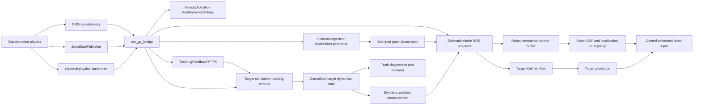

# Sensor architecture review

Review date: 2026-10-23. Scope: the current working tree, including uncommitted localization robustness and target-context/freshness/lifecycle work. This is a read-only architecture review. The only files created by this task are this document and [the proposed design](sensor_architecture_proposed_design.md). No implementation is authorized by these recommendations.

## 1. Executive summary

**Architecture verdict: CONDITIONAL.** Current ownership supports the research testbed. Sensor generation, ROS transport, observation mathematics, fusion policy and system composition already have useful boundaries. A dedicated `robot_sensors` package is not justified by current consumers or dependencies.

Three verified problems matter most:

1. The apparent sensor adapter API is not the production path. `SensorInterface` and its three implementations are referenced by tests, while `EstimationNode` constructs measurements inline. In particular, `ImuSensor` defaults to a six-component acceleration/rate observation, whereas production fuses only a scalar yaw rate. Treating these as interchangeable would be incorrect.
2. Sensor selection is distributed across valid owner configurations without an assembled sensor inventory. Publisher presence, subscription presence, fusion selection, assumed covariance and mandatory safety feedback are difficult to distinguish. For example, nominal wheel variance resolves to `1e-6`, not the `0.05`/`0.02` visible in the base estimator YAML, because the bringup calibration override wins. This is inheritance, not two runtime filters, but it is easy to misread.
3. M08 records localization configuration and seeds, but its strict benchmark contract rejects intentional simulated-sensor changes as scenario mismatches. Separate runs work; an explicitly declared sensor ablation is not yet a supported matched benchmark mode.

Recommend **Option B, a small consolidation within existing packages, starting with Option A's discoverability improvements**. Keep M07 as the sole system composition entry and M08 as the experiment entry. Do not add a generic sensor registry, new top-level configuration system or simulated-noise dependency to estimation.

Poor distance/pointing scores, slip, covariance calibration limitations and legitimate changes in reactive target trajectories are experimental outcomes or separately documented limitations. They are not evidence that these package boundaries are wrong. This review changes no tracking parameters.

## 2. Evidence and runtime vocabulary

Paths below are relative to the repository root. Production connections were traced through current builder, launch, callback, factory and estimator call sites; file existence alone was not considered proof of runtime use.

Three deployment contexts must be distinguished:

| Context | Entry | Meaning in this review |
|---|---|---|
| S: standalone default | `src/robot_simulation/launch/simulation.launch.py`, default `config/launch.yaml` | Robot physics, wheel/joint feedback and synthetic target publisher. Static tracking context; no estimator unless separately launched. Physical base truth defaults off. |
| N: nominal composed simulation | `src/robot_bringup/config/system_nominal.yaml` | Selects `reactive_tracking_oscillatory.yaml`; wheel/joint fusion, target estimation/prediction/control computation and odometry-derived tracking TF. Default actuation and command publication are false. |
| L: localized manipulation | `src/robot_bringup/config/system_manipulation_D_localized.yaml` | Selects `robot_localized.yaml` and `reactive_manipulation_localized.yaml`; imperfect external localization, physical context and physically derived tracking TF. Actuation still requires explicit enablement. |

Both N and L were resolved and preflighted **in memory from source**, using `load_system_configuration` with source package-share lookup. Both succeeded. Python bytecode writing was disabled. This is configuration verification, not a new live experiment.

Retained runtime evidence: `results/target_context_nominal/m03_localization_20261023T040401_263745Z_wbg5yij4/localized_D42/graph.json` shows `localization_sensor` publishing `/localization/odometry`, `estimation_node` subscribing, and `/estimation/robot_state_full` consumed by `control_node`. Its physical truth topic has subscribers `simulation_node`, `localization_sensor`, `tracking_feedback_tf` and `experiment_recorder`; neither estimation nor control directly subscribes to that truth topic. The corresponding D917 directory also preserves the prior run. These graphs are partial, historical observations, not a complete current ROS graph.

No new Gazebo launch, functional test suite, experiment materialization or result generation was performed for this read-only review. Runtime status below means wiring established by the selected current configuration unless explicitly attributed to retained evidence. Independently launched external publishers cannot be excluded by static inspection.

## 3. Current architecture map



The bridge-to-estimation edge carries wheel/joint observations; physical truth is routed only through the explicit imperfect localization generator before robot fusion. In L, truth also supplies target context and tracking TF, which affect target dynamics. In N, TF uses wheel odometry. Target dynamics receive tracking position, not a camera image. These provenance distinctions must remain visible in experiment descriptions.

## 4. Exact source, consumer and configuration inventory

Long paths are intentional: these are actual production entrypoints, not an inferred future sensor directory.

| Source | Producer file | ROS node/topic | Adapter | Measurement model | Consumer | Configuration | Runtime status |
|---|---|---|---|---|---|---|---|
| Wheel odometry | `src/robot_simulation/robot_simulation/gazebo/robot_builder.py::configure_robot_model` adds Gazebo `DiffDrive` | `ros_gz_bridge`: `/wheel/odometry`, `nav_msgs/Odometry`; header `odom`, child `base_link` | `src/robot_estimation/robot_estimation/nodes/estimation_node.py::_wheel_odometry_callback`; takes twist x/z, checks frames, assigns configured diagonal R | `src/robot_estimation/robot_estimation/robot/models/measurement_model.py::WheelOdometryMeasurementModel`; z=[v,ω], h=x[3:5], H selects those states | `RobotStateEstimator.update_wheel_odometry`; separately `VelocityActuationNode._odom_callback`; N tracking TF | `src/robot_simulation/config/gazebo/robot.yaml`: `robot.differential_drive.*`; `src/robot_estimation/config/robot_estimator.yaml`: wheel topics/frames/variances/max age; bringup `estimation_overrides` | Active publisher S/N/L; fusion N/L. 50 Hz configured odometry. Physical skid slip remains possible; no separate noise/delay injection in this producer. |
| Joint position/velocity feedback | Same `robot_builder.py` adds Gazebo `JointStatePublisher`; names originate in robot description | Bridge `/joint_states`, `sensor_msgs/JointState` | Same estimation node `_joint_state_callback`: selects description-ordered arm names, checks duplicates/lengths/finiteness, builds [q,dq] and configured R; separate raw-bound safety state | Same model file `JointEncoderMeasurementModel`; h=x[5:], H selects 2N joint states | `RobotStateEstimator.update_joint_encoders`, bounds conditioner; actuator safety/reference guard; tracking TF; visualization/recorder | `robot.yaml`: `robot.joint_states.topic`, joint name template; authoritative `src/robot_description/config/robot/robot.yaml`; estimator joint variances, names/count and freshness; `src/robot_simulation/config/actuation.yaml` | Active S/N/L, fused N/L. Builder sets no independent joint publication rate; physics-driven plugin feedback. Exact achieved rate was not freshly measured. Mandatory feedback for present active control/safety. |
| IMU yaw rate | **No IMU producer** found in current robot Xacro, builder or normal launches | `estimation_node` nevertheless subscribes to `/imu`, `sensor_msgs/Imu`; required frame `base_link` | `_imu_callback` takes only `angular_velocity.z`, configured scalar variance; ignores orientation, acceleration and incoming covariance | Same model file `ImuYawRateMeasurementModel`; h=x[4], H selects ω | `RobotStateEstimator.update_imu` through common robot queue | `robot_estimator.yaml`: `imu_topic`, `imu_frame`, `imu_yaw_rate_variance`; no publisher/fusion-enable switch | Available consumer, **not connected to a built-in producer** in S/N/L. It will fuse compatible externally published messages; subscription alone does not demonstrate active IMU sensing. |
| Imperfect external planar localization | `src/robot_simulation/robot_simulation/measurements/planar_localization.py::PlanarLocalizationSensor`; `src/robot_simulation/robot_simulation/nodes/localization_sensor.py::LocalizationSensorNode` | Source `/simulation/robot/ground_truth`; output `/localization/odometry`, Odometry with acquisition stamp, world/base_link; diagnostics separate | `_localization_callback`: source/child frames, publisher count, age, quaternion; acquisition-time TF; extracts x/y/yaw covariance; `transform_observation` | `src/robot_estimation/robot_estimation/robot/planar_pose.py::PlanarPoseModel`; h=x[:3], H selects pose; wrapped yaw innovation | `RobotStateEstimator.update_planar_pose`, NIS gate and `PoseAcceptance`; trust gates full estimated-state publication | Sim deployment `localization_sensor_config` → `src/robot_simulation/config/sensors/planar_localization.yaml`; fusion `src/robot_estimation/config/robot_localized.yaml`: `localization_enabled`, topic/frame/age/NIS/consensus/trust | Available but unselected S/N. Active and fused L; retained graph confirms publisher/subscriber. Synthetic abstraction of external localization, not real SLAM/VIO. |
| Synthetic target position | `src/robot_simulation/robot_simulation/nodes/simulation_node.py::_publish_measurement`, using `src/robot_simulation/robot_simulation/measurements/synthetic_measurement.py::SyntheticMeasurementGenerator` | `simulation_node`: `/perception/target_position`, `geometry_msgs/PointStamped`, world frame and committed state time | `_target_measurement_callback`: finite position, stable nonempty frame, configured R, separate target time validation | `src/robot_estimation/robot_estimation/target/models/measurement_model.py::PositionMeasurementModel`; H=[I₃,0] for [p,v] | Target Kalman filter; full target state → prediction → control | `src/robot_simulation/config/measurements.yaml`: `measurements.target_position.enabled/topic/observation/noise/random_seed/rate_hz`; estimator `src/robot_estimation/config/target_estimator.yaml`: target topic/variance/dimension | Active S/N/L, fused N/L. Nominal schedule 20 Hz; only committed/acknowledged target states publish, so schedule is not guaranteed delivery rate. M07 supported composition currently requires enabled position measurement. |
| Physical base pose/context | Gazebo `OdometryPublisher`, configured in `robot_builder.py`; ROS bridge in `src/robot_simulation/launch/simulation.launch.py` | `/simulation/robot/ground_truth`, Odometry world/base_link | `SimulationNode._on_physical_base` → `src/robot_simulation/robot_simulation/state/physical_context.py::PhysicalPositionHistory` | No EKF model for direct truth context; latest causal position with bounded age/history | Target environment/context integration; localization generator; L tracking FK; offline metrics and visuals | `robot.ground_truth_odometry.*` (20 Hz default), `runtime.publish_ground_truth`; deployment `physical_context.base_topic/reference_frame/max_age`; environment `context_requirements` | Disabled default S/N; active L. **Simulation context/truth, not a robot estimator observation**. L context max age .3 s. |
| Tracking-frame TF/FK | `src/robot_bringup/robot_bringup/nodes/tracking_feedback_tf.py::TrackingFeedbackTF`, `tracking_pose`; `WholeBodyKinematics.compute` | `/tf`, TransformStamped; tracking_frame child; N parent odom from wheel pose, L parent world from physical pose; joints measured | `src/robot_simulation/robot_simulation/gazebo/tracking_frame_provider.py::TrackingFrameProvider`; TF2 plus direct contextual TF history, causal `position_at` | Kinematic composition of measured base pose and q with authoritative mount; no independent EKF observation or covariance | Fight/Flight tracking position and contextual target field; physical visualization uses its own explicitly physical FK | Bringup `tracking_tf.rate_hz/max_age/max_skew/future_tolerance`; sim `tracking.source/reference_frame/tracking_frame/max_age/future_tolerance/pose_source`; description tracking mount | S static context default, no broadcaster launched by standalone simulation. Active N/L broadcaster configured 20 Hz; L physical-derived. Derived context, **not an extra independent sensor**. |
| Target physical/display truth | `SimulationNode._on_pose_result` commits numerical candidate after `GazeboPoseClient` service acknowledgement; `_publish_ground_truth` | `/simulation/target_position`, PointStamped; service `/world/{world}/set_pose` is acknowledgement, not a measurement stream | Recorder/visualization normalization; no target truth adapter into estimator | None: committed numerical target state | Evaluation/visualization, synthetic target generator input | `src/robot_simulation/config/simulation.yaml`: `simulation.ground_truth.topic`; target entity and pose service deployment | Active S/N/L. Distinct from noisy target observations. Target pose is driven kinematically by the numerical model; this stream is not a separate Gazebo target sensor. |
| Simulation clock | Gazebo clock; simulation launch bridge | `/clock`, `rosgraph_msgs/Clock` | ROS clock callbacks, estimator reset callback, target `_on_clock`, controller/actuator reset paths | No h/H; establishes source-time epoch | All simulated-time nodes and experiment windowing | `gazebo.clock_topic`, `use_sim_time`, time tolerances and lookback capacities under their existing owners | Active S/N/L. Timing infrastructure, not a fused observation. |

Plugin construction and the launch bridge together establish the producer path. Wheel odometry is wheel-derived kinematic motion, not the physical-world pose publisher, despite both using Odometry.

Additional classifications:

- `src/robot_description/urdf/tracking_frame.xacro` adds a schematic housing/lens pointing along tracking/wrist +X. It adds **no Gazebo camera sensor, image topic or field of view**. `src/robot_models/robot_models/camera/{geometry,projection}.py` provides geometry utilities, not a deployed image-measurement pipeline. The pinhole utility's +Z convention must not be substituted for the configured tracking axis.
- `src/robot_bringup/robot_bringup/nodes/tracking_visualization.py` and `visualization/scene.py` consume physical truth, joints and estimated/predicted streams for diagnostic markers. Those computed axes/lines are not independent sensor data and are not fused.
- `src/robot_simulation/robot_simulation/nodes/velocity_actuation.py` publishes `ActuationTelemetry`; native actuator traces, localization diagnostics and estimator diagnostics describe existing physical/filter sources. They are safety/diagnostic outputs, not additional observations.
- StateEstimate, PredictedTrajectory, ControlTelemetry and SafeVelocityCommand are derived pipeline outputs. Prediction consumes the stamped target estimate; control consumes the stamped robot estimate and prediction, not raw physical truth.
- No current normal-launch lidar, GNSS, image, depth or magnetometer publisher was found in source/launch/configuration searches. This does not exclude external processes or Gazebo-provided topics outside the deployed tree.

## 5. Runtime-wired and bypassed abstractions

| Component | Current callers | Assessment |
|---|---|---|
| `src/robot_estimation/robot_estimation/interfaces/sensor_interface.py::SensorInterface` | Three sensor wrappers; import compatibility assertion in `src/robot_bringup/test/test_architecture.py` | Repository production node/factory does not use it. Public import compatibility is tested; external usage is unknown. |
| `src/robot_estimation/robot_estimation/robot/sensors/wheel_odometry.py::WheelOdometrySensor` | `src/robot_estimation/test/test_robot_sensors.py` | Raw-array [v,ω] → Measurement wrapper, not a ROS Odometry parser. Production builds the equivalent value/R inline. |
| `.../robot/sensors/joint_encoder.py::JointEncoderSensor` | Same test module | Raw-array [q,dq] wrapper; no ROS name selection. Equivalent array-to-Measurement role exists inline. |
| `.../robot/sensors/imu.py::ImuSensor` | Same test module | Raw-array [a,ω] wrapper, dimension 6 by default. Production yaw-rate observation is dimension 1. Not a drop-in adapter. |
| `src/robot_estimation/robot_estimation/factory/estimator_factory.py` | Production node and M07 preflight | Constructs estimator/process/measurement models and localization acceptance; does not construct these sensor wrappers. |

Repository-wide symbol searches found no production call to the three wrappers' `create_measurement`. They are implemented/tested but not connected; calling them dead external API would exceed the evidence.

### What is actually duplicated

Wheel/joint array-to-Measurement construction and configured R shape checking appear in both wrappers and callbacks. They do **not** duplicate two complete ROS parsers: the wrappers never handle ROS names, frames or message covariance. IMU code has divergent semantics rather than equivalent parsing. Forcing callbacks through these classes without resolving that distinction would increase risk.

`src/robot_estimation/robot_estimation/measurement.py::Measurement` checks vector and R dimensions. The old wrappers also check fixed R dimensions. The callbacks check finite values/R; the EKF checks observation/Jacobian dimensions. Localization's `transform_observation` and `update_planar_pose` additionally check covariance validity at the frame-transform and public fusion boundaries. The latter are defensible separate trust boundaries, not evidence to delete validation. There is no single existing adapter-wide promise of finite, symmetric, positive-definite covariance: the old wrappers validate shape only, and normal configured variances permit zero. A migration must preserve PSD versus SPD requirements per observation rather than silently strengthen or weaken them.

### Localization ownership is already clear

| Responsibility | Owner | Preserve |
|---|---|---|
| Noise, epoch calibration bias, latency/jitter, outages/dropout/outliers, seeded reset | `measurements/planar_localization.py::PlanarLocalizationSensor` in simulation | Acquisition time retained through delayed release; generator R=diag(white_std²+bias_std²). |
| Subscribe to physical truth, validate ingress, publish Odometry/covariance | `nodes/localization_sensor.py::LocalizationSensorNode` in simulation | Transport and source-time delivery; unobserved covariance entries remain explicitly large. |
| Parse pose, publisher-count/frame/age checks and acquisition-time TF lookup | `nodes/estimation_node.py::_localization_callback` | Do not replace stamped TF with latest TF or relabel receipt time. |
| Transform pose/R, observation h/H and yaw wrapping | `robot/planar_pose.py::transform_observation`, `PlanarPoseModel` | Full selected 3×3 covariance and J R Jᵀ. |
| EKF innovation/NIS, recovery covariance treatment and accepted updates | `robot/robot_state_estimator.py::update_planar_pose` | Existing Joseph update, conditioning and single-sample fusion behavior. |
| Consensus, trust expiry, reacquisition | `robot/planar_pose.py::PoseAcceptance`; publication gate in estimation node | Current 5-sample/4-inlier/.30 s-span policy, trust timeout .35 s in L; no replayed-history refusion. |

These components concern one source but implement different responsibilities. There is no verified reason to merge them. Estimation has no production import of simulation sensor generation; bringup imports both packages for assembly, which is the correct dependency direction. Simulation truth feeding the imperfect generator is explicit, not hidden estimator access to Gazebo.

## 6. Configuration usability and ownership

`src/robot_configuration/robot_configuration/yaml_loader.py::load_yaml` provides recursive mapping inheritance through one `extends` parent; lists/scalars/null replace. Cycles and malformed documents are rejected. `resources.py::resolve_resource` supports resource paths and `{package, path}` references with validation. M07 resolves manifest references relative to the document that declares them before inheritance merge. Nested simulation deployment paths retain their `paths.base` contract; they should not be assumed to use manifest-relative resolution.

Composition chain:

```text
M07 system manifest
  ├─ estimation.robot.config + estimation.target.config → algorithm/fusion assumptions
  ├─ simulation.config → bringup profile
  │    ├─ simulation_config → simulation deployment/scenario
  │    │    ├─ robot.config → plugin feedback/physical truth transport
  │    │    ├─ simulation.measurement_config → synthetic target generator
  │    │    └─ localization_sensor_config → optional pose generator
  │    ├─ estimation_overrides → selected simulation calibration, applied last
  │    └─ tracking_tf → measured feedback FK publication limits
  └─ runtime → actuation, command publication, GUI/visuals, truth override
```

Manifest estimator references replace legacy bringup estimator resource selection. The optional profile `estimation_overrides` then changes the merged estimator parameters. Launch derives names, model resource and feedback topics from the physical deployment. Source-only resolution demonstrated:

| Effective value | N nominal | L localized |
|---|---|---|
| Wheel assumed variances (v,ω) | `1e-6, 1e-6` | `.02, .04` |
| Joint assumed variances (q,dq) | `1e-6, 1e-6` | `1e-6, 1e-6` |
| Target position assumed variance | `.01` on each axis | Same |
| Robot reorder holdback | `.03 s` | `.08 s` |
| Optional pose publisher/fusion | No selected publisher / false by default | Enabled / true |
| Target tracking pose source | Wheel-derived TF | Physical base + measured joints TF |
| Actuation / command publication | false / false | false / false unless explicitly enabled |

These are observations, not recommended calibrations. `simulation_estimation_localized.yaml` extends `simulation_estimation_wrist15.yaml`; the inherited calibration explains the small joint variances.

Localization generator defaults: 10 Hz, latency .04 s plus uniform jitter up to .01 s; source delivery age .15 s; white standard deviations [.04 m, .04 m, .034906585 rad]; calibration bias standard deviations [.01 m, .01 m, .008726646 rad]; dropout .05; no outages; outlier probability 0; seed 42 before M08 seed derivation. Estimator acceptance age is independently .15 s. Delivery-age and fusion-age settings have different responsibilities even when equal. An increased source latency can fit generator validation but exceed the robot's holdback: each file being valid is insufficient to establish usable combined timing.

Synthetic target generator R is `.01 I₃`. `PointStamped` does not carry covariance, although `SyntheticMeasurement` has it internally; estimation reconstructs R from `target_position_variance`. Generation covariance and assumed observation covariance may intentionally differ. They must both be recorded, not automatically forced equal.

M07 currently rejects unknown manifest keys, validates producer/fusion topic/frame compatibility, disallows direct configured truth-topic fusion, validates mandatory feedback and constructs selected actual components. It does not expose a sensor inventory or implementation selector. It allows fusion enabled with the simulated publisher disabled or absent; that may mean an external provider or an intentional outage, but that intent is not declared. A missing provider fails closed through freshness/trust rather than being an understood experimental selection.

## 7. Replacement and extension assessment

| Use case | Currently supported / configuration-only path | Source changes or limitations |
|---|---|---|
| A: toggle localization | Select an inherited estimator YAML with `localization_enabled: false` to stop fusion. Keeping the publisher on is a valid fusion ablation. Separately select an inherited simulation sensor YAML with `localization_sensor.enabled: false` to omit the publisher; route it through scenario/profile/system references. | No Python change for either existing toggle. Publisher off + fusion on is an outage/external-provider case, not the same as fusion off; L full-state publication remains trust-gated. No equivalent independent wheel/joint/IMU fusion enable flags. Disabling mandatory joint/wheel feedback cannot produce a meaningful active run under current contracts. |
| B: alter characteristics | Inherit `config/sensors/planar_localization.yaml`, override documented noise/bias/latency/dropout/outage/outlier fields; point inherited scenario/profile at that resource. | Config only for modeled effects; validate latency against source age, reorder holdback, mandatory feedback age and trust startup/reacquisition. No current generic wheel/joint noise-injection profile. No tuning done here. |
| C: equivalent replacement | Disable simulated publisher and launch an external Odometry source on the declared localization topic with correct child/source frames, source epoch, normalized planar pose and valid selected covariance. Existing fusion/model/trust can be reused. | External startup/ownership is not selected or managed by current M07. A managed replacement needs a launch integration and preflight/metadata change. It must deliver within the chosen timing contract and not introduce a second publisher. No estimator-model change if the observation contract is equivalent. |
| D: new observation | Existing pure measurement-model and filter APIs can express another h/H; ROS subscriptions and source dispatch are explicit. | New ROS adapter/subscription, model, factory wiring, typed parameters/config, queue dispatch and per-source tests are required; simulator/recorder changes only if generated/recorded. Detailed ownership and file list in proposed design. A changed state dimension is a separate estimator extension, not a sensor toggle. |
| E: compare selections | M08 variants each select a `system_config`. `configuration.py::materialize_run` records resolved owner resources, parent files/hashes, merged estimator parameters, physical/world contracts and seeds. Localization gets a derived independent seed; target measurement uses the run seed. | Runs and metadata supported today. `benchmarking.py::summarize` requires equal comparison-contract hashes. That contract includes complete `localization_sensor` and target `measurements`; changing them marks runs incomparable and suppresses aggregate metrics. An explicit bounded experimental-difference policy is needed for accepted sensor comparisons. |

Adding a conventional pose source within an equivalent contract is localized to transport/configuration. Adding new observation mathematics necessarily touches estimation; adding synthetic generation also touches simulation. That cross-package work represents real responsibilities, not automatically scattering. The avoidable problem is that the current node hides most conversion and dispatch details among timing/publication duties.

## 8. Strengths and recent contracts to preserve

- Pure models and filters remain ROS/Gazebo-independent. M07 preflight is an assembly boundary, not a second numerical implementation.
- `TimestampBuffer` reorders robot observations by acquisition time with age/future/capacity bounds; the target filter has its own chronology. Neither is an out-of-sequence smoothing estimator. Delayed delivery is not permission to fuse stale observations after the filter cursor.
- Localization covariance transformation, wrapped yaw, consensus/trust and reacquisition are explicit. Raw joint bounds and mandatory wheel/joint freshness gate full state independently of a recent aggregate timestamp.
- Target context now buffers bounded delayed physical/TF samples, selects only causal fresh values through integration substeps, commits only after pose acknowledgement and clears history on clock reset. Unrecoverable target-time gaps terminate the essential composition; no silent trajectory restart should be introduced by sensor replacement.
- Control's recent duplicate/older-input handling preserves newer cached valid state and prediction; telemetry identifies their original reference times. Actuator command-session/replay, physical feedback, timeout and ownership checks remain separate from fusion configuration.
- Launch treats pipeline failures as essential and keeps optional visualization separate. M08 performs owned-process teardown and records selected resources. A future sensor provider must fit those lifecycle contracts.
- Imperfect localization is the explicit sanctioned route from simulator truth into robot estimation. Physical truth used to drive reactive target context must not be relabeled as an estimated robot input or an additional independent measurement.

## 9. Open questions and limits of the review

1. Are there external users of `SensorInterface` or the three wrappers? Repository tests preserve an import; source inspection cannot authorize deleting an external API. Proposed migration retains compatibility initially.
2. No fresh full ROS graph was captured. IMU producer absence is established for the built-in deployment, not every possible user process. Achieved feedback rates, DDS latency distributions and packet loss require runtime measurements outside this task.
3. An external pose provider's provenance/correlation with wheel odometry or IMU is not declared. Reusing a covariance-bearing Odometry message does not demonstrate statistical independence; selection design must require that assumption to be documented.
4. The recorder has an optional localization stream but no IMU stream in `recording/normalization.py::STREAM_TYPES`, and no TF stream. `runner.py::required_streams` does not require localization. Full IMU/replacement-source experiment observability would need explicit recorder/readiness work. Missing optional observations must be reported rather than invented.
5. Current API dimensional/finiteness checks differ by boundary. No claim of universally validated covariance is made, and this review does not change numerical acceptance behavior.

## 10. Reproduce the static evidence

From `/home/user/ros2_ws`, these commands read source and retained evidence only:

```bash
rg -n 'SensorInterface|WheelOdometrySensor|JointEncoderSensor|ImuSensor|create_measurement' src --glob '*.py'
rg -n '_.*callback|Measurement\(|_queue_robot|_drain_robot' src/robot_estimation/robot_estimation/nodes/estimation_node.py
rg -n 'localization_sensor|comparison_contract|seed_consumers' src/robot_experiments/robot_experiments/configuration.py
cat src/robot_experiments/robot_experiments/benchmarking.py
cat results/target_context_nominal/m03_localization_20261023T040401_263745Z_wbg5yij4/localized_D42/graph.json
```

The in-memory configuration check used `source install/setup.bash` and `PYTHONDONTWRITEBYTECODE=1 python3 -B`, prepended each `src/<package>` to `sys.path`, and invoked `load_system_configuration(Path(...), lambda package: Path('/home/user/ros2_ws/src') / package)` for the two named manifests. No materializer or launch was invoked. Historical regression results remain historical; no new functional-test pass is claimed by this review.
