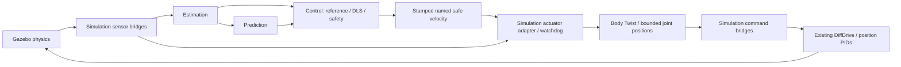

# Closed-Loop Tracking v1

The production Gazebo launch now closes the loop through the existing DLS and
SafetyPipeline. Compute Only remains the default. No changes were committed or
pushed, and robot geometry, reference radius, PID gains and effort limits were
preserved.



Bringup composes these packages and the simulation clock. Only Simulation owns
Gazebo plugins, bridges and actuator transport. The adapter sends body-frame
linear.x = v and angular.z = omega directly to DiffDrive. Each arm velocity is
integrated into a position reference for the existing, sole joint PID.

## Launch

From `/home/user/ros2_ws`, build and source the workspace:

```bash
source /opt/ros/jazzy/setup.bash
colcon build --symlink-install --packages-up-to robot_bringup
source install/setup.bash
export OPENBLAS_NUM_THREADS=1 OMP_NUM_THREADS=1
ros2 launch robot_bringup closed_loop.launch.py enable_actuation:=true gui:=false
```

Optional GUI, in another sourced terminal with the same Gazebo partition:

```bash
gz sim -g --force-version 8
```

Default Compute Only, including the moving target and permanent gravity holding:

```bash
ros2 launch robot_bringup closed_loop.launch.py
```

To enable transport/adapter while keeping Control publication disabled:

```bash
ros2 launch robot_bringup closed_loop.launch.py enable_actuation:=true publish_commands:=false
```

The standalone arm-holding simulation still works with:

```bash
ros2 launch robot_simulation simulation.launch.py gui:=false
```

Start one server for a given ROS domain/Gazebo partition. The validation tools
isolate their servers and clean up their own process groups. These commands
should be run after stopping an earlier server in the same domain/partition.

## Configuration and contracts

| Owner / configuration | Added parameters and meaning |
| --- | --- |
| Control `config/control.yaml` | `command_topic`, `command_frame_id`, `command_joint_names`; `publish_telemetry`, `telemetry_topic`. Existing `publish_commands=false` remains default. Publication requires computation and safety. Bringup derives joint names from the description and frame from DiffDrive. |
| Simulation `config/actuation.yaml` | `command_topic`; `rate_hz=50`; `command_max_age=0.25` s; `feedback_max_age=0.2` s; `wall_timeout=0.5` s; `future_tolerance=0.01` s; `max_position_lead=0.08` rad; `max_integration_dt=0.1` s. |
| Simulation `config/gazebo/robot.yaml` | `joint_position_topic_template=/model/{model}/joint/{joint}/cmd_pos`. The same template configures the PIDs, bridges and adapter. The Gazebo default numeric `/0/` path is not ROS compatible. |
| Simulation launch | `enable_actuation=false` gates ROS-to-Gazebo command bridges. Existing `gui` and `config` remain supported. |
| Bringup `config/closed_loop.yaml` | Package resource paths for simulation, actuation, Control and both estimator configurations. Absolute paths also work. |
| Bringup launch | `config`, `gui=false`, `enable_actuation=false`, optional `publish_commands` override. Publication cannot be enabled without actuation opt-in. |
| Simulation `config/scenarios/` | `moving_target.yaml`, `target.yaml`, `environment.yaml`: the existing fight-flight dynamics with alpha=0, damping=0.05 and a harmonic restoring field about [2.2, 0, 0.85]; initial target [2.7, 0, 0.85], velocity [0, 0.35, 0]. Robot physics and the 1 m reference sphere are unchanged. |
| Validation `closed_loop_thresholds.yaml` | Duration 35 s, evaluation after 10 s, mean error ≤0.30 m, RMSE ≤0.35 m, improvement ≥25%, target excursion ≥0.30 m, base excursion ≥0.10 m, joint smoke response ≥0.02 rad, stopped base speed <0.01 m/s, feedback skew ≤0.08 s, wall timeout 240 s. |

`SafeVelocityCommand` carries computation time, body frame, ordered joint names,
`[v, omega, dq...]`, an increasing sequence and a session UUID. `active=false`
means stop the base and hold the last safe arm reference. Control publishes only
the SafetyPipeline result; raw outputs are available solely in diagnostics.
`ControlTelemetry` carries validity/reason, selected target, desired pose,
estimated-state FK pose, raw velocities and safe velocities in the estimate frame.

The actuator independently checks shape, finiteness, physical velocity bounds,
frame/name identity, timestamp freshness/order, command publisher ownership,
actuator publisher ownership, and fresh raw odometry/joint feedback. A separate
steady-clock watchdog also works while simulation time is paused. Commands
arriving before complete feedback are discarded. Recovery initializes references
from fresh measurements; subsequent integration uses positive simulation dt,
joint position bounds and a measured-position lead envelope. A stall cannot
accumulate unlimited reference drift. Timeouts retain the last reference rather
than repeatedly adopting gravitational sag.

Clock resets clear feedback and references and retire the previous command
session. No pre-reset arm reference is sent into the new world; the existing
PID startup targets provide holding until fresh feedback and a fresh session
arrive. Graceful shutdown publishes a base stop and safe holding before destroying
the ROS context.

## Frames and model ownership

Control continues to use a bare `SerialArmModel` and apply the physical tracking
mount once through `TrackingFrameKinematics`. The observer uses the existing
Bringup factory, whose `FixedMountModel` already includes that mount, and does
not add another tracking transform. Bringup derives world→odom translation and
rotation from the actual configured robot spawn pose, including its 0.25 m
height; this relationship is not hard-coded as identity. Prediction transforms
remain resolved at their reference timestamp.

## Measured validation

Eight impacted/dependent packages built successfully. Functional regressions:
**625 passed, 18 lint tests deselected**. Control Flake8/PEP257 and Models
Flake8/PEP257 passed. Targeted Ament Flake8 passed for all six new production/test
Python files. Package-local repository lint still has six existing failures:
Bringup Flake8, Description Flake8, Prediction Flake8/PEP257, Simulation
Flake8/PEP257. Broad root-directory lint scans also traverse unrelated packages;
they are not reported as green. Estimation has no separate Flake8/PEP257 tests.

The active and hold-only experiments each recorded 35 simulated seconds from
the production Bringup launch. Comparison uses the same 10–35 s window relative
to target initialization, so differing startup/discovery times do not shift the
target phase. Each window has 500 measured-FK samples. Position error is the
norm between the real controller's desired tracking-frame reference and FK
computed independently from measured wheel odometry and joint encoders, never
from commanded positions. Desired references retain the existing sphere policy.

| Metric | Hold-only | Closed loop |
| --- | ---: | ---: |
| Mean position error | 0.3900 m | 0.1785 m |
| Position RMSE | 0.4699 m | 0.2024 m |
| 95th percentile error | 0.7915 m | 0.3361 m |
| Base excursion during evaluation | effectively 0 | 0.2115 m |
| Active safe commands recorded | 0 | 692 |
| Actuator outputs recorded | 0 | 1742 |

Mean error improved **54.2%**, exceeding the 25% threshold. The target moved
about 0.947 m from its initial observed position. Active joint excursions in
description order were [0.3660, 0.2812, 0.1283, 0.0313] rad. Safe commands and
measured joint positions/velocities stayed within configured limits over the
recorded interval. Peak measured joint speeds were [0.1361, 0.4935, 0.3413,
0.4022] rad/s. The position-only task does not constrain orientation; no
orientation-success claim is made. Startup blocked cycles: eight active and
eight hold-only, with waiting-for-input reasons retained in the result files.


The separate actuator smoke test moved the base 0.3520 m while rotating, and
all four joints responded by [0.4359, 0.4101, 0.4216, 0.6558] rad. With publication
disabled there were no incoming commands and the base command stayed zero.
After stopping the smoke command stream, the independent watchdog stopped the
physical base and retained the arm references. Hold-only arm motion after
settling was negligible, with minimum measured tracking height 0.3962 m above
the odom origin.

Failure injection paused only test-owned processes. Command timeout, stale
prediction and stale robot estimates each produced zero base commands, unchanged
arm references and measured base speed 0 m/s. Every case resumed tracking after
valid inputs returned. A full Gazebo reset changed the command session and
recovered. After reset, a pre-reset session was replayed as the **sole** command
publisher with fresh timestamps: the actuator still blocked it. A new controller
session recovered. Graceful controller shutdown also stopped the base. Unit
tests additionally cover startup without complete feedback, wall-clock timeout
during a clock pause, malformed/unsafe commands, feedback ordering watermarks,
source competition, timestamp ordering and reset races.

Evidence: [comparison](../results/validation/closed_loop_comparison.json),
[limits](../results/validation/closed_loop_limits.json),
[smoke](../results/validation/closed_loop_smoke/result.json),
[final failures/recovery](../results/validation/closed_loop_failures_final/result.json).
Build/test summaries are in [the check log](../results/validation/closed_loop_checks.txt);
the complete file list is in [the change manifest](../results/validation/closed_loop_changed_files.txt).
The corresponding directories contain runtime logs; active/baseline directories
also contain target histories, base commands and full `samples.jsonl` telemetry.

Reproduce validation after building/sourcing:

```bash
OPENBLAS_NUM_THREADS=1 OMP_NUM_THREADS=1 ROS_DOMAIN_ID=89 python3 tools/validation/closed_loop_gazebo.py --case active --output /tmp/tracking-active
OPENBLAS_NUM_THREADS=1 OMP_NUM_THREADS=1 ROS_DOMAIN_ID=90 python3 tools/validation/closed_loop_gazebo.py --case baseline --output /tmp/tracking-baseline
python3 tools/validation/compare_closed_loop.py --active /tmp/tracking-active --baseline /tmp/tracking-baseline --output /tmp/tracking-comparison.json
OPENBLAS_NUM_THREADS=1 OMP_NUM_THREADS=1 ROS_DOMAIN_ID=91 python3 tools/validation/closed_loop_safety.py --case smoke --output /tmp/tracking-smoke
OPENBLAS_NUM_THREADS=1 OMP_NUM_THREADS=1 ROS_DOMAIN_ID=92 python3 tools/validation/closed_loop_safety.py --case failures --output /tmp/tracking-failures
python3 -m pytest src --import-mode=importlib -p no:launch_testing -p no:launch_ros -m 'not linter' -q
```

The safety observer uses the installed `psutil` package to address only children
of its own launch. It does not manipulate unrelated simulations.

## Changes by package and file

| Package | New/modified files and purpose |
| --- | --- |
| Interfaces | `msg/SafeVelocityCommand.msg`, `msg/ControlTelemetry.msg`, `CMakeLists.txt`, `package.xml`: reusable command and diagnostic contracts. |
| Control | `ros/control_node.py`, `pipeline/tracking_control_orchestrator.py`, `pipeline/safe_tracking_controller.py`, `config/control.yaml`, `package.xml`, `test/test_control_node.py`, `test/test_robot_model_control.py`: opt-in safe publication, epoch/invalidation handling, existing-computation diagnostics and regressions. The model test now constructs from lower-level components, removing the Control→Bringup test dependency cycle. |
| Simulation | `actuation/__init__.py`, `actuation/position_reference.py`, `actuation/velocity_actuation.py`, `gazebo/robot_builder.py`, `launch/simulation.launch.py`, `config/actuation.yaml`, `config/gazebo/robot.yaml`, three `config/scenarios/*.yaml` files, `setup.py`, `package.xml`, `test/test_position_reference.py`, `test/test_velocity_actuation.py`, `test/test_robot_builder.py`: reference integration, watchdogs, configured PID topics, gated bridges and moving scenario. |
| Bringup | `launch/closed_loop.launch.py`, `config/closed_loop.yaml`, `setup.py`, `package.xml`: minimal production composition and resource/dependency installation. |
| Documentation | This report, updates to `control_compute_only.md` / `gazebo_arm_hold.md`, `superpowers/plans/closed-loop-tracking-v1.md`; validation observer/safety/comparison scripts, threshold configuration and evidence under `docs/validation/closed_loop*`. |

## Limitations

This verifies one bounded moving-target deployment with the existing position
task and controller tuning. It is not an orientation, collision-avoidance or
arbitrary-terrain guarantee. Measured base FK uses wheel odometry, so wheel slip
and geometric calibration can affect absolute physical pose accuracy. Estimation
still drops delayed sensor packets rather than performing out-of-sequence fusion;
the measured experiment succeeded without weakening freshness checks.

The downstream watchdog protects against upstream loss and clock pauses while
the adapter is alive; graceful shutdown is covered. An adapter/bridge crash or
SIGKILL can prevent the final zero from reaching Gazebo. A lower-level drive
watchdog would be needed for that failure class. Publisher checks cover ROS
ownership; separate Gazebo-native command publishers require deployment discipline.
Joint-position PIDs constrain effort and references; they do not guarantee a
hard physical speed bound for every possible disturbance or initial transient.

Automatic approval review rejected stopping one orphaned Gazebo process during
an early diagnostic run because process ownership could not be established from
its current parent. Later read-only checks established ownership from the original
launch log and the task's unique ROS domain/Gazebo partition; cleanup was then
approved and completed. Subsequent validation used explicit process-group cleanup.
No work remains blocked by that rejection.
