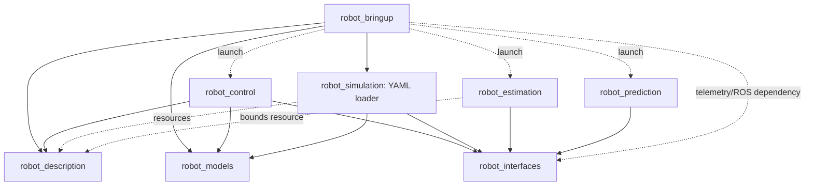
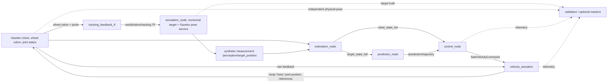

# M06 — Architecture audit (Phase 1)

2026-10-15. Audit/design only. No source migration, algorithm change, deletion,
simulation run, commit or push. Companion design:
[`m06_target_architecture.md`](m06_target_architecture.md).

## Assessment and scope

The current system has sound numerical and safety boundaries, a working production
chain, and useful independently testable algorithms. Its public presentation is
more generic than its deployment contracts: the supported robot is a planar
differential-drive base with this four-joint arm; prediction deployment is fixed
IMM plus residual correction. The main architectural debt is inconsistent entry
points, incomplete configuration reachability, implicit semantic contracts and
packaging/validation coupling. A wholesale pipeline rewrite would discard useful
separation without fixing these problems.

Inspected all eight package manifests, setup/config/CMake metadata, the 422
nonignored source/resource/test files, and parsed all 327 Python files for imports
and top-level symbols. Reviewed runtime call paths, message definitions, model
composition, factories, loaders, launch resolution, safety, TF, prediction timing,
and relevant tests/validation wrappers directly. Static inventory is not a proof
that every public method is used externally or that every dynamic path is correct.
The supporting [inventory](validation/m06_architecture_inventory.json) records
imports, symbols, package dependencies and file/path disposition for review.

Evidence baseline remains M03's 848 functional tests and M04/M05's fresh 210 focused
tests, not a new test campaign. M02–M05 remain CONDITIONAL: physical joint overspeed,
skid odometry drift, aggressive joint covariance overconfidence, aggressive
tracking/freshness and sub-real-time throughput are not repaired by folder moves.
M04 measured RTF 0.882/0.872 nominal/aggressive, distance error 0.077/0.207 m and
pointing 8.34/24.76 degrees; aggressive wrist speed reached 5.355 versus 1.5 rad/s.

## Existing architecture map

| Package | Owns now / public entry | Permitted target dependencies | Must not own or depend on |
|---|---|---|---|
| `robot_description` | Physical YAML, Xacro/URDF, model parameter dataclasses and validated description adapters, display launch | NumPy/YAML; ament resource lookup at I/O boundary; display ROS tools | Controller policies, scenario selection, estimator algorithms; control/simulation imports |
| `robot_models` | Pure kinematics/dynamics, composition, task/reference/camera geometry, numerical limits; `BaseModel`, `ManipulatorModel`, `RobotModel`, `ModelData` | NumPy; injected model specs | ROS/Gazebo, package-share lookup, robot YAML loading, experiment conditions |
| `robot_interfaces` | Five ROS message contracts and rosidl generation | std_msgs, geometry_msgs, rosidl | Python numerical implementations, configuration loader, launch or scenario policy |
| `robot_estimation` | Generic KF/EKF and state/measurement contracts; robot/target models, timing and constraints; `estimation_node` executable | robot_interfaces, description at node/config boundary, NumPy/SciPy, ROS transport | Prediction/control/Gazebo plugins; truth as a hidden localization observation |
| `robot_prediction` | Pure predictors, time-aligned residual/confidence/adaptation; ROS `prediction_node` | robot_interfaces and ROS at node boundary, NumPy/YAML | Robot actuator topology, control/simulation concrete components, ground truth |
| `robot_control` | Interfaces, model/state/message adapters, references/tasks, DLS/WLS, command safety; `control_node` | robot_models, robot_interfaces; description at project configuration boundary; ROS/TF at node/message boundary | Gazebo PID/physics, target scenario dynamics, bringup runtime imports |
| `robot_simulation` | Numerical target world, fields, integrators, synthetic sensors, Gazebo construction/bridges; actuator transport/guard/holding; simulation and actuation executables | robot_models, robot_interfaces, description resources; Gazebo/ROS | Control algorithms, changing estimator truth to conceal drift, authoritative duplicate geometry |
| `robot_bringup` | Installed resource resolution, composition/launch, measured tracking TF and optional visualization, description-to-model deployment factory | Declared launch dependencies on all deployed packages; description/models for its FK workers | Numerical controller/filter implementation, physical limit copies, experiment-specific branches in algorithms |

Physical description parsing is a legitimate description responsibility; mathematical
composition is a legitimate models responsibility. `robot_interfaces` stays CMake
and message-only. Pure Python contracts remain domain-local; there is no reason to
move every dataclass into ROS messages or a universal common package.

### Actual package dependency graph

Arrows mean consumer → dependency. Solid lines include direct runtime imports;
dashed lines include launch/resource coupling. No circular dependency between the
eight project packages was found in this graph. This is a static dependency audit,
not a claim about every external plugin.



`robot_models` has no runtime imports from other project packages. The low-level
control/filter/predictor mathematics does not import Gazebo. The bringup→simulation
loader dependency is explicit in XML, but it is an ownership smell: ordinary system
configuration loading need not require a simulation implementation package.

### ROS data flow and executable boundaries



Actual chain: `closed_loop.launch.configure` loads component YAML, includes
`simulation.launch.configure`, starts estimation/prediction/control/actuation plus
static world→odom, and conditionally starts tracking TF/markers. Simulation builds
URDF→SDF with plugins, starts Gazebo and bridges, then runs numerical target dynamics
and asynchronous pose updates. Target state commits/publishes only after Gazebo
accepts the pose. Robot ground truth is optional observational output, not EKF input.

Executable Python locations differ:

| Executable | Current module |
|---|---|
| `control_node` | `robot_control.ros.control_node` |
| `estimation_node` | `robot_estimation.estimation_node` |
| `prediction_node` | `robot_prediction.prediction_node` |
| `simulation_node` | `robot_simulation.nodes.simulation_node` |
| `velocity_actuation` | `robot_simulation.actuation.velocity_actuation` |
| `tracking_feedback_tf`, `tracking_visualization` | root modules in `robot_bringup` |

These are real ROS adapters with console scripts, not evidence of seven different
algorithm families. The target standard is `nodes/`, with executable names unchanged.

## Control composition: apparent duplication versus real work

The production call path is:

```text
ControlNode._validate_inputs / _compute_control
  RobotStateMessageAdapter -> RobotStateAdapter
  PredictionMessageAdapter + TF conversion at prediction reference stamp
  ControlExecutionPipeline.compute
    PlanarKinematicsAdapter.convert
    SafeTrackingController.compute
      TrackingControlOrchestrator.compute
        target sampling / lookahead
        measured FK -> TrackingReferenceBuilder (reference position/pose)
        ControlPipeline.compute
          ModelDataBuilder (FK/Jacobian/twist, optional tracking shift)
          selected Controller.compute (DLS or WLS + VelocityTask)
      SafeControlPipeline.apply (independent final projection)
  publish authenticated SafeVelocityCommand and diagnostics
```

Evidence is in `robot_control/pipeline/{control_execution_pipeline,
safe_tracking_controller,tracking_control_orchestrator,control_pipeline}.py`,
`adapters/model_data_builder.py`, and `factory/control_factory.py::build`.

These layers are intentional separation, not four duplicate controller algorithms.
Freshness belongs upstream, model preparation outside the solver, and independent
safety downstream. WLS calls the same `SafeControlPipeline.feasible_bounds` used by
final projection. Factory `uses_safety_bounds` injects that shared object. No
downstream bypass or weaker project limits was found on the production path.
Two FK evaluations can occur for reference generation and model data; that is
confirmed repeated work, not permission to merge reference/control/safety. M04
profiling does not justify a computation rewrite during migration.

Actual extension friction: `ControlExecutionPipeline` and `ControlFactory` require
`PlanarKinematicsAdapter` via concrete `isinstance`, despite documentation about
alternative state layouts. `SafeTrackingController` similarly takes concrete
orchestrator/safety types. Those are honest current implementation boundaries;
generalizing them needs a demonstrated new adapter contract, not folder changes.

## Configuration and source-of-truth map

| Category | Current authoritative owner / actual call path | Reachability and constraint |
|---|---|---|
| Geometry, inertial/collision dimensions, joints/axes/physical limits, mount | `robot_description/config/robot/robot.yaml` → Xacro, description parser, control projection, estimator constraint, Gazebo builder/actuation | Shared source; actual topology is current four-joint serial arm |
| World/terrain, physics step, Gazebo systems | simulation `config/launch.yaml`, `worlds/tracking_testbed.sdf.xacro`, terrain/scenario files → world/robot builders | Explicit resource base `package` or `config`; physics 0.002 s unchanged |
| Deployment names/topics/spawn | simulation `config/gazebo/robot.yaml` | Joint naming template expands description keys; spawn defines world→odom |
| PID holding and initial reference | simulation `config/gazebo/joint_position_hold.yaml` | Applied by builder and actuation handoff; physical bounds not redefined |
| Actuation timing/recovery/watchdogs | simulation `config/actuation.yaml` | Safety policy, not physical servo speed guarantee |
| Base command envelope | control `config/control.yaml` | Passed to actuator; current policy owner is control, physical arm bounds from description |
| Target dynamics, environmental fields, RK4 | simulation scenario target/environment YAML → `SimulationFactory` registries | Fight/flight and saturated fight/flight; restoring/sinusoidal fields; RK4 |
| Synthetic sensor covariance/rate/seed | simulation `config/measurements.yaml` | Independent measurement-generation settings; not a global experiment seed |
| Robot/target filters | estimator YAML → `EstimationNode._create_*_estimator` | Parameters selectable, algorithm classes hard-wired EKF/KF |
| Deployment measurement/noise overrides | bringup `config/simulation_estimation.yaml` passed after estimator YAML | Deliberate override layer; record effective configuration, not defaults alone |
| Predictor/adaptation | prediction `config/prediction.yaml` → `PredictionConfig` → `PredictionSystemFactory.create` | Package resource path fixed in node; factory unconditionally chooses IMM+ResidualAdapter |
| Control and task | control YAML + optional strategy YAML → adapters/factory/registries | DLS/WLS; Cartesian/distance-pointing; shared radius and axes injected |
| System composition | bringup `config/closed_loop.yaml` and inherited scenario files | Selects simulation, actuator, control and estimator resource files; no predictor file selector |
| Duration, output, evaluation thresholds | `docs/validation/v2_tracking_gazebo.py` CLI and `v2_thresholds.yaml` | Validation-only orchestration; not a production experiment API |

Loading is not uniform and should not be blindly made uniform. Simulation's
`factory/config_loader.py::load_yaml` implements relative-parent `extends`, recursive
mapping merge, list/scalar/null replacement, cycle/recursive-alias rejection.
Bringup and marker configuration reuse it. PredictionConfig is plain YAML plus
section access. Control strategy YAML is plain YAML, and rejects unknown top-level
strategy categories; ROS estimator YAML uses ROS parameter semantics. Xacro and
description parsers consume raw YAML. These formats serve different boundaries;
`extends` is not currently supported everywhere. A future system resolver should
compose resource references and feed existing owners, not assume all component
documents share ROS or inheritance semantics.

Inherited **parent filenames** resolve relative to the child YAML. Resource **values**
inside inherited documents resolve according to the consuming package/resource-base
policy, not necessarily the directory of the file where the value first appeared.
Changing this silently would break existing scenarios. Lists replace; hence child
environment files repeat the centering entry when replacing a list of fields.
That repetition is required by the current merge contract, not a second centering
implementation. Tests check the unchanged centering field.

## Mathematical and semantic composition audit

| Boundary | Actual contract | Finding |
|---|---|---|
| Robot estimator → control | `[x,y,yaw,v,omega,q[n],dq[n]]`, 5+2n; full row-major covariance; frame/time in Header | Current n=4, dimension 13. Adapter produces configuration `[x,y,yaw,q]` and velocity `[v,omega,dq]`; q and velocity dimensions intentionally differ |
| Target estimator → predictor → control | Common `[p[d],v[d]]`; default d=3; internal CA acceleration is not part of public state | Prediction supports general d; deployed DistancePointingTask and frame converter require six-state 3D targets |
| Prediction times | Header is source estimate epoch; timestamps are absolute future sample times | Node publishes reference stamp correctly; control transforms at reference time and selects/interpolates at `now+lookahead`, not header+first-sample confusion |
| Reference-frame conversion | p'=Rp+t, v'=Rv for fixed inertial frame relation | Correct for static world↔odom; moving-frame velocity terms not modeled. Arbitrary moving frames are unsupported despite generic frame strings |
| Robot Jacobian | World-expressed geometric twist `[linear,angular]`; body base command coordinates `[v,omega]` | WholeBodyJacobian rotates both blocks; FixedMountModel/TrackingFrameKinematics shift linear block by `-skew(offset) J_angular`; finite-difference tests exist |
| Tracking mount | Description relative to wrist; folded into configured manipulator once | Control rejects double mount. Generic builder treats `parent` as metadata; control project adapter enforces `wrist_link`, bringup factory does not validate the parent equivalently |
| Optical axis | Control uses tracking-frame +X; up is -Y; physical mount RPY is configured | Matches user intent and current task/markers. CameraProjection separately uses conventional optical +Z and is not this control path. A real image camera requires an explicit tracking→optical transform |
| Command transport | Body `[v,omega,dq]`, exact joint names/order, source session+sequence, active flag | `SafeVelocityCommand` is a velocity/reference request, not a torque interface or physical-speed guarantee. Inactive holds reference and stops base |
| Timing | ROS simulation time at transport; M03 causal holdback; steady clock for wall watchdog | Separate clock roles are intentional. Reset/session retirement and queued-epoch clearing must survive migration |
| Covariance | EKF/target covariance serialized; predictor contract permits covariance internally | ROS PredictedTrajectory has no covariance field; control validates but does not use robot covariance for chance constraints. Do not advertise uncertainty-aware control |
| Truth versus observation | Target truth separate from noisy synthetic target measurement; physical robot truth optional | Current control/estimator uses wheel odometry/joints, not Gazebo physical pose; validation/markers use physical truth for comparison |

### Important interaction semantics

`closed_loop.launch.py` supplies **wheel odometry** to `TrackingFeedbackTF`, which
combines it with measured joint positions and broadcasts odom→tracking. Static
world→odom completes the chain. `TrackingFrameProvider.position_world` feeds this
live TF to Fight/Flight, with age checks; unavailable TF pauses the target advance.
It does not substitute a static point. However, under skid drift this TF is an
odometry-derived robot position, not independent physical Gazebo position. Thus the
reactive target responds to the robot's inferred tracking point while physical
evaluation uses the true point. The optional marker worker deliberately displays
both physical and faded odometric axes.

This is a confirmed experiment-semantic limitation, not a new proof that the
controller points along the wrong axis. Future experiment profiles must explicitly
name physical versus inferred interaction feedback. Changing that source changes
the scenario and belongs in a separately measured experiment; no M06 migration
should silently switch it or feed truth into localization.

### Implicit model metadata

`StateEstimate.msg` carries no layout identifier or joint names. Control knows
layout from `RobotStateAdapter`; estimator and conditioning use positional slices.
Bringup derives identical joint order from the description, so current wiring is
consistent. Standalone estimator configuration verifies joint count/uniqueness,
but its constraint bounds follow description insertion order without proving the
configured joint-name order represents that same order. Equal dimensions alone
cannot detect a swapped shoulder/elbow meaning. This is a confirmed configuration
validation gap, not evidence of a swap in the captured system. M07 should validate
the resolved profile/order end to end; no message redesign is needed for this MVP.

## Risk-ranked findings

P1 = address before claiming generic installed deployment or unified selection;
P2 = valuable next migration/documentation work; P3 = keep/defer. Known physical
safety shortcomings retain their existing milestone priority, outside this audit.

| ID / priority | Classification | Evidence and impact | Recommended disposition |
|---|---|---|---|
| A01 / P1 | Confirmed configuration reachability defect | `prediction_node.py::__init__` fixes package config path; `system_factory.py::create` always builds IMM+residual; estimator `_create_*` hard-wires algorithms. YAML numbers do not provide implementation selection | M07 expose resource path and only registered supported selectors; reject unsupported kinds; preserve existing defaults |
| A02 / P1 | Confirmed interface restriction, not a runtime regression | `ControlExecutionPipeline.__init__`, `ControlFactory.build` require PlanarKinematicsAdapter; `RobotModel` mandates base+manipulator; description parser and arm FK encode this topology | Document planar_mobile_manipulator capability. A quadrotor needs estimator/state/actuation interfaces, not a YAML rename; defer new robot implementation |
| A03 / P1 | Confirmed dependency metadata omissions | prediction directly imports `ament_index_python` and `std_msgs`, absent XML; simulation TrackingFrameProvider imports `tf2_ros`, absent XML; bringup imports NumPy, absent XML; models requires NumPy in setup but absent XML | Declare direct rosdep dependencies; verify clean installed resolution; don't rely on transitive development environment |
| A04 / P1 | Confirmed metadata validation gaps | Whole-body factory ignores mount parent label while Xacro honors it; standalone estimator validates count but not bounds/name correspondence | Profile validation must bind end-frame parent and order. Keep currently verified wrist/order; no generic filter changes |
| A05 / P1 | Confirmed experiment-semantic limitation | Reactive TF uses wheel odom; independent physical measurement diverges on skid turns | Explicit feedback-source metadata and experiment reporting; no silent behavior change in structural migration |
| A06 / P2 | Confirmed ownership coupling / differing loader contracts | Bringup launch and visualization import `robot_simulation.factory.config_loader`; PredictionConfig/ROS/raw YAML use different semantics | Extract the one tested inheritance implementation to a narrowly owned configuration library, retain shim; do not invent a second resolver |
| A07 / P2 | Confirmed portability risk in validation | `v2_tracking_gazebo.py` source-root paths and string replacement of launch text; probes execute archived modules in live module globals | Preserve evidence/archives; update exact import/instrumentation sites in migration. A class re-export alone is not equivalent for monkeypatch/exec wrappers |
| A08 / P2 | Confirmed structural inconsistency | Six ROS adapter files outside nodes; root prediction factory/loader and bringup model factory differ from existing factory convention | Mechanical moves, stable executable names, selective compatibility paths; don't rewrite algorithms |
| A09 / P2 | Confirmed backup installation defect | Source has two `control_node.py*.bak` files and `config/scenarios/environment_oscillatory_aggressive.yaml.bak`; simulation `setup.py::install_directory_tree` installs any non-dot filename | Preserve backups outside package source and exclude backup/cache suffixes in resource installation; historical model.sdf asset is not runtime garbage |
| A10 / P2 | Confirmed documentation/metadata drift | README lists nonexistent perception/experiments packages as current; descriptions are TODO/agricultural; models setup version .0.1 versus XML .0.0 | Separate implemented/planned packages, align metadata. Six Python packages omit explicit ament_python buildtool dependency though export selects it; declare it consistently |
| A11 / P2 | Confirmed limited duplicate adaptation | Estimator sensors validate/create Measurement, but node separately constructs measurements/covariance; Bringup and Control have distinct registry assembly around shared model composition | Sensor consolidation optional after equivalence tests; do not duplicate model composition again or merge layers just for shorter code |
| A12 / P3 | Intentional alternative implementations | FixedMountModel versus TrackingFrameKinematics; DLS versus WLS; KF versus EKF; typed ROS data versus pure domain data | Keep. Factory rejects double mount and existing tests verify equivalence |
| A13 / P3 | Similar but intentionally separate registries | Control `ComponentRegistry.create(name,params)` vs simulation `create(spec,**dependencies)` differ in API/error contracts | Keep domain registries; no demonstrated benefit from a cross-domain registry abstraction |
| A14 / P3 | Confirmed scoped fallback; not silent recovery of invalid config | IMMPredictor constructor allows default probabilities, ConfidenceWeighting uses uniform weights for zero sum, disabled optional fields/truth are explicit | Preserve numerical policies; future config validator should report effective defaults. Unknown registry types already fail loudly |

The model package NumPy manifest gap and models version mismatch are installation
defects even though source-workspace imports currently succeed. New profile checks
must be actionable errors, not a silent fallback to the current robot/controller.

## Referenced, inactive and legacy code disposition

Reference searches include source imports, test imports, entry points, launch files
and validation scripts, not filenames alone. External consumers cannot be ruled out.

| Component | Classification / evidence | Action |
|---|---|---|
| DLS `baseline/jacobian_controller.py` | Live default registry selection and controller tests; v1 comparison utility | Keep executable baseline |
| CV/CA/CT predictors | Runtime dependencies of IMM and direct predictor tests | Keep; exposing standalone selection is future factory wiring |
| Estimator `robot/sensors/` adapters | Referenced by `test_robot_sensors.py`; current node bypasses them | Tested alternative boundary, not dead code; no deletion |
| RLSAdapter / AdaptiveStateSpace | Internal RLS dependency, no route from current deployment factory | Dormant alternative, not a selectable deployed adapter; keep and label |
| BaselineFusion / AdaptiveFusion / ConfidenceWeighting | Alternative fusion path with internal references, not current weighted residual path | Keep; don't label current deployed fusion interchangeable |
| TrajectoryBuffer / TwistBuffer | Thin VectorBuffer specializations with no discovered deployed caller; ResidualBuffer is live via monitor | No repo runtime caller found; no proof of external uselessness. Retain public alternatives pending explicit deprecation |
| OnlineSequenceLearner | Abstract learner API only; no concrete learned deployment | Extension contract, not an implemented ML predictor |
| ArmDynamics / MobileDynamics / camera geometry/projection | Reusable mathematical alternatives; no current Gazebo actuation call path | Keep; not duplicate Gazebo physics or current tracking controller |
| Empty aerial/omnidirectional package initializers | Existing reserved namespace, no model implementation | Do not claim support; don't create more empty symmetry directories |
| `docs/validation/m02_before_source`, `m03_before_source` | Deliberate executable behavior baselines used by probes | Keep byte-for-byte, not abandoned backups |
| Ignored `.bak`, `__pycache__`, `.pytest_cache` | Local backups/caches; caches include names of old modules with no current .py | Backups archive without loss; caches excluded from installation. A stale .pyc is not evidence of a live source implementation |
| `models/target/model.sdf` | Installed model asset; generated runtime worlds go to temporary directories | Keep source asset; don't conflate SDF extension with generated output |
| Historic `config/comparison`, `config/experiments` and validation scripts | Explicitly installed legacy configs, research/test harness rather than new experiment manager | Keep during compatibility migration; report reachability before any deprecation |
| `config/disturbances.yaml` | Confirmed empty installed legacy stub; no source/validation runtime reference found | Retain/label legacy; do not treat it as an active field configuration or silently accept it when selected. Actual field settings are in environment YAML |

No production class is certified genuinely unused by this audit. The absence of a
repository caller is documented where found, rather than treated as deletion
authority. Historical duplicate-looking wrappers and evidence are preserved.

## What should remain unchanged

1. Pure model/filter/predictor/controller mathematics, their domain-specific folders,
   numerical tests, and source-stamped transport.
2. Authoritative physical description and existing model/limit extraction; no
   robot constants copied into new configuration infrastructure.
3. WLS shared bounds plus independent final safety, DLS compatibility, M02 guard,
   PID holding/startup handoff, timeout/replay/session/reset protections.
4. M03 buffer and correlated mean/covariance conditioning, exact planar propagation,
   truth/measurement separation and explicit remaining limitations.
5. Existing scenario inheritance semantics, package-share resource paths, raw
   evidence and generated-SDF audits. No mass relocation of historical results.

## Phase 1 verification and next action

Source AST and metadata/reference inventory was regenerated; direct core call paths
were inspected. A read-only installed-entrypoint import check and final source hash
comparison are recorded in `validation/m06_audit_verification.json`. No numerical
or Gazebo regression was rerun for this documentation-only phase. No claim that
structural migration has passed tests is made.

The check loaded all seven installed console entry points without constructing ROS
nodes, compared all 52 installed YAML resources with source, and resolved inheritance
for the 51 mapping documents. The empty disturbances stub is reported separately,
not forced through the mapping loader. All 425 source-file hashes, including the
three ignored backups, remain unchanged. Existing build/install artifacts were not
deleted or rebuilt. These checks establish present import/resource reachability,
not clean-machine dependency completeness.

Next prompt should approve the bounded migration in the companion design: declare
dependencies, standardize node/factory/config-loader locations with compatibility,
extract one YAML inheritance owner, preserve all algorithm/config semantics, update
tests/instrumentation, and validate installation. Implementation selection and run
management belong to M07/M08. Approval is for a concrete path map and checkpoints,
not a blanket permission to refactor working algorithms.
