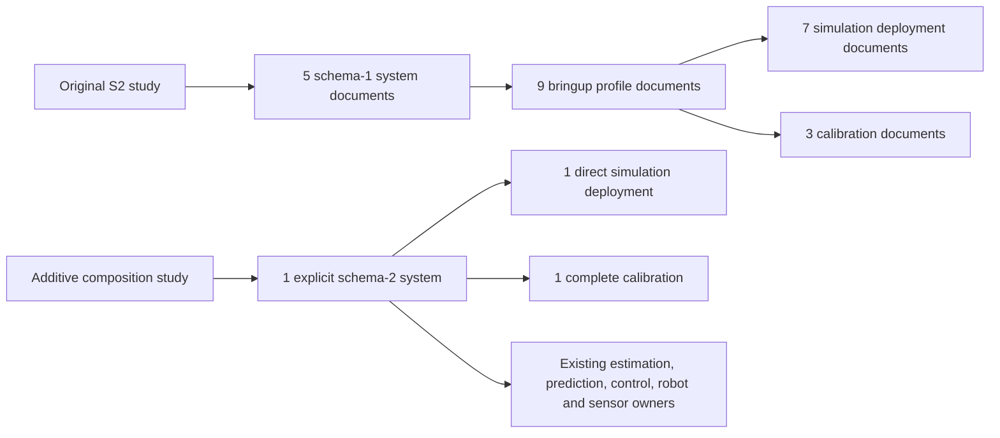

# S3A — Explicit System Composition Closure

2026-10-24. **CONDITIONAL** overall: the composition migration, deterministic
behavioral equivalence, installations and end-to-end launches are verified. The
higher-noise run again lacks complete ROS joint-observation coverage. Scientific
eligibility remains withheld by the unchanged M08 gate. S3B was not started.

## New composition and ownership

Entry: `src/robot_bringup/config/systems/mobile_manipulator_pose_tracking.yaml`.
It represents the historical **localized manipulation D** setup: authoritative
physical +/-15-degree wrist, saturated Fight/Flight, base-relative guidance,
imperfect planar localization, robot EKF/target KF, IMM/residual/weighted fusion,
and arm-priority WLS. It does not represent all possible mobile manipulators.

A schema-2-only compiler builds the existing in-memory profile interface, then
executes the original M07 owner validators, real factories and cross-owner checks.
Both existing launch files and the M08 materializer/runner are byte-unchanged.
M08 still creates its existing run-local schema-1 profile/system adapter and
preflights those actual generated inputs. A generated execution adapter is distinct
from selecting the legacy bringup forwarding profiles; no such profiles are read
by the new source composition, including the real runtime owner snapshots.

The manifest selects actual description/model, estimator owners/calibration,
prediction/adaptation/fusion, controller/strategy, direct simulation deployment,
robot deployment, actuation, optional localization source, TF and runtime policy.
Physics, target dynamics/environment, sensors, limits, PID, estimator/prediction/
controller mathematics and safety remain with their existing owners.

### Graph and measured indirection

Arrows below are resource-selection groups, not one literal inheritance chain.
Each group may have its own independent `extends` edges.



| Selection group | Old documents / parent edges | New documents / parent edges |
|---|---:|---:|
| System | 5 / 4 | 1 / 0 |
| Legacy bringup profiles | 9 / 8 | 0 / 0 |
| Simulation deployment | 7 / 6 | 1 / 0 |
| Calibration | 3 / 2 | 1 / 0 |

The nine bypassed profile documents are reactive_manipulation_localized,
reactive_manipulation_wrist15, reactive_manipulation, reactive_tracking_oscillatory,
reactive_tracking_3d, reactive_tracking_saturated, reactive_tracking,
optimal_tracking and closed_loop. No document was deleted or archived.
Captured owner resources fall **46 -> 25** for each S2 assignment variant.
There are **four additive YAML resources**: system, direct deployment, calibration
and one experiment entry. The latter inherits the unchanged S2 study and replaces
only its complete global system reference. Remaining robot-deployment/target
owner inheritance has at most two parent edges; localized estimator and strategy
inheritance remain meaningful component reuse. There is no new noise-only system.
Exact paths/ancestry and all 25 resources are saved in `equivalence.json`.

### Schema, authority and precedence

Schema 1 keeps its existing `simulation.config = bringup profile` meaning.
Schema 2 explicitly means `simulation.config = direct robot_simulation deployment`.
It requires explicit simulation robot/actuation/tracking_tf selectors; localization
and estimation calibration are optional. Robot/localization selectors must agree
with the deployment's canonical resource paths or fail. Omitted/null localization
is valid when the deployment has no producer. Existing external-source/fusion
semantics are preserved; S2 assignments still require an actual enabled producer.

Manifest references use the shared declaring-document package/relative resolver,
including lexical package traversal protection. Deployment-internal references
remain string paths under `paths.base`, matching the existing simulation launcher.
Package mappings there are rejected before launch rather than accepted by one
loader and failing at runtime. Tracking numeric inputs use the existing DOUBLE
validator and the TF adapter's finite/range constraints, without changing values.

Calibration applies after disjoint robot/target parameter owners, preserving all
eight effective legacy fields. Competing robot/target owner keys, unknown calibration
keys and physical/topic/frame contradictions remain errors. As in schema 1,
manifest estimator types win optional owner/calibration selector defaults: tests
verify both actual constructed identities and final launched parameter values.
This existing selector authority is distinct from numeric calibration precedence.

The complete flat calibration retains wheel variances 0.02/0.04, joint position/
velocity variances 1e-6, target acceleration prior 0.5, full-state publication 50 Hz,
diagnostic period 5 s and the wrist description reference. Sensor producer noise
and estimator assumptions are not mixed or changed.

Nonempty runtime/strategy/lookahead/feedforward launch overrides retain their
existing precedence, including explicit false. `config:=legacy-profile` is rejected
with schema 2; select a direct deployment in the manifest. Compute Only and
`publish_commands:=false` remain available. Tracking TF retains 20 Hz, 0.2 s age,
0.05 s skew and 0.01 s future tolerance. Physical target tracking/context retains
0.3 s age and zero tracking future tolerance. Physics remains dartsim_recovery,
2 ms steps, native holding and unchanged limits/tolerances.

## Deterministic equivalence and provenance

Old: unchanged `config/sensor_noise_study.yaml`, selecting the schema-1 localized-D
system. New: `config/sensor_noise_composition.yaml`, inheriting that exact study
and selecting the explicit composition. Name, variants, seed 42, exact noise
vectors, 8 s measurement/3 s settling, metric families, readiness/alignment,
actuation, recording and execution deadlines all match.

Under the **same current implementation**, every actual generated input (11 YAMLs),
materialized M07 plan/inventory/identities, context, effective owners, seed consumers,
protected conditions and full comparison views match for corresponding runs.
Raw direct-launch Node parameter lists and included simulation deployment values
also match. Additional unit cases verify independent materialization at seed 917.
Only generated run-directory prefixes are normalized for generated-file/plan
comparison; no comparison view/hash is normalized.

| Variant | Original SHA-256, identical old/new |
|---|---|
| baseline | `eaed6bed93ba15fc3af4804cd83465374d8764378c1f84bd0413ce2aeda378cc` |
| higher_noise | `70cd56201966e6118151c80ff4d01849e34e5c817232c864b94dc0fcb5de2f11` |

Shared current invariant: `99bb823edc747843f0aecc380c79c738e97ff6198b80bd3772e5da1fe0bb8e42`.
Frozen source fingerprint: `a8a6c7ffcd5ba0626ba88d32e2cca048eea5005f8d619a7454224097be88a2df`.
The two current configuration compatibility decisions have no rejection reasons.
The actual live runs have these exact hashes and source fingerprint too.

There are ten raw-inventory provenance differences, all attributable to four
resource identity replacements: system, profile-interface owner, deployment and
calibration paths. The exact field differences and old/new paths are recorded;
owner values and semantic roles agree. New profile provenance is the manifest
owning the in-memory adapter, not a legacy profile. S1 adds only
`runs[].system.composition` for schema-2 systems, including this role and calibration.
Schema-1 explain shape is unchanged; runtime eligibility stays null before execution.

Compared with historical S2 evidence, original/reduced invariant contracts have
no differences. The sole changed protected field is `evaluation.source_sha256`
(d6607693... -> a8a6c7ff...), correctly changing historical invariant hash bb8c245f...
to the current hash above. Metric definitions and protected behavioral values do
not change. No mask, allowlist or source-fingerprint rule was weakened.
`historical_contract_differences.json` preserves this distinction.

All **17 pre-existing experiment preparations** also match before/after the code
change, including generated inputs and complete prepared dictionaries. That
separate compatibility audit uses a fixed source-label to isolate behavior across
code revisions; it does not claim scientific eligibility across those revisions.
The mandatory same-revision audit above uses the actual frozen fingerprint.

## Tests, installations and review

Evidence root: `results/configuration_composition_s3a_validation/` (ignored).

| Check | Actual result |
|---|---|
| Initial new M07 tests | 17 failed / 23 passed before implementation |
| Initial new M08 tests | 4 failed before implementation |
| Initial new feature tests | 44 passed |
| Review findings reproduced | 9 failed / 3 passed, 40 deselected |
| Final focused composition tests | **56 passed**, 8.78 s |
| Broader M07/M08/shared focused tests | **552 passed**, 3 style checks deselected, before the 12 added review/boundary cases |
| Final full functional regression | **1515 passed**, 18 style checks deselected, 100.64 s; includes final review cases and architecture/legacy tests |
| Normal affected-package build | **3 packages passed**, 1 min 8 s |
| Copied affected-package build | **3 packages passed**, 4 min 16 s, using the unchanged complete S2 copied underlay |
| Source/symlink/normal installed checks | Old/new explain complete views equal; new validate-only succeeds; no runtime during explain |
| Copied checks from `/tmp` | All four new YAMLs regular installed files, no primary source/build/install references, old/new explain views equal, validate-only succeeds |
| Scoped flake8/pydocstyle | New compiler/tests and explain clean; no new diagnostics in modified assembler |

Existing assembler lint debt is 59 before / 57 after; unrelated debt was not
reformatted. The established importlib/disabled launch-testing plugin invocation
is used for multi-package pytest collection. Build/dependency warnings are retained
in logs rather than presented as functional failures.

Read-only independent review found the deployment-path syntax/preflight mismatch;
eight RED/GREEN cases now cover it. A ninth RED/GREEN case handles ROS DOUBLE
tracking types. Additional tests document typed selector authority and absent/null
localization. The reviewer reached its usage limit after reporting findings and
before a final summary; no clean final-review verdict is fabricated. Primary
review, runtime and the full regression provide the final evidence. One unused
compiler source argument is a deferred minor with no runtime effect.

## Real ROS/Gazebo result

Study: `results/configuration_composition_s3a/sensor_noise_comparison_20261024T160955_742101Z_6z7cqkcp`.

Both runs completed through the unchanged M08/M07 execution path, with observed
component identity checks passed. Each was actuated/headless, with 3 s settling
and 8 s evaluation. No legacy bringup profile occurs in either runtime owner
snapshot. These are per-run measurements, not an eligible aggregate comparison.

| Measurement | baseline | higher_noise |
|---|---:|---:|
| Mean distance error (m) | 0.109614 | 0.085082 |
| Max distance error (m) | 0.209339 | 0.180912 |
| Mean pointing error (deg) | 6.600058 | 7.220996 |
| Max pointing error (deg) | 19.479821 | 20.340946 |
| RTF | 0.773682 | 0.794867 |
| Localization records | 114 | 129 |
| Target measurement records | 194 | 249 |
| Joint-state records | 3791 | 2924 |
| Robot estimate records | 501 | 507 |
| Prediction records | 193 | 228 |
| Control records | 246 | 249 |
| Command records | 238 | 249 |
| Actuation records | 109 | 134 |

Stream counts cover complete recordings, including startup/settling. Required
simulation, sensor, estimation, prediction, control, command and actuation sources
were active. Invalid commands, watchdog events, rejected commands and feedback
rejections were zero in both evaluation windows. No causal tracking-performance
claim or bitwise trajectory equivalence is made.

Baseline acceptance is true. Higher-noise acceptance is null; its reported joint-observation
span is 7.992/8.0 seconds (99.9%), with a **158 ms** maximum gap against
the unchanged **150 ms** budget. Baseline maximum gap is 52 ms with full coverage.
The CLI exit code is **3** and comparison eligibility is false, retaining
`higher_noise seed 42: required physical joint observation coverage incomplete`.
The S2 observation-coverage issue recurs (previously 252 ms). Its cause is not
established here and is not attributed to noise or the composition migration.
No observation budget was increased, missing record hidden or gate bypassed.

Complementary 2 ms physics traces are complete from startup: 6413 samples per
joint for baseline and 7507 for higher noise. They pass existing position/speed
numerical tolerances (0.001 rad / 0.001 rad/s), with no violating samples. Maximum
shoulder undershoot is approximately 6.47e-5 rad and elbow speed excess is
5.01e-10 rad/s, both below the existing tolerances. This evidence does not replace
the ROS coverage gate. Native motor torque remains unavailable; neither trace
acceptance nor this migration demonstrates measured effort compliance or hardware
safety. Exact metrics/traces and statuses are saved in `live_measurements.json`
and the original study files.

Both launches shut down cleanly with empty survivor lists. Independent environment
scanning found no processes in either owned Gazebo partition. No unrelated launch
was stopped. Cleanup is recorded in `processes_after.json` and each run status.

## Preservation, limits and verdict

All original YAMLs, including the S2 entry and legacy profiles, remain byte-identical.
Only the five listed pre-existing implementation/documentation files changed;
no file was deleted, moved or archived. Unrelated dirty edits and evidence are
preserved. Historical result files retain size/mtime metadata (9721 files checked).
Git HEAD and index are unchanged; no staging, commit or push occurred.

**CONDITIONAL** overall: explicit composition, owner/launch/configuration equivalence,
legacy compatibility, scientific contract preservation, installations, functional
regression and operational simulation pass. Runtime scientific eligibility remains
conditional on complete joint-observation coverage. This task does not resolve
ROS observation delivery or measured torque availability.

Rollback: select the unchanged `config/system_manipulation_D_localized.yaml` or
original `config/sensor_noise_study.yaml`; retain all evidence. No migration of
historical A-E studies or original user launch defaults is required.

## Exact changed files

Modified:

1. `src/robot_bringup/robot_bringup/factory/system_configuration.py`
2. `src/robot_bringup/setup.py`
3. `src/robot_experiments/robot_experiments/explain.py`
4. `docs/m07_unified_system_configuration.md`
5. `docs/m08_experiments_and_benchmarking.md`

Added:

6. `src/robot_bringup/robot_bringup/factory/explicit_composition.py`
7. `src/robot_bringup/config/systems/mobile_manipulator_pose_tracking.yaml`
8. `src/robot_bringup/config/calibration/manipulation_pose.yaml`
9. `src/robot_simulation/config/scenarios/base_relative_manipulation.yaml`
10. `src/robot_experiments/config/sensor_noise_composition.yaml`
11. `src/robot_bringup/test/test_explicit_composition.py`
12. `src/robot_experiments/test/test_explicit_composition.py`
13. `docs/validation/configuration_composition_s3a_plan.md`
14. `docs/validation/configuration_composition_s3a_closure.md`

Generated validation scripts/logs/copy builds and new runtime artifacts remain in
the two isolated ignored result roots. Neither launch file, M08 configuration/
assignment/preparation/comparison/runner implementation, algorithms nor physical
owners changed. Nested bringup config installation is the only packaging extension.

## Reproduction

```bash
cd /home/user/ros2_ws
source /opt/ros/jazzy/setup.bash
colcon build --base-paths src --symlink-install --packages-up-to robot_experiments
source install/setup.bash
export OPENBLAS_NUM_THREADS=1 OMP_NUM_THREADS=1 MKL_NUM_THREADS=1
# Direct explicit composition; omit enable_actuation for Compute Only.
ros2 launch robot_bringup closed_loop.launch.py \
  system_config:=config/systems/mobile_manipulator_pose_tracking.yaml \
  gui:=false enable_actuation:=true
# Existing runner; each invocation reserves a new unique directory.
ros2 run robot_experiments run --config config/sensor_noise_composition.yaml --validate-only
ros2 run robot_experiments run --config config/sensor_noise_composition.yaml --explain
ros2 run robot_experiments run --config config/sensor_noise_composition.yaml \
  --output results/configuration_composition_s3a
python3 -m pytest src/robot_bringup/test/test_explicit_composition.py \
  src/robot_experiments/test/test_explicit_composition.py -q --import-mode=importlib \
  -p no:launch_testing -p no:launch_ros -p no:cacheprovider
python3 -m pytest src -q --import-mode=importlib -p no:launch_testing \
  -p no:launch_ros -p no:cacheprovider \
  -k 'not copyright and not flake8 and not pep257'
```

Use a fresh output/build prefix for reproduction; do not overwrite recorded
validation. The saved `equivalence.py` and `legacy_preparation.py` utilities explain
the exact comparison boundaries; focused tests reproduce the permanent contract.

## S3B recommendation, not implementation

After separate authorization, migrate remaining entry points one at a time through
the proven schema-2 path, retaining complete owner/launch/scientific equivalence
and installed replay compatibility. Consider bypassed profile/system/scenario and
calibration forwarding chains only after validating all incoming references.

`retained_legacy_references.txt` verifies that the original S2 entry and schema-1
noise study still select the old localized-D system; old noise profiles/scenarios
inherit the localized chain; the A-E study still depends on the original system
family. Those files remain required compatibility resources. Do not delete the
bypassed chains or flatten independent numerical/physical owners to meet a quota.
Authoritative description raw readers/Xacro must retain their current format.
First investigate observation/recording gaps separately if scientific benchmarking
needs eligible data; structural equivalence does not authorize coverage relaxation.
Stop after S3A; no S3B consolidation or archival has been performed.
