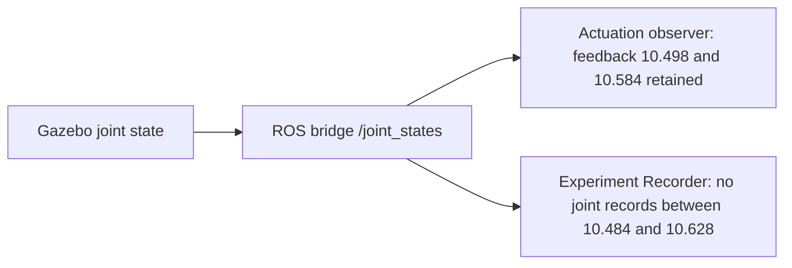

# Physical observation coverage reliability — D2.9a

**Observation reliability: CONDITIONAL. Scientific comparability: CONDITIONAL.
Dashboard ranking: CONDITIONAL.** The retained CV recorder really lacks physical
joint observations; the coverage calculation and rejection are correct. Independent
actuator feedback proves joint messages existed inside that gap. The precise
recorder/transport loss mechanism cannot be reconstructed from this uninstrumented
Run. No speculative production fix, replacement samples or new study was applied.

Sixteen new focused tests and the affected regression suites pass (**168 tests**).
The affected `robot_experiments` package builds. Both historical metric documents
replay identically, including the safety/coverage results. Existing D2.9 comparison,
Runner, Recorder, algorithms, thresholds and dashboard behavior are unchanged.

## Retained evidence and exact gap

Read-only source study:
`results/scientific_comparison/live/nominal_20261102T092746_387134Z_qzhhxo3p`.
Original D2.9 Session: `3349f30d-c4cf-454d-abf6-38ed20e583aa`; it now contains
additional Runs and was left intact. A separate ordinary audit Session,
`0107977c-ac52-47f7-bf3b-4198e88ed3df`, references only the two original Runs.
It adds reference metadata in `results/observation_coverage/workspace`, not new
Runs or copied result storage.

| Evidence | IMM | CV |
| --- | ---: | ---: |
| Run ID | `4ce2a7ef-299c-41b9-afb6-bf51e5df9ee9` | `d1477a39-39ca-413e-a4ff-777516a9c41d` |
| Execution | Completed | Completed |
| Seed / actuation enabled | 42 / false | 42 / false |
| Scoring source-time window [s] | 4.402–10.402 | 4.842–10.842 |
| Joint records, entire recording / in scoring window | 4,698 / 2,497 | 4,025 / 2,073 |
| Median positive joint source spacing [s] | 0.002 | 0.002 |
| Whole-recording observed joint rate [Hz]* | 451.548 | 371.081 |
| Largest scoring joint gap [s] | 7.654–7.674 | **10.484–10.628** |
| Maximum scoring joint gap [s] | 0.020 | **0.144** |
| Covered duration / requested [s] | 6 / 6 | **5.936 / 6** |
| Physical position/speed coverage | 100% | **98.9333%** |
| Physical safety acceptance | True | Unknown |
| Recorded radial RMSE [m], descriptive only | 0.765429 | 0.762845 |
| Owned simulation cleanup survivors | 0 | 0 |

*Observed rate is `(record_count−1)/(last_source−first_source)`, including startup,
not a measured publisher rate or a middleware-loss count. Source spacing suggests
nominal 500 Hz observations. No publisher sequence count was retained in this Run.

Every persisted joint source timestamp matches its original ROS header. JSONL
counts match Recorder availability counters; there are no normalization rejections
or out-of-order joint counters. Both position and velocity safety calculations
reject zero samples. These facts rule out an invalid-array/name-order filter or
post-recording metric filter as the cause of this particular gap.

### Coverage arithmetic and boundaries

The authoritative existing rule in
`robot_experiments/metrics/__init__.py::_safety` is a forward hold from an actual
valid sample, capped at the unchanged `max_skew = 0.08 s`. It does not interpolate.
For the CV sample at 10.484 s, that hold expires at **10.564 s**. The next recorded
sample is 10.628 s. Thus:

`unobserved = 10.628 − 10.564 = 0.064 s`

`observed = 6 − 0.064 = 5.936 s; coverage = 5.936 / 6 = 0.9893333333`.

This one internal gap explains the entire deficit. Scoring-boundary clipping,
including the genuine final pre-start sample's remaining hold, adds no missing
interval. The slight floating representation of the 4.842 s start is handled by
the existing pre-start rule; it is not the cause. Position and velocity coverage
agree. Full replay uses all raw JSONL samples, with empty streams represented as
empty lists exactly as the original store did, and reproduces **all saved metric
fields**, not just coverage. Display trajectory downsampling is not involved.

## Localization of the observation-path failure

### Joint messages existed inside the missing interval

The existing velocity-actuation observer independently subscribes to the same
configured `/joint_states` topic. Its `feedback_stamp` is copied from accepted
JointState headers; it is not the telemetry publication time or an estimated pose.
Its recorded, valid telemetry includes:

| Actuation telemetry source [s] | Actual joint feedback header [s] | Recorder arrival [host monotonic s] | Actuation enabled |
| ---: | ---: | ---: | --- |
| 10.502 | **10.498** | 58569.780946354 | false |
| 10.602 | **10.584** | 58569.926878800 | false |

Both feedback headers fall strictly inside the recorder's 10.484–10.628 gap.
At least these source messages were published, bridged and delivered to another
ROS subscriber. Odometry and base-truth source sequences also remain continuous
through this interval (maximum scoring gaps 20 ms and 50 ms respectively).



The witness is diagnostic corroboration only. It neither proves publication of
every nominal 2 ms epoch nor provides complete replacement coverage. No actuator
snapshot, wheel odometry, estimate or native trace was inserted into `joints`.
The original safety result remains Unknown.

### Recorder arrivals and load

The clock recording jumps **10.486 → 10.630 s**, matching the joint jump with a
2 ms offset. Joint callback-entry arrivals are separated by **0.219594059 s** of
host monotonic time. Across **all recorded streams**, the longest callback-entry
blackout is:

- Last entry: prediction source 10.658 s at host **58570.047188498**.
- Next entry: clock source 10.630 s at host **58570.262394625**.
- No recorded arrivals for **0.215206127 s** of host time.

The last prediction source was already 172 ms ahead of the Recorder's last clock
10.486 s. This is evidence of asynchronous backlog, not a clock reset. The clock
recording remains monotonic; source timestamps are not changed to match its lag.
The IMM recording has a separate 96 ms all-stream arrival blackout with only a
2 ms source advance: a wall-time pause alone does **not** imply missing physical
coverage. Source epochs and wall intervals must not be conflated.

The Recorder uses one `SingleThreadedExecutor`, synchronous normalization and
line-buffered JSONL writes, and explicit **BEST_EFFORT / KEEP_LAST / depth 100**
subscriptions. At 2 ms source spacing, 100 samples represent about 200 ms of source
history. The independent actuator observer requests the installed default
**RELIABLE / KEEP_LAST / depth 10** QoS. Backlog plus a service interruption is
consistent with high-rate reader-history eviction or best-effort loss, but does
not identify the actual middleware loss location or justify a new depth value.
Changing reliability alone would not prove that a finite reader history cannot
overflow while callbacks are delayed.

A Runner host-monitor tick is stamped **58570.235627465**, inside the blackout,
with clock still 10.486 s and 412.1% summed descendant CPU. It starts about 188 ms
after the last callback entry; this timestamp cannot attribute the entire blackout
to that tick. The monitor does not measure Recorder root CPU/stages/off-CPU time.
No causal claim about the CV predictor, WSL scheduling, synchronous writes or one
particular monitoring syscall is supported by these samples.

### Exact classification and uncertainty

| Candidate | Evidence-based conclusion |
| --- | --- |
| Global simulation pause / total physical publisher absence | Does not explain the gap: independent joint feedback and continuous physical-source epochs exist inside it. |
| Missing observations in the Recorder's stream | **Confirmed.** Raw JointState records really are absent; at least two missing header epochs reached another subscriber. |
| Recorder rejection or metric filtering | Not supported: local rejection/order counters and safety rejection counts are zero. |
| Recording/transport loss or high-rate subscriber servicing/backlog failure | **Localized to this observation branch**, with a concurrent Recorder-wide entry blackout and lag. |
| Exact DDS loss, queue eviction, callback/write stall or OS descheduling subcause | **Undetermined.** This Run disabled observer diagnostics and has no callback exits/stages, middleware sequence/reception metadata or scheduler trace. |
| Coverage-calculation defect | **Not demonstrated.** Independent arithmetic, complete replay and boundary tests agree with saved results. |
| Scientific acceptance failure | **Legitimate:** the measurement evidence cannot cover 64 ms of the scoring interval. |

This is not a newly discovered predictor-specific failure. Earlier retained
[R1C evidence](runtime_reliability_r1c_closure.md) already contains incomplete
joint coverage in IMM and higher-noise Runs and complete coverage in a CV Run.
[R1B2A](runtime_reliability_r1b2a_closure.md) fixed the demonstrated executor
ready-iterator issue while explicitly retaining unlocalized observation/service
loss as a limitation. That fix is already present and was not duplicated here.

## Correction decision and next engineering step

**No production correction is justified by the currently retained attribution.**
The store preserves every supplied observation; the coverage engine reports the
real missing source interval correctly. Increasing history depth, changing QoS,
reducing publication rate, changing physics, adding persistence queues or extending
holds would be a speculative remedy or a weakened observation contract.

The smallest justified next investigation uses the **existing** opt-in
`--observer-diagnostics` on the same immutable paired configuration, with actuation
still OFF, collecting callback-stage and batch durations, root CPU/off-CPU counters
and available MessageInfo publication/reception metadata. First inspect whether
that RMW actually supplies GIDs/sequence numbers; unsupported fields stay unknown.
Correlate an actual gap with normalization/write duration, between-batch service
interruption and publisher sequence continuity before selecting a correction.
Sequence gaps alone still do not prove the loss location. Existing independent
actuator feedback can corroborate publication without replacing scientific data.
Instrumentation has documented timing overhead, so it cannot itself establish an
uninstrumented performance/reliability PASS.

**No new Gazebo pair was run in D2.9a.** The prompt conditions a new verification
pair on correction of a demonstrated defect; no such correction has been proved.
The maximum one-pair allowance was not consumed by a speculative retry. No before/
after physical improvement is claimed. Original versus read-only replay coverage:
IMM **100% → 100%**, CV **98.9333% → 98.9333%**.

## Scientific and dashboard acceptance

The isolated reference Session is read through
`ExperimentBackend.get_session_comparison()`; frozen evidence and
source/seed/Variant guards remain active. The user's expanded original Session
is neither edited nor filtered in place. Both Runs remain
Completed, Seed 42 and six scored seconds, with their original cleanup/provenance.
The backend still returns `comparable:false`, `ranking:null`, with incomplete CV
physical coverage and unavailable physical safety acceptance identified in reasons.

No inference of model superiority follows from CV's lower recorded RMSE. The
original execution/measurement/quality/safety distinctions are retained:

- IMM physical sampled safety is accepted; CV has safe **observed** samples but
  Unknown full-window physical safety.
- Both Runs have Unknown overall acceptance because
  `physical_actuation_demonstrated` is null with actuation intentionally OFF.
- The existing ranking policy checks physical sample safety and recorded command
  safety gates; it does not turn actuation-disabled research into a hardware-safety
  demonstration. This policy was not changed. Here CV coverage already blocks
  comparability and Rank independently of any other acceptance issue.

Dashboard code/layout did not change. The analysis renders the actual
`comparison_view()` component from this read-only backend result and asserts two
`rank-unavailable` cells, both containing **Unavailable**, with no colored rank
cells. The backend and dashboard component agree; this is a component-render check,
not a new browser/layout check. No new Chromium run is claimed or required for
an unchanged UI.

## Verification and preservation

Added `test_observation_coverage.py`: **16 passing tests**, including the retained
CV/IMM gap epochs, leading/trailing coverage, expired pre-start holds, future-only
samples, out-of-order/duplicate epochs, duplicate unsafe peaks, independent position/
velocity validity, wall-versus-source time, real store/executor paths using test
transport, observable DDS sequence gaps, and execution/acceptance separation.
Synthetic test payloads and test-only publisher sequences are explicitly labeled;
none are recorded as experimental Runs or used to modify historical evidence.

The new tests plus affected metrics/Recorder/observer/Runner/lifecycle/scientific-
comparison/ranking regressions: **168 passed in 69.36 s** (`regression.txt`).
No production bug fix is claimed from tests that verify existing correct behavior.
Build: **robot_experiments succeeded**, 9.32 s (`build.txt`). Colcon emitted its
existing-underlay override warning; exit was zero. No broad style/lint pass is
claimed. A byte-hash manifest covers **746 existing D2.9 evidence and experiment
production files**; the final preservation check must have an empty changed list.
No historical JSON, JSONL, frozen configuration, source header, metric, Run, Session
or previous report was rewritten.

Evidence under `results/observation_coverage/`:

- `analyze.py`, `analysis.json`, `replay_verified.txt`: reproducible full raw replay,
  independent gap arithmetic, actual independent feedback witnesses, service
  timestamps, saved acceptance gates and read-only backend comparison.
- `coverage_tests.txt`, `regression.txt`, `build.txt`: actual verification output.
- `preserved_files.json`, `preservation.json`: SHA-256 preservation evidence.
- `workspace/sessions/0107977c-ac52-47f7-bf3b-4198e88ed3df.json`: ordinary backend
  Session references for the isolated two-Run comparison.

Reproduce without ROS/Gazebo processes or writes to historical Runs; the script
creates/reuses its own ordinary audit Session metadata:

```bash
cd /home/user/ros2_ws
source /opt/ros/jazzy/setup.bash
source install/setup.bash
export PYTHONPATH="src/robot_dashboard:src/robot_experiments:$PYTHONPATH"
build/dashboard_venv/bin/python results/observation_coverage/analyze.py
build/dashboard_venv/bin/python -m pytest \
  src/robot_experiments/test/test_observation_coverage.py \
  src/robot_experiments/test/test_metrics.py \
  src/robot_experiments/test/test_recording.py \
  src/robot_experiments/test/test_observer_timing.py \
  src/robot_experiments/test/test_execution.py \
  src/robot_experiments/test/test_runner.py \
  src/robot_experiments/test/test_scientific_comparison.py \
  src/robot_experiments/test/test_condition_ranking.py -q
colcon build --packages-select robot_experiments --symlink-install
```

## Exact changed files and verdicts

Source/test/permanent documentation additions only:

1. `src/robot_experiments/test/test_observation_coverage.py`
2. `docs/validation/physical_observation_coverage.md`

Generated analysis, logs and preservation metadata are separate under
`results/observation_coverage/`. No production implementation/configuration file
was changed or removed. No commit/push; D3, Dynamics Editor and MPC were not started.

| Acceptance area | Verdict | Remaining blocker |
| --- | --- | --- |
| Observation reliability | **CONDITIONAL** | Recorder-branch loss is confirmed; the precise service/transport subcause is uninstrumented and no reliable correction is demonstrated. |
| Scientific comparability | **CONDITIONAL** | Existing real CV window lacks 64 ms of required physical observations; the pair remains rejected. |
| Dashboard ranking | **CONDITIONAL** | Existing backend withholds Rank correctly; no eligible real paired ranking is established. |

Coverage arithmetic, replay integrity and fail-closed acceptance checks **PASS**.
These checks do not convert unresolved measurement reliability into a PASS.
