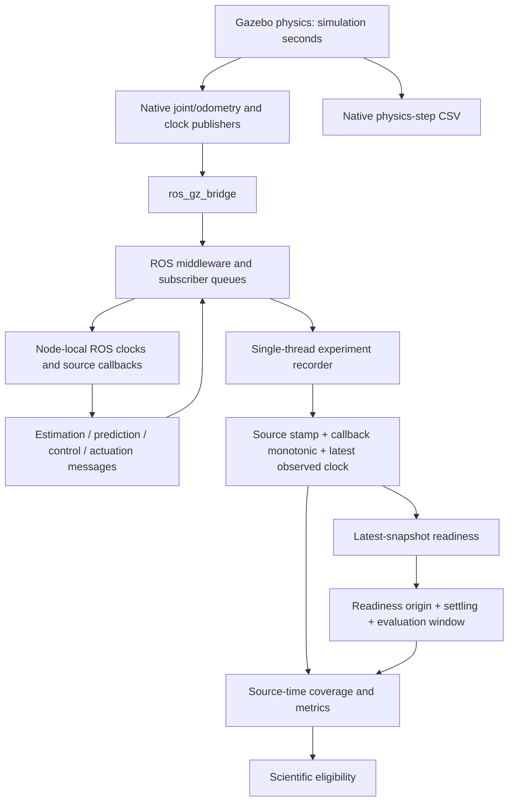

# R1A — ROS/Gazebo runtime reliability and synchronization diagnosis

2026-10-25, Asia/Jerusalem. **Diagnosis only; incidents are not resolved.**

## Executive findings and verdicts

- **Incident A, S2: PROBABLE CAUSE.** Experiment-observer service interruption and selective ROS delivery/recording loss, with finite-queue overflow/backlog the leading mechanism. The 252 ms source gap is real in the recording; upstream ROS consumers saw joint stamps inside it, and native physics continued. The precise blocking operation/drop location is unobserved.
- **Incident B, S3A: PROBABLE CAUSE.** Same observer-side failure class supported independently: 158 ms source gap, upstream actuator witness and continuous physics. A specific shared scheduling or DDS defect with S2 is not established.
- **Incident C, S3B1 IMM: PROBABLE CAUSE upstream; ROOT CAUSE IDENTIFIED for the immediate readiness rejection.** The observer's latest-stream snapshot never satisfied its declared symmetric ±80 ms condition. Clock-consumer skew plus unequal stream backlog is observed; bounded recorder/executor service unfairness is the leading upstream explanation. Exact DDS/executor/publisher latency attribution remains unverified.
- **CV control case:** readiness was achievable, but only nine recorded callback snapshots were jointly fresh. Its success is not evidence that the infrastructure is robust or that IMM mathematics is defective.

There is no demonstrated single underlying cause for all incidents. Observer-side delay/loss and correct strict gate rejection are shared observed features. R1B needs narrow instrumentation before a production correction. No new Gazebo runs were launched: another uninstrumented retry could reproduce a failure but cannot distinguish the remaining leading mechanisms. All historical recordings needed for these conclusions exist.

Evidence tags used below: **O** = directly observed; **C** = verified code behavior; **I** = inference; **H** = unconfirmed hypothesis. Confidence refers to causal attribution, not statistical probability.

## Scope, evidence and reproducibility

The ignored evidence directory is `results/runtime_reliability_r1a/`. `analysis.json` contains per-stream full distributions for all six runs, signed ages, own-receipt and latest-snapshot pass counts, gap boundaries, host samples, diagnostics and physics continuity. `supplement.json` contains upstream ROS witnesses, callback silences and actual IMM/CV input differences. `input_hashes.json` hashes every input read by the main analysis; `baseline.json` freezes 1,663 existing source/document files, HEAD/index and 5,475 historical file sizes/mtime values.

The studies inspected are:

- A: `results/sensor_assignments_s2/sensor_noise_comparison_20261024T113624_303754Z_d62m_2cw/`
- B: `results/configuration_composition_s3a/sensor_noise_comparison_20261024T160955_742101Z_6z7cqkcp/`
- C/CV: `results/configuration_nominal_composition_s3b1/paired_prediction_20261024T165445_163245Z_t2c8zpgk/`

For every run, original status/metadata/resolved configuration/metrics, all telemetry JSONL streams, host samples and native CSV where present were read. No historical source or result file is an output destination. The generated-world artifacts are missing at `runs/higher_noise_seed42/generated_world.sdf` in study A and `runs/baseline_seed42/generated_world.sdf` in study B; the other four exist. Resolved input deployments and continuous native 2 ms traces still establish the relevant timestep for the two missing worlds, but their exact rendered plugin documents cannot be independently inspected. No missing world is reconstructed or substituted. Original closure/equivalence/readiness artifacts are corroborating evidence; calculations below are from raw messages. Relevant source files are enumerated in the architecture and R1B sections. S1/S2/S3A/S3B1 closure reports were also inspected.

## Timestamp authority and observation pipeline



The native CSV is a parallel evidence path, not a replacement for ROS coverage.

| Timestamp | Authority/domain/units | Meaning and historical availability |
| --- | --- | --- |
| Physics time / native CSV `time`, `pre_time`, `dt`, iteration | Gazebo simulation seconds / integer iterations | Physics sample epoch; native CSV available for A/B, absent C/CV. Monotonic 2 ms grid verified. No wall emission/receipt times. |
| Gazebo/bridged `/clock` payload | Gazebo simulation sec+nanosec → float seconds | Observer reference is most recently received payload, not independently current physics. Raw bridged input/output sequence and emission time unavailable. |
| ROS node clock `get_clock().now()` | ROS simulation seconds when use_sim_time=true | Each node has independently serviced clock subscription. Current installed Jazzy TimeSource uses BEST_EFFORT depth 1; recorder explicitly uses depth 100. Not a conversion to wall time. |
| Joint/base/odometry header stamp | Native source simulation sample time, forwarded by bridge | Raw header and normalized float preserved. No evidence of wall-time restamping; endpoint runtime QoS discovery and native publisher emission logs were not recorded. |
| Target truth/measurement stamp | Committed numerical `state.time` / measurement timestamp, simulation seconds | Simulation node publishes after Gazebo pose acknowledgement. Integration/context/ack may delay emission; stamp stays the modeled sample epoch. |
| Robot/target estimate header | Committed filter-state epoch, simulation seconds | Retains sample/filter epoch; not publication time. Robot reorder holdback 30 ms in nominal, 80 ms localized; full-state rate ceiling 50 Hz. |
| Prediction header / trajectory timestamps | Target-estimate reference epoch / future rollout epochs, simulation seconds | Prediction header is the reference epoch, not first future rollout time. Algorithm completion latency is not recorded separately. |
| Control, command, actuation header | Producer node-local ROS clock at publication | Not the observer receipt time. Control compute wall duration is recorded independently in telemetry. Nested feedback/accepted stamps remain raw sec/nanosec mappings. |
| Recorder `arrival_monotonic` | Same observer process host monotonic seconds | Captured at callback entry before normalization/JSON/write. Not NIC/DDS receipt, not write completion. Comparable across streams within one run; never subtracted from simulation seconds. |
| Recorder envelope `clock` | Last observer `/clock` simulation value | Captured before processing a non-clock message. Clock rows use their own clock payload. No extrapolation, interpolation or timestamp replacement. |
| Estimator diagnostic parsed `time`, `raw_joint_time` | Producer-local ROS seconds and last accepted joint sample epoch | Unheadered String: normalized source_time stays null. These fields are separately usable as explicit producer diagnostics, not fabricated source stamps. |
| Readiness/evaluation origin | Last observer clock value at successful readiness | Simulation origin + settling gives start; + duration gives end. IMM origin/window absent. |
| Lifecycle deadlines / host metrics | Host monotonic seconds; CPU percent and summed RSS | 45 s readiness, 12 s stall, 150 s total wall deadline; independent of RTF. UTC started/ended strings are provenance, not a latency clock. Publisher emission/DDS reception/write-completion wall times unavailable. |

### Exact source and acceptance rules

- `src/robot_simulation/launch/simulation.launch.py:163` builds the one-way clock/joint/odometry bridge; `gazebo/robot_builder.py:177` injects JointStatePublisher without a rate selector. All four available generated worlds have a 0.002 s physics step and only a topic selector in JointStatePublisher (`generated_world_checks.json`). Native joints are produced by the Gazebo server plugin, then converted by the `parameter_bridge` process to `/joint_states` (`sensor_msgs/JointState`). No recorder timer downsamples joints.
- `nodes/simulation_node.py:410`, `:533`, `:334` (under `robot_simulation/robot_simulation`) use clock-triggered integration, asynchronous pose acknowledgement and committed sample timestamps. Ground truth has no periodic 100 Hz publisher guarantee; integration dt=10 ms is a ceiling. No candidate is stamped with observer receipt time.
- `src/robot_estimation/robot_estimation/nodes/estimation_node.py:453`, `:610`, `:631` drain ordered observations and publish filter-state epochs. `prediction_node.py:261` forwards the estimate reference epoch in the trajectory header. `control_node.py:552` and `:573` stamp command/telemetry from the controller clock; `velocity_actuation.py:365` stamps actuator diagnostics from its clock.
- `recording/normalization.py:144` under `robot_experiments/robot_experiments` converts sec/nanosec with `sec + nanosec × 1e-9`; it preserves raw payload, source stamp, observer clock and callback monotonic time. `storage.py:35` records in callback order and writes each JSONL line synchronously, line-buffered, before returning. Diagnostics lack a header and keep source_time=null.
- `recording/ros.py:41` explicitly uses BEST_EFFORT, VOLATILE, KEEP_LAST depth 100 for every subscribed stream. SingleThreadedExecutor drains one blocking callback plus up to 127 nonblocking callbacks, bounded by 10 ms, then returns. rclpy default integer-depth application publishers/subscribers use depth 10; TimeSource clock subscriptions use depth 1. Installed bridge headers specify default publisher/subscriber queues of 10; historical runtime QoS overrides/discovery are unavailable.

Let C be the latest observed clock and s_i the latest received source stamp.
`storage.py:73` requires every selected stream to exist, C to exist, and
**|C − s_i| ≤ B for every required i**. `run_window` additionally requires C>0.
Equality is accepted by a literal floating-point `>` rejection, with **no epsilon**.
There is no separate future tolerance, pairwise alignment, interpolation or historical best-sample selection in readiness. At B=80 ms, past failure is C−s_i>80 ms and future failure is C−s_i<−80 ms. Pairwise separation may reach 160 ms while both endpoints pass; that is not a separate gate.

`runner.py:87` selects clock, target truth/measurement, joints, base truth, robot/target estimate, prediction and control, plus command when publication is enabled and actuation when actuation is enabled: all 11 in C/CV. Optional localization and wheel odometry are recorded but not required readiness streams. Readiness checks run after executor drains, not after each callback. An old latest sample vetoes all otherwise fresh streams. The independent callback replay is an optimistic superset of actual checking opportunities.

`execution.py:241` uses host monotonic deadlines. Before origin, readiness is tried first and then the readiness deadline is checked; wall timeout is checked earlier. A backward clock invalidates the run. Once origin O exists, readiness is not re-established on every sample; the evaluated interval is [O+3, O+3+D], D=8 s for A/B and 6 s for C/CV. Progress and stop conditions use simulation time. Nothing rescales source time by RTF.

For valid physical joint sample epochs t_j, `metrics/__init__.py:64` includes the last pre-start sample only if its remaining hold overlaps the window. Each sample covers
**[max(start,t_j), min(end,t_j+B,t_(j+1))]**, clipped to nonnegative length.
Coverage is the sum of these disjoint right-hold lengths, capped at window length.
Missing duration must be ≤max(1e-9,1e-9×window duration) to be complete. Max-gap reporting includes window endpoints. Joint position/speed numerical tolerance 0.001 is separate from coverage. A/B use B=150 ms, C/CV use 80 ms. Source-time gaps cause uncovered duration even if all observed physical values are safe. Future samples at receipt are exposed, not restamped; alignment does not substitute callback intervals for source gaps. `SourceIndex` nearest/bracketing checks retain their separate B+1e-12 alignment boundary.

## Incidents A and B — physical joint observation coverage

| Run | All-record joint count | Observed Hz* | Coverage s | Max source gap ms | Arrival gap for that pair ms | No-recorder-callback interval ms | Window RTF |
| --- | --- | --- | --- | --- | --- | --- | --- |
| S2/baseline | 3298 | 260.84 | 8.000/8 | 24.0 | 34.552 | 27.097 | 0.783794 |
| S2/higher_noise | 2427 | 186.19 | 7.898/8 | 252.0 | 305.105 | 296.295 | 0.766176 |
| S3A/baseline | 3791 | 304.22 | 8.000/8 | 52.0 | 52.316 | 42.485 | 0.773682 |
| S3A/higher_noise | 2924 | 198.22 | 7.992/8 | 158.0 | 216.908 | 212.464 | 0.794867 |

*Observed Hz is (n−1)/(last−first source stamp), not native publication throughput. Counts/rates cover startup and settling; coverage/RTF are the declared evaluation windows. Max arrival gap here is between the same pair that maximizes source gap; it is not the independently largest interarrival gap. Full distributions and boundaries are retained in analysis.json.

**A — O:** S2's window is [5.032,13.032] s. Recorded joint epochs jump from **6.290 to 6.542 s**. The 252 ms source gap exceeds the 150 ms hold by exactly **102 ms**, explaining all missing coverage: **7.898/8 s, 98.725%**. The pair's callbacks are 305.105 ms apart; inside that interval, **296.295 ms** pass without any recorded topic callback. The native trace contains **125 strictly interior physics epochs**, each on the continuous 2 ms grid. Estimator diagnostics report raw_joint_time=**6.388** at producer time 6.400; actuator feedback also references **6.292, 6.390, 6.484**. Those joint epochs existed in the ROS consumer path despite absence from experiment joint recording.

The 6.388 witness was recorded at host monotonic 2461.246587, when the observer clock was only 6.224 s; the recorder did not receive its gap's preceding joint epoch 6.290 until 2461.318787. Thus this is not merely a late physics calculation: the observer is processing unequal stream backlogs. This observation does not reveal the DDS publish sequence numbers or how many of the 125 physics epochs were actually published as ROS messages.

**B — O:** S3A's window is [6.754,14.754] s. Joint epochs jump from **7.812 to 7.970 s**. The **158 ms** gap exceeds the same budget by **8 ms**, explaining **7.992/8 s, 99.9%** coverage. Callbacks are 216.908 ms apart; **212.464 ms** have no recorded topic callback. There are **78 strictly interior physics epochs**. Actuation reports feedback_stamp=**7.880** at header time 7.900; its observer clock was only 7.710 s. No matching estimator diagnostic falls inside this short interval, but the actuator witness independently proves an upstream ROS consumer received a missing joint epoch.

**C/I:** The gaps are source-header gaps in persisted ROS observations. They coincide with common observer callback silences, not just a joints-only recorder sampling timer. Their continuous native traces and upstream ROS witnesses rule out absence of all physics or all ROS joint observations across those intervals. They do not locate a drop specifically in DDS rather than callback servicing, bridge delivery to this subscriber, or recorder processing. A/B headers remain monotonic; no clock reset, invalid joint timestamp or rejected-normalization event accounts for these gaps.

Nearby half-second host samples show descendant CPU around 513% in A and 467–499% in B and roughly 885/886 MB summed RSS. No sudden RSS excursion or documented lifecycle event aligns with either gap. That resolution cannot resolve a 212–296 ms scheduling stall. Continuous **simulation-time** physics does not prove continuous **wall-time** progress. A simulator/host scheduling pause remains possible; physics trace files have no host clock. The shorter S3A gap is not evidence of a configuration fix or a causal noise effect.

## Incident C and successful CV case — exact readiness reconstruction

| Run | Snapshots after all required streams present | All-pass snapshots | Fraction | Best worst absolute age ms | Window / decision |
| --- | --- | --- | --- | --- | --- |
| S3B1/imm | 11400 | 0 | 0.000000% | 100.000 | none; timeout |
| S3B1/cv | 10765 | 9 | 0.083604% | 54.000 | 12.998–18.998 s; accepted |

Every snapshot uses the same recorder-host monotonic ordering. There are **zero arrival ties and zero saved-observer-clock versus replay-clock mismatches** in all six runs. For each snapshot, the independent inequality calculation matches the production `TelemetryStore.ready` method on a detached in-memory store. The original S3B1 readiness audit is independently reproduced. Snapshot counts refer to required-stream callbacks; optional-stream callbacks do not change that state.

IMM first has all 11 streams at observer clock **1.036 s** (last is prediction). Its best snapshot occurs at **C=1.282 s**, arrival_monotonic=20866.990542. The table gives signed age C−s_i and remaining margin B−|age|; negative margin is a failure. The CV best snapshot is also its actual readiness origin **C=9.998 s**. The clock row has age zero by construction, not independent proof the observer clock is current.

| Stream | IMM signed age ms | IMM margin ms | IMM condition | CV age ms | CV margin ms |
| --- | --- | --- | --- | --- | --- |
| clock | 0.0 | 80.0 | pass | 0.0 | 80.0 |
| target_truth | -100.0 | -20.0 | future | -6.0 | 74.0 |
| target_measurement | -100.0 | -20.0 | future | -6.0 | 74.0 |
| joints | 90.0 | -10.0 | past | 0.0 | 80.0 |
| base_truth | -68.0 | 12.0 | pass | -2.0 | 78.0 |
| robot_estimate | -60.0 | 20.0 | pass | 36.0 | 44.0 |
| target_estimate | -50.0 | 30.0 | pass | 54.0 | 26.0 |
| prediction | -50.0 | 30.0 | pass | 54.0 | 26.0 |
| control | -22.0 | 58.0 | pass | 48.0 | 32.0 |
| command | -22.0 | 58.0 | pass | 48.0 | 32.0 |
| actuation | -22.0 | 58.0 | pass | -2.0 | 78.0 |

**O:** IMM target truth and target measurement each fail by **20 ms on the future side**; joints fail by **10 ms on the past side**. No missing stream or independent pairwise-skew check causes this candidate's failure. It is the closest recorded simultaneous margin; choosing a different callback or checking after every callback does not repair this run. Deadline failure occurs at host elapsed **45.011379 s**, C=24.022 s, origin=null. No evaluated IMM tracking or window RTF is invented.

The first failing stream in code order is target truth in **11,179/11,400** eligible snapshots (11,173 future failures and six past failures). Other first failures: target measurement 126, joints 18, base truth 65, robot estimate 12. This ordering statistic does not mean those are the only failures; full per-stream counts follow. CV has nine joint-pass snapshots clustered at C=9.998–10.024 s, only about **27.8 ms of callback host-time span**, and reaches the origin at the first. A successful run therefore samples a short favorable alignment, not a continuously valid ±80 ms relationship.

### Nominal source rates and mathematical feasibility

| Required stream | Same configured source cadence for IMM and CV |
| --- | --- |
| clock | No explicit rate; 2 ms physics/clock grid (500 Hz potential) |
| target_truth | Ack-driven, integration dt=10 ms (≤100 Hz) |
| target_measurement | 20 Hz maximum, scheduled at commits |
| joints | No plugin rate selector; 2 ms physics grid (500 Hz potential) |
| base_truth | 20 Hz |
| robot_estimate | ≤50 Hz; filter epoch, reorder=30 ms / drain=100 Hz |
| target_estimate | On accepted target observations (≤20 Hz) |
| prediction | On accepted target estimates (≤20 Hz); rollout dt=.1 is not publish period |
| control | 20 Hz validation timer; invalid callbacks can also publish |
| command | 20 Hz nominal; stop/reject callbacks can also publish |
| actuation | 10 Hz simulation diagnostic timer |

The generated nine input YAMLs match between IMM and CV except `system.yaml`'s three prediction selectors: type, adaptation, fusion. Source scenarios, measurements, physics, estimation, safety, control, rates, duration and seed match. `supplement.json` records the actual file/path differences. Different trajectories and load are expected runtime outcomes, not configuration inequality.

In ideal phase-aligned delivery a periodic source has latest-sample age in [0,T); this does not include queue delay, compute time, variable sample epochs or clock-consumer skew. Actuator diagnostics have T=100 ms, so an 80 ms criterion is possible but not continuously guaranteed even ideally. A 20 Hz stream adds up to 50 ms phase age. Nominal robot estimates add 30 ms reorder holdback plus up to a 10 ms drain period and up to a 20 ms publication interval, before transport. Independent clocks/callback phases can consume the remaining margin. CV proves the configured joint condition is achievable; it does not prove an always-valid bound or make IMM's failure an algorithm defect. The 10 ms node-local future tolerance and controller's 0.2/0.5 s input ages are independent safety rules, not substitutes for M08's 80 ms readiness budget.

### Observed source and callback cadence

All-record statistics, including startup/settling/shutdown recording, not inferred publisher rates. Intervals are min / median / p95 / max in **milliseconds**. Arrival intervals measure callback entry spacing, not transport latency. Zero duplicates and out-of-order source stamps were observed in all 11 required streams of both runs. Prediction compute duration itself is unavailable.

#### S3B1/imm

| Stream | n | Source-span Hz | Callback-span Hz | Stamp interval ms (min/med/p95/max) | Interarrival ms (min/med/p95/max) |
| --- | --- | --- | --- | --- | --- |
| clock | 5211 | 216.92 | 127.72 | 2.000 / 2.000 / 14.000 / 242.000 | 0.579 / 5.083 / 19.217 / 402.234 |
| target_truth | 1288 | 55.81 | 32.74 | 10.000 / 14.000 / 38.000 / 82.000 | 3.630 / 23.106 / 73.387 / 426.557 |
| target_measurement | 383 | 16.60 | 9.74 | 50.000 / 58.000 / 78.000 / 102.000 | 11.586 / 91.427 / 216.772 / 509.982 |
| joints | 2388 | 99.39 | 58.52 | 2.000 / 8.000 / 26.000 / 252.000 | 0.644 / 13.914 / 40.250 / 412.608 |
| base_truth | 484 | 20.00 | 11.86 | 50.000 / 50.000 / 50.000 / 50.000 | 10.378 / 72.010 / 163.444 / 562.560 |
| robot_estimate | 958 | 39.64 | 23.49 | 20.000 / 24.000 / 36.000 / 52.000 | 6.470 / 21.401 / 127.524 / 956.221 |
| target_estimate | 382 | 16.59 | 9.74 | 50.000 / 58.000 / 78.000 / 102.000 | 7.455 / 53.063 / 349.899 / 1929.562 |
| prediction | 382 | 16.59 | 9.73 | 50.000 / 58.000 / 78.000 / 102.000 | 4.529 / 32.549 / 400.787 / 2431.825 |
| control | 376 | 19.58 | 9.23 | 28.000 / 50.000 / 58.000 / 204.000 | 5.573 / 24.696 / 441.676 / 3996.083 |
| command | 298 | 15.55 | 7.31 | 28.000 / 50.000 / 60.000 / 1184.000 | 4.143 / 24.619 / 330.534 / 5898.943 |
| actuation | 163 | 10.00 | 3.99 | 78.000 / 100.000 / 110.000 / 124.000 | 5.753 / 63.098 / 838.704 / 6000.607 |

#### S3B1/cv

| Stream | n | Source-span Hz | Callback-span Hz | Stamp interval ms (min/med/p95/max) | Interarrival ms (min/med/p95/max) |
| --- | --- | --- | --- | --- | --- |
| clock | 5691 | 299.32 | 228.15 | 2.000 / 2.000 / 10.000 / 176.000 | 0.558 / 2.435 / 13.529 / 283.258 |
| target_truth | 1143 | 64.14 | 49.07 | 10.000 / 12.000 / 30.000 / 54.000 | 2.852 / 17.222 / 41.255 / 297.878 |
| target_measurement | 307 | 17.21 | 13.17 | 50.000 / 56.000 / 72.000 / 96.000 | 4.244 / 70.266 / 126.710 / 367.166 |
| joints | 2884 | 151.80 | 115.70 | 2.000 / 4.000 / 18.000 / 192.000 | 0.626 / 6.481 / 20.246 / 287.882 |
| base_truth | 383 | 20.00 | 15.40 | 50.000 / 50.000 / 50.000 / 50.000 | 8.964 / 61.473 / 96.822 / 302.207 |
| robot_estimate | 684 | 40.26 | 30.62 | 20.000 / 24.000 / 34.000 / 48.000 | 3.927 / 28.678 / 69.550 / 339.906 |
| target_estimate | 293 | 17.19 | 13.08 | 50.000 / 56.000 / 72.900 / 96.000 | 8.742 / 68.200 / 175.167 / 418.601 |
| prediction | 292 | 17.19 | 13.10 | 50.000 / 56.000 / 73.000 / 96.000 | 6.139 / 64.541 / 188.028 / 417.736 |
| control | 339 | 20.00 | 15.18 | 26.000 / 50.000 / 54.000 / 76.000 | 4.807 / 54.571 / 163.523 / 613.794 |
| command | 340 | 20.00 | 15.19 | 26.000 / 50.000 / 54.000 / 76.000 | 2.702 / 51.735 / 184.897 / 903.489 |
| actuation | 180 | 10.04 | 7.64 | 24.000 / 100.000 / 106.000 / 130.000 | 5.129 / 115.205 / 296.476 / 1039.624 |

### Signed ages, future observations and freshness opportunities

Age is the **recorded observer clock minus header stamp at that callback**; negative values indicate a producer stamp ahead of that observer, not proof of physically future data. The table includes negative values instead of discarding them. `future` gives count(age<−1e-9) / count(age<−80 ms). `own fresh` tests |age|≤80 ms only at that stream's receipt; `latest fresh` tests its most recent sample across all required callback snapshots after every required stream exists. These are different denominators and neither alone proves joint readiness.

#### S3B1/imm

| Stream | Signed age ms (min/med/p95/max) | Future: any / beyond budget | Own receipt fresh | Latest snapshot fresh | Latest past/future failures |
| --- | --- | --- | --- | --- | --- |
| clock | 0.000 / 0.000 / 0.000 / 0.000 | 0 / 0 | 5211/5211 (100.00%) | 11400/11400 (100.00%) | 0 / 0 |
| target_truth | -196.000 / -160.000 / -112.000 / 80.000 | 1282 / 1262 | 26/1288 (2.02%) | 221/11400 (1.94%) | 6 / 11173 |
| target_measurement | -188.000 / -158.000 / -116.000 / 80.000 | 381 / 378 | 5/383 (1.31%) | 511/11400 (4.48%) | 6 / 10883 |
| joints | -18.000 / 2.000 / 61.300 / 172.000 | 252 / 0 | 2297/2388 (96.19%) | 11359/11400 (99.64%) | 41 / 0 |
| base_truth | -198.000 / -188.000 / -82.000 / 26.000 | 476 / 460 | 24/484 (4.96%) | 254/11400 (2.23%) | 0 / 11146 |
| robot_estimate | -164.000 / -6.000 / 540.300 / 702.000 | 489 / 363 | 247/958 (25.78%) | 2330/11400 (20.44%) | 4077 / 4993 |
| target_estimate | -188.000 / -32.000 / 673.800 / 948.000 | 212 / 161 | 91/382 (23.82%) | 2478/11400 (21.74%) | 3730 / 5192 |
| prediction | -182.000 / 174.000 / 1397.200 / 1750.000 | 140 / 110 | 56/382 (14.66%) | 1656/11400 (14.53%) | 6078 / 3666 |
| control | -194.000 / 626.000 / 4483.500 / 4832.000 | 114 / 89 | 44/376 (11.70%) | 704/11400 (6.18%) | 8140 / 2556 |
| command | -194.000 / 507.000 / 4764.300 / 4822.000 | 93 / 73 | 37/298 (12.42%) | 563/11400 (4.94%) | 8760 / 2077 |
| actuation | -194.000 / 376.000 / 6471.800 / 7692.000 | 59 / 46 | 21/163 (12.88%) | 757/11400 (6.64%) | 8141 / 2502 |

#### S3B1/cv

| Stream | Signed age ms (min/med/p95/max) | Future: any / beyond budget | Own receipt fresh | Latest snapshot fresh | Latest past/future failures |
| --- | --- | --- | --- | --- | --- |
| clock | 0.000 / 0.000 / 0.000 / 0.000 | 0 / 0 | 5691/5691 (100.00%) | 10765/10765 (100.00%) | 0 / 0 |
| target_truth | -192.000 / -158.000 / -54.200 / 40.000 | 1135 / 1053 | 90/1143 (7.87%) | 712/10765 (6.61%) | 0 / 10053 |
| target_measurement | -190.000 / -160.000 / -72.600 / 40.000 | 305 / 288 | 19/307 (6.19%) | 1047/10765 (9.73%) | 0 / 9718 |
| joints | -10.000 / 6.000 / 138.000 / 182.000 | 200 / 0 | 2364/2884 (81.97%) | 10027/10765 (93.14%) | 738 / 0 |
| base_truth | -198.000 / -188.000 / -50.200 / 8.000 | 380 / 352 | 31/383 (8.09%) | 667/10765 (6.20%) | 0 / 10098 |
| robot_estimate | -166.000 / -142.000 / -6.300 / 90.000 | 651 / 585 | 95/684 (13.89%) | 1698/10765 (15.77%) | 56 / 9011 |
| target_estimate | -184.000 / -142.000 / -20.400 / 100.000 | 284 / 251 | 41/293 (13.99%) | 2498/10765 (23.20%) | 81 / 8186 |
| prediction | -184.000 / -134.000 / 36.900 / 200.000 | 270 / 233 | 50/292 (17.12%) | 3015/10765 (28.01%) | 341 / 7409 |
| control | -186.000 / -144.000 / 160.600 / 382.000 | 292 / 254 | 53/339 (15.63%) | 2229/10765 (20.71%) | 898 / 7638 |
| command | -186.000 / -136.000 / 292.100 / 582.000 | 273 / 235 | 56/340 (16.47%) | 2276/10765 (21.14%) | 1384 / 7105 |
| actuation | -194.000 / -152.000 / 237.900 / 562.000 | 157 / 133 | 30/180 (16.67%) | 3044/10765 (28.28%) | 1054 / 6667 |

**O/I:** IMM has two simultaneous problems: target/base source stamps generally lead the lagging observer clock, while queued prediction/control/actuation observations become seconds old relative to it. Maximum recorded ages are **1.750 s prediction**, **4.832 s control**, **7.692 s actuation**. CV shows smaller but still material late data (199/382/562 ms respectively). This cannot be explained only by testing at executor-batch boundaries, missing topics, or the nominal publication periods.

Contemporaneous estimator diagnostics independently show producer-local clock leads of up to **190 ms in IMM** and **192 ms in CV** relative to the recorder clock. This is a comparison of two simulation-clock values at a causally related emission/receipt, not a wall/simulation conversion. It supports lagging clock consumption. Diagnostic messages can themselves be delayed (IMM also shows a −6.602 s diagnostic time difference), so this does not provide an exact network or clock latency.

## Load, scheduling and recorder mechanisms

| Run | Whole-recording RTF* | Valid control compute med/p95/max ms | Descendant CPU median/max % | Max summed descendant RSS MB |
| --- | --- | --- | --- | --- |
| S2/baseline | 0.787645 | 17.253 / 31.483 / 38.678 | 514.5 / 628.5 | 884.1 |
| S2/higher_noise | 0.777734 | 21.808 / 38.995 / 68.207 | 494.9 / 634.2 | 884.7 |
| S3A/baseline | 0.826454 | 16.351 / 39.842 / 60.867 | 477.8 / 566.6 | 881.4 |
| S3A/higher_noise | 0.782051 | 23.265 / 43.071 / 55.675 | 485.0 / 585.8 | 886.6 |
| S3B1/imm | 0.588802 | 36.177 / 79.874 / 141.665 | 463.8 / 584.1 | 797.9 |
| S3B1/cv | 0.762246 | 24.546 / 45.412 / 73.627 | 456.4 / 582.0 | 798.1 |

*Whole-recording RTF uses the first/last recorded clock epochs divided by their host monotonic receipt span; it differs from window RTF and may reflect observer backlog. No IMM evaluation-window RTF exists. All six metadata platform records expose six logical CPUs. A CPU sum near 500% means about five logical CPU equivalents; it is not proof of host-wide saturation. The runner samples only launch **descendants**, excluding the experiment recorder itself and unrelated host work. RSS sums double-count shared pages; no system memory availability, paging, run queue or cgroup throttling history was recorded. Startup zeros reduce means, so medians/maxima are shown. No OOM/CPU-saturation cause is asserted.

IMM's recorded WLS compute median/p95/max is 36.18/79.87/141.67 ms versus CV's 24.55/45.41/73.63 ms. The configured controller is identical; a harder trajectory or scheduling can change its duration. These measurements are not predictor compute timings and do not prove the IMM prediction algorithm caused recorder starvation. CPU totals and RSS are similar between these two sequential runs; per-process CPU and direct predictor timing are missing.

**C:** Each observer callback recursively converts a ROS object, validates/normalizes it, retains both normalized and raw payload, serializes JSON and synchronously writes a line. At 2 ms physics cadence, clock and joint traffic alone can offer up to about 1,000 callbacks per simulation second; actual offered ROS publication counts were not recorded. Finite BEST_EFFORT histories cannot guarantee lossless observation under stalls. With a 100-message clock history, 100 × 2 ms = approximately 200 ms of source-time history; the repeatedly observed 190–196 ms producer lead is consistent with servicing an old retained clock backlog. This arithmetic is a queue-capacity consistency check, not a measured occupancy or DDS drop count.

**C/H:** The observer alternates executor timeouts `.02` and `0.0` each drain cycle. In installed `rclpy/executors.py:859`, changing the kwargs recreates the cached ready-callback generator. Ready subscriptions are iterated in node subscription order (`:820`). A bounded drain can therefore restart before reaching later subscriptions. `executor_probe.py` invokes the actual installed method with synthetic always-ready callbacks: artificial five-callback cycles repeatedly visit `clock, clock, target_truth, target_measurement, joints`; constant-argument control visits all 11. This demonstrates a reproducible fairness risk in the code path, **not** a reproduction of historical DDS scheduling or a measured five-callback historical budget. Historical drain counts, durations and budget-hit reasons were not recorded. Node TimeSource depth 1 and observer depth 100 also implement different backlog behavior. Installed dependency hashes/versions are saved; the historical records do not contain hashes of those external dependencies.

`OwnedLaunch` separately monitors descendants at 200 ms; runner host sampling occurs at roughly 500 ms between drain batches. Their callback/GIL/I/O cost is unmeasured. They are possible contributors rather than established stall causes. Neither RTF reduction alone nor missing observations alone identifies the responsible process.

## Hypothesis matrix — A and B separately assessed

| Hypothesis/mechanism | Support A / B | Contradiction or scope limit | Confidence A/B | Missing evidence and smallest discriminator |
| --- | --- | --- | --- | --- |
| Clock/source misalignment alone makes coverage fail | Both show ~190 ms producer lead | Coverage uses joint source gaps, independent of observer-clock age | Low / Low | Trace clock dispatch and joint receive sequence; unchanged source-gap gate must still fail |
| Physically future joint messages | Some cross-stream stamps lead observer | Gap endpoints are near observer clock; upstream consumer and physics epochs agree | Low / Low | Native→bridge sequence/stamp correlation |
| Publisher stops/irregular cadence for every consumer | 252 / 158 ms recorded gaps | Upstream ROS consumers saw 6.388 / 7.880; physics grid continuous | Low / Low as sole cause | ROS publisher sequence and second-consumer receive trace |
| Recorder executor service interruption/starvation | 296.295 / 212.464 ms no callback; upstream witnesses | No executor batch/OS scheduling trace | Medium / Medium | Batch start/end, per-stream service counts and scheduler/off-CPU trace |
| Finite-queue overflow or BEST_EFFORT subscriber loss | 100-depth queues, missing persisted samples, shared callback silence | No DDS lost-event/sequence counters | Medium / Medium | Publication/reception sequence and loss events for clock/joints |
| Recorder JSON/write or monitor delay | Inline conversion/write, host sampling between drains | Individual operation wall durations absent | Medium / Medium | Bounded per-stage monotonic duration counters |
| Gate off-by-one/boundary bug | Failures are close to budget in B | Independent right-hold math gives exactly 102 / 8 ms loss | Low / Low | Existing prestart/gap tests; preserve exact gate and replay statuses |
| Simulator/host slowdown or scheduling jitter | Window RTF <1; callback silence | Physics source time continuous; no per-step wall clock | Medium / Medium as contributor | Native step wall monotonic + per-process/off-CPU samples |
| Startup/reset/shutdown transition causes gap | Finite runs have lifecycle transitions | Both gaps strictly inside evaluation; no backward clock | Low / Low | Correlate transition events; current recorded timeline already contradicts |
| Noise or IMM computation creates loss | Higher-noise run is affected in both studies | No repeated/randomized or per-process causal trace; baseline also drops samples | Low / Low | Instrument fixed unchanged study, no parameter sweep or noise-causality claim |

## Hypothesis matrix — C (IMM) versus successful CV

| Hypothesis/mechanism | Supporting evidence | Contradiction / missing causal link | Confidence | Next discriminating test |
| --- | --- | --- | --- | --- |
| Observer-clock versus producer-clock skew vetoes readiness | Targets ahead ~160 ms; best future failure 100 ms; zero joint-pass snapshots | Upstream source of clock backlog not measured | High for immediate gate mechanism | Replay unchanged inequality; timestamp clock callback and DDS receive |
| Physically future source generation | Negative observer-relative ages | Independent producer clocks and depth asymmetry explain appearances; no emission/physics host correlation | Low | Record source generation/emission and causal clock receipt, no restamping |
| Slow source periods make policy intrinsically impossible | 100 ms actuator period exceeds 80 ms age budget | CV has nine genuine passes; individual period is not an impossibility proof | Low as sole cause | Phase/cadence replay under unchanged periods |
| Bounded executor drain unfairness/starvation | Callback-order reset probe; unequal low-rate backlogs up to seconds | Historical batch order/duration absent; probe is synthetic | Medium | Record per-batch timeout, service count/order, budget-hit flags |
| QoS queue overwrite/backlog | Clock depth 100 vs node depth 1; multi-second stale low-rate traffic | No publisher sequence or queue occupancy evidence | Medium | MessageInfo sequences and lost events, same rates/QoS |
| Recorder conversion/write/monitor consumes service budget | Synchronous raw+normalized JSON and line flush; high offered-rate potential | Recorder CPU/IO duration not measured | Medium | Per-stage timing + recorder root process CPU/off-CPU |
| Freshness math or batch-only checking bug | Very narrow favorable CV opportunities | Independent per-callback IMM replay still 0; exact source selection verified | Low as bug | Existing strict readiness tests and raw replay; no gate relaxation |
| Simulator/host scheduling jitter | Whole-recording IMM RTF .589 vs CV .762 | Observer RTF can itself be biased by backlog; no host-wide run queue | Medium as contributor | Per-process load, native wall-step trace, observer clock lag |
| Startup/lifecycle failure | IMM first complete snapshot at C=1.036; deadline at 45.011 s | All required streams exist for the remaining run; no reset/process crash | Low as sole cause | Mark startup milestones and exact first/last sequence per stream |
| IMM algorithm computational load causes starvation | IMM run has lower RTF and higher controller compute tail | Predictor CPU/compute timing absent; controller is same WLS; sequential trajectories differ | Low for algorithm attribution | Timestamp predictor entry/exit + per-process CPU, unchanged original algorithms |

## Failure layers and ruled-out explanations

| Layer | A/B | C |
|---|---|---|
| 1 — Production | Continuous physics and specific missing ROS joint stamps received elsewhere are demonstrated. Complete ROS publication of every physics step is not demonstrated. | Every required source publishes; physics-time trace absent. No evidence that a producer intentionally generated physically future data. |
| 2 — Delivery/recording | Selective observation loss at the experiment consumer and common callback silences demonstrated. Queue-overwrite/executor/IO/host attribution remains probable. | Large consumer-clock skew and unequal retained-source backlog demonstrated. Exact publisher-to-DDS-to-callback decomposition missing. |
| 3 — Validation | Gate correctly withholds coverage for the 102/8 ms uncovered intervals. Safe native traces do not override it. | Gate correctly finds no valid latest snapshot; changing batch-check timing alone cannot recover any captured IMM snapshot. CV's completed window and gate acceptance are preserved. |

Ruled out as complete explanations: missing source topics; inverted/out-of-order source clocks; coverage arithmetic error; only batch-boundary checking in C; all physics/ROS joint production ceasing throughout A/B gaps; an accidentally changed CV physical scenario; nominal publication periods making readiness universally impossible. What remains unknown: exact full publication counts, where individual samples were lost, wall-time physics progress, per-process utilization and recorder stage time, DDS occupancy/loss counters and publisher-to-receiver latency. A noise or IMM causal effect is unproven. No diagnosis is presented as a fixed incident.

## R1B — smallest authorized-next-step proposals (not implemented)

### 1. Instrument the observer before choosing a correction

Likely locations: `robot_experiments/recording/ros.py:43–69`, `storage.py:35–68`, `runner.py:143–162`, and optional external process profiler. Proposed fields: callback stream/stamp, latest observer clock before/after, monotonic entry/normalize-end/serialize-end/write-end, batch start/end, callbacks by stream, timeout argument, 10 ms/128-callback budget-hit reason and per-stream last-service age. Request MessageInfo publication/reception sequence, publisher GID and source/received middleware timestamps **when supported**; mark unavailable/unsupported sentinels. DDS timestamp domains must be documented per RMW and never assumed to be simulation time. Track message-lost events if supported. Sample recorder-root CPU/RSS/off-CPU alongside existing descendants.

Intended behavior is diagnostic only. Emit bounded in-memory counters/rings and low-rate summaries; avoid adding synchronous per-message JSON/logging to the suspected hot path. Expected value: separate publication gaps, DDS overwrite, clock queue backlog, executor service starvation and JSON/write/monitor stalls. Overhead cannot be declared negligible before measurement: target constant-time counters plus a few monotonic reads, benchmark with/without instrumentation, and require measured added CPU/wall overhead below a declared 5% diagnostic budget without changing scientific gates. If that budget is not demonstrated, label the run perturbed and use it only for code-path discrimination. This instrumentation changes production observation code and needs separate authorization.

Tests before/after: synthetic always-ready subscriptions must expose timeout-switch ready-iterator restart and later-stream service delay; operation-duration/loss telemetry must retain unsupported values explicitly and not change raw source stamps or ready/coverage results. Runtime: one bounded unchanged original paired study, plus one unchanged sensor-noise study only if needed to capture the separate gap mechanism; retain failures and owned-process cleanup. No retries until a pass.

### 2. Correct bounded draining only if instrumentation confirms unfair service

Likely location: `recording/ros.py:53–69`. Preserve one bounded executor and lifecycle responsiveness, but use a supported scheduling pattern that does not repeatedly discard a partially serviced ready set when changing timeout kwargs. Do not mutate private rclpy iterators or blindly increase callback limits. Intended effect: finite per-source service latency under sustainable load, preserving full raw observation recording and timestamp authority. Evidence: installed reset semantics, synthetic probe and observed unequal backlog; the historical causal link remains unverified. Risk: CPU busy-spin, DDS ordering/fairness differences, slower shutdown/deadline checks. Required regression: busy early streams and ready late streams must all be serviced within a declared finite number of unchanged-size batches; raw delivery order/stamps and 10 ms/lifecycle bounds remain auditable. Validate unchanged original IMM/CV source rates and strict 80 ms policy, and report failure if offered load remains unsustainable.

### 3. Isolate persistence or monitoring only if measured cost explains stalls

Likely locations: `storage.py:67`, `runner.py:143`, and `execution.py:127`. If profiling identifies synchronous conversion/write or lifecycle monitoring as the dominant stall, first remove only redundant work or move persistence behind a bounded, explicitly accounted queue. Acquisition timestamps and scientific data must be preserved; overflow must invalidate coverage or fail explicitly, never silently drop or fabricate samples. Keep monitoring sufficient for orphan ownership, wall deadlines and cleanup. Risks: changed crash durability, unflushed tail data, memory growth, hidden drop buffers or stale clock handling. Regression: stalled writer/slow monitor with bounded memory, exact raw payload/order, no timestamp substitution, explicit overflow and successful shutdown flush. Runtime must measure both source and arrival coverage, stage durations and overhead using original gates. No implementation is selected before the profiler evidence.

### 4. Clock handling after attribution, without weakening scientific meaning

Do not change `/clock` QoS or replace the observer clock with max(header stamp), wall time or an extrapolated clock as an R1A fix. If an independently measured old clock queue is responsible, R1B may evaluate a separately configured current-clock observation path while retaining the raw clock stream and exposing missing clock observations. A newest-clock consumer can make previously buffered sources look *older*, so this alone may not cure readiness. Regression must include ahead-of-observer stamps, genuine future data, replay/reset, missing sources and overloaded delivery; source epochs, ±80/150 ms budgets and no-extrapolation requirements remain unchanged. Any proposed source-rate reduction changes the scientific producer configuration and is outside this targeted correction unless separately authorized.

Instrumentation is the recommended immediate R1B scope. R1B implementation, S3B2, mathematical changes, QoS/rate/deadline changes and threshold tuning are not started.

## Verification, preservation and exact files

Targeted existing tests (`test_execution.py`, `test_recording.py`, `test_metrics.py`, `test_scientific_comparison.py`): **98 passed in 4.20 s** (`timing_tests.log`). These exercise boundary freshness, raw time preservation, bounded draining, deadlines/reset, coverage/prestart carry and scientific eligibility; they validate code semantics, not the speculative upstream cause. No unrelated full regression or Gazebo retry is used as causal evidence.

The analysis independently reconstructs physical coverage including the pre-start sample carry, then checks it against original metrics. Using only interior-window samples initially exposed that carry distinction in the diagnostic script; it was corrected to match the inspected production formula, not by changing any data/gate. Final results match all five available evaluated runs. Every per-callback independent readiness predicate matches production on a detached store; raw recorded-clock replay has no mismatches. `crosscheck.py` additionally checks the original S3B1 audit, **74,431** raw header/clock timestamps, gap arithmetic and upstream witnesses. The installed-executor probe has a constant-argument control. No ROS context/Gazebo process is created by these probes.

Scripts created only under ignored `results/runtime_reliability_r1a/`: `analyze.py`, `supplement.py`, `executor_probe.py`, `write_report.py`, `crosscheck.py`, `check_worlds.py`, `preserve.py`. Generated evidence includes baseline/source hashes, full diagnostics, dependency hashes/current versions, test logs, preservation results and initial Git status. Raw input hashes are checked after analysis; original historical files and metadata are not modified. No diagnostic runtime was launched, so no owned ROS/Gazebo processes or cleanup actions were needed; earlier original run cleanup statuses remain intact.

**Only one nonignored file is added:** `docs/validation/runtime_reliability_r1a_diagnosis.md` (this report). No production/source/test/YAML file is changed. Final `preservation.json` verifies all 1,663 captured files and 5,475 historical file stats unchanged, all hashed inputs intact, and HEAD/index unchanged. Historical source fingerprints remain in original run metadata; current complete source/document and dependency hashes are retained without rewriting those identities. No staging, commit or push.

Reproduction (offline only; commands write into the new R1A evidence directory, never the original study directories):

```bash
cd /home/user/ros2_ws
source install/setup.bash
export PYTHONDONTWRITEBYTECODE=1 OPENBLAS_NUM_THREADS=1 OMP_NUM_THREADS=1 MKL_NUM_THREADS=1
python3 results/runtime_reliability_r1a/analyze.py
python3 results/runtime_reliability_r1a/supplement.py
python3 results/runtime_reliability_r1a/executor_probe.py
python3 results/runtime_reliability_r1a/check_worlds.py
python3 results/runtime_reliability_r1a/crosscheck.py
python3 -m pytest src/robot_experiments/test/test_execution.py \
  src/robot_experiments/test/test_recording.py src/robot_experiments/test/test_metrics.py \
  src/robot_experiments/test/test_scientific_comparison.py -q --import-mode=importlib \
  -p no:launch_testing -p no:launch_ros -p no:cacheprovider
python3 results/runtime_reliability_r1a/preserve.py
```

No scientific gate, readiness rule, timestamp, scheduling/QoS setting, source rate, safety rule or production algorithm was changed. Stop after R1A.

